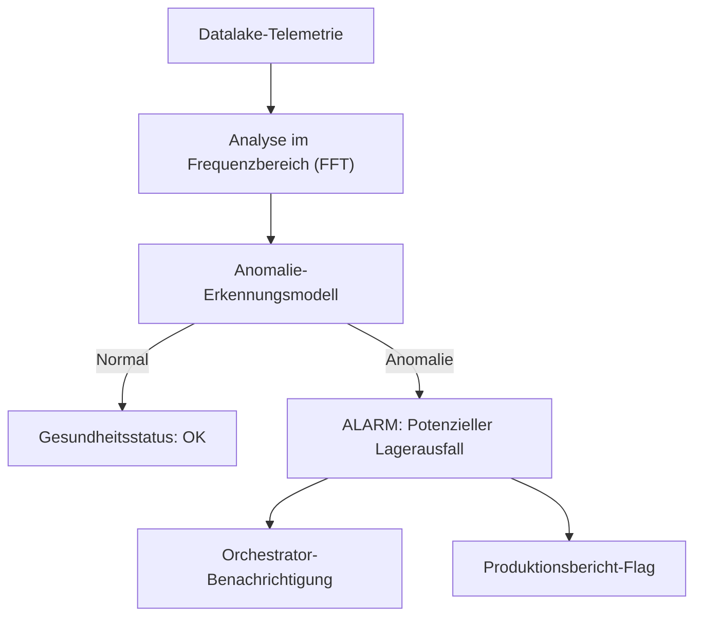

<!-- =============================================================================
HYDRA-UMC-ANOMALY-DETECTOR - Statistical anomaly detector
Copyright (C) JuanenRac (Electro Hobby 3D) <electrohobby3d@gmail.com>
GPL-3.0-or-later - see LICENSE
============================================================================= -->

<p align="center">
  
</p>

# 📈 HYDRA-UMC-ANOMALY-DETECTOR

<p align="center"><a href="README.md">🇺🇸 English</a> | <a href="README_spa.md">🇪🇸 Español</a> | <a href="README_fra.md">🇫🇷 Français</a> | <a href="README_ita.md">🇮🇹 Italiano</a> | 🇩🇪 <b>Deutsch</b> | <a href="README_zho.md">🇨🇳 简体中文</a> | <a href="README_jpn.md">🇯🇵 日本語</a> | <a href="README_por.md">🇵🇹 Português</a></p>

### 🧠 Statistische Anomalieerkennung & Motorvibrationsanalyse (kein Machine-Learning-Modell)

<p align="center">
  
  
  
  
  
  
</p>

---

> **Ehrlichkeitscheck - was heute wirklich läuft:** das FFT-Spektrum (`fft.py`), die statistische Baseline pro Bin (`baseline.py`), der Max-Z-Score-Anomaliedetektor (`detector.py`), die Precision/Recall/F1-Metriken über eine gelabelte Fixture (`metrics.py`), die Drift-Erkennung per gleitendem Mittelwert (`drift.py`), der echte HYDRA-UMC-DATALAKE-HTTP-Client (`datalake_client.py`) und die einfache JSON/HTTP-API (`api.py`) sind real und getestet (87 bestehende Tests: `pytest tests/` - `test_fft.py`, `test_baseline.py`, `test_detector.py`, `test_metrics.py`, `test_drift.py`, `test_datalake_client.py`, `test_api.py`). „AI-driven" und „Learning Models" weiter unten beschreiben echte Signalverarbeitung plus eine statistische Baseline, die aus bekannt gesunden Fenstern angepasst wird - kein trainiertes neuronales Netz, und kein kontinuierliches Lernen im Hintergrund: eine Baseline wird einmalig angepasst, entweder beim Start aus dem echten DATALAKE-Verlauf oder über einen expliziten `POST /baseline/fit`-Aufruf, und bleibt genau diese Modellversion bis zur nächsten expliziten Neuanpassung (siehe die eigene Modellversionierung von `detector.py`). Die Phasen 3 und 4 der ROADMAP weiter unten (unüberwachtes Lernen, akustische Analyse) sind vollständig aspirativ - für keine der beiden existiert in diesem Repository bisher Code. Siehe `CHANGELOG.md` für das, was bisher genau ausgeliefert wurde.

> **Stand von Sicherheit (Safety) und Security:** Dieses Ökosystem ist kein zertifiziertes Sicherheitssystem. Es gibt noch keinen Hardware-E-STOP-Pfad, keine von der Firmware durchgesetzten Grenzen oder Verriegelungen und keinen verifizierten Bewegungsbefehl; Firmware-Images werden mit CRC32 und einem HMAC-SHA256 mit gemeinsamem Schlüssel geprüft, nicht mit einer asymmetrischen Signatur; TLS und gegenseitiges TLS sind optional und standardmäßig aus; noch keine eigene Platine wurde bestückt oder getestet. Lesen Sie die [Sicherheitsbasis](https://github.com/JuanenRac/HYDRA-UMC-DOCS/blob/main/docs/SECURITY_BASELINE.md) und das [Bedrohungsmodell](https://github.com/JuanenRac/HYDRA-UMC-DOCS/blob/main/docs/THREAT_MODEL.md), bevor Sie sich für die Sicherheit einer Person auf eine Aussage hier verlassen.

---

## 📋 Auf einen Blick

| | |
|---|---|
| Version | `0.1.8` |
| Reifegrad | Funktionsfähig |
| Tests | 154 (`python -m pytest -q tests`) |
| Technik | Python / FFT / statistical baseline detection |
| Ziel | Der Raspberry Pi CM5 einer HYDRA-UMC-Zelle |
| Auf echter Hardware | Noch nicht: für diese Version ist kein Lauf auf echter Hardware vermerkt |

**Springe zu:** [Überblick](#-überblick) · [Architektur](#-architektur) · [Funktionen](#-funktionen) · [Sicherheit und Schutz](#-sicherheit-und-schutz) · [Schnittstellen](#-schnittstellen) · [Konfiguration](#-konfiguration) · [Schnellstart](#-schnellstart) · [Tests](#-tests) · [Fehlerbehebung](#-fehlerbehebung) · [Struktur des Repositorys](#-struktur-des-repositorys) · [Verwandte Projekte](#-verwandte-projekte)

## 🚦 Projektstatus

Jede Zeile ist ein Teil dieses Repositorys, und die Ampel sagt, wie weit er heute ist. Sie beruht auf dem, was das Repository zeigen kann (Tests, Builds, Läufe), nicht auf dem, was geplant ist.

🟢 Fertig und überprüft · 🟡 Funktioniert, mit bekannten Grenzen · 🟠 Teilweise fertig oder noch nicht überprüft · 🔴 Nicht gemacht oder funktioniert nicht

| Bereich | Stand | Was das hier bedeutet |
|---|---|---|
| Software | 🟡 | Funktioniert für seinen Hauptzweck; die Ehrlichkeitsprüfung oben nennt, was noch fehlt |
| Tests | 🟢 | 154 automatische Tests, bei jeder Änderung ausgeführt |
| Echte Hardware | 🔴 | Noch nicht: für diese Version ist kein Lauf auf echter Hardware vermerkt |
| Dokumentation | 🟢 | README in acht Sprachen, bei jeder Änderung gegen das Manifest geprüft |

## 🎯 Überblick

**HYDRA-UMC-ANOMALY-DETECTOR** soll der proaktive Wächter der Robotergesundheit werden. Er wendet eine FFT und eine statistische Basislinie (kein Machine-Learning-Modell) auf Telemetrie-Messwerte an (Vibrationen, Motorstromsignaturen und thermische Profile) und meldet Abweichungen von einer gesunden Basislinie; Ausfälle sagt er noch nicht voraus.

Ziel ist es, den "digitalen Fingerabdruck" jedes Motors und Werkzeugkopfs zu überwachen, damit Lagerverschleiß, lose Riemen oder Kühlungsausfälle Wochen im Voraus erkannt werden könnten und eine geplante Wartung statt Notreparaturen möglich wird (geplant: Code zur Ausfallvorhersage existiert noch nicht).

## 🧩 Rolle in HYDRA-UMC

**HYDRA-UMC-ANOMALY-DETECTOR** liest die Telemetrie, die HYDRA-UMC-DATALAKE speichert, findet die Serien, die sich nicht mehr wie früher verhalten (ein Lager, das zu singen beginnt, ein Antrieb, der driftet) und meldet das per HTTP, zurück in den Data Lake und als MQTT-Alarme. Er beobachtet; er steuert nie eine Maschine.

## 🏛️ Architektur

<p align="center">
  
</p>

<details>
<summary>Textversion des Diagramms (Mermaid)</summary>



</details>

**Warum es so gebaut ist**

* **Warum es Geschwister, kein Submodul, von HYDRA-UMC-DATALAKE ist.** Anomalieerkennung ist eine reine Lese-Analytics-Arbeitslast über bereits gespeicherte Telemetrie - sie getrennt zu halten bedeutet, dass ein Absturz des Detektors oder eine langsame Modellinferenz nie die eigenen Schreibvorgänge von HYDRA-UMC-TELEMETRY-COLLECTOR in denselben Speicher blockieren.
* **Warum heute FFT + eine statistische Baseline, noch kein trainiertes neuronales Netz.** Das README nennt dies "KI-gestützt" - was in diesem ersten Durchgang echt ist und läuft, ist eine echte Signalverarbeitungstechnik (`src/hydra_umc_anomaly_detector/fft.py`, numpys eigene FFT) plus ein pro Frequenzbin gelerntes statistisches Profil aus bekannt gesunden Fenstern (`baseline.py`) und ein Max-Z-Score-Urteil (`detector.py`) - kein trainiertes Deep-Learning-Modell. Es funktioniert, ist gegen echte synthetische Fehlersignaturen getestet, und ist das richtige Fundament, auf dem später ein gelerntes Modell aufgebaut wird (siehe den Abschnitt FAHRPLAN weiter unten) - aber es hier ein neuronales Netz zu nennen würde übertreiben, was tatsächlich läuft.
* **Warum ein Max-Z-Score über alle Bins, kein fester Schwellenwert.** Ein fester Schwellenwert ('Motortemperatur > 80C') übersieht allmähliche Drift und löst Fehlalarme bei legitimen Lastspitzen aus - jeden Bin des LIVE-Spektrums gegen die GELERNTE eigene gesunde Baseline dieses konkreten Motors zu vergleichen erkennt einen neuen/verschobenen Frequenzpeak (eine echte Lagerdefekt-Signatur) ohne einen dieser beiden Fehlermodi. Der Standard-Schwellenwert (10.0) wurde aus echter empirischer Trennung gewählt, nicht geraten - siehe das eigene Docstring von `detector.py` für die tatsächlichen Zahlen aus den synthetischen gesund-vs-fehlerhaft-Testfixtures dieses Projekts.
* **Wie sich das ins restliche Ökosystem einfügt.** Ein Geschwisterdienst unter HYDRA-UMC-DATALAKE - führt Anomalieerkennung über die Telemetrie aus, die HYDRA-UMC-TELEMETRY-COLLECTOR dort bereits geschrieben hat.
* **Warum `DriftMonitor` ein von `AnomalyDetector.score()` getrennter Mechanismus ist, kein größerer Schwellenwert.** Sie beantworten unterschiedliche echte Fragen: "ist DIESES Fenster anomal" (ein einmaliges Urteil) versus "hat sich der JÜNGSTE Durchschnitt still verschoben" (ein gleitender Trend, robust gegenüber einem einzelnen verrauschten Ausreißer-Fenster). Ein echter simulierter Drift-Test hat gefunden und dokumentiert ehrlich, dass beim Max-Z-Score-Design dieses Detektors bei einem Fehler eines neuen Frequenztyps das eigene Flag eines einzelnen Fensters tatsächlich *vor* dem gleitenden Drift-Signal auslöst - der eigentliche Wert von `DriftMonitor` liegt hier in einer Bestätigung eines anhaltenden Trends, nicht in einer früheren Warnung, und der Code sagt das auch so, statt es zu übertreiben.
* **Warum `metrics.py` Precision/Recall berechnet, statt die Qualität des Schwellenwerts als Prosa stehen zu lassen.** Das eigene Docstring von `detector.py` behauptete früher nur "gesund bewertet bis zu ~5.3, fehlerhaft bewertet in den Hunderten" - echt, aber keine Zahl, gegen die eine künftige Neujustierung regressionstesten könnte. `precision_recall()` über dasselbe echte Fixture gibt dem einen echten, überprüfbaren Wert (heute 1.0/1.0).

## ✨ Funktionen

* **Ein Detektor pro Reihe (`/detectors/{sourceId}/{kind}/{field}/...`).** Ein Motor und eine Spindel schwingen nicht gleich, und eine gemeinsame Referenz nannte die jeweils andere auffällig. `POST /detectors/{sourceId}/{kind}/{field}/fit` passt die Referenz dieser Reihe an (das Tripel, unter dem DATALAKE sie ablegt), `.../detect` bewertet ein Fenster dagegen, `.../drift/init` und `.../drift/observe` geben ihr einen eigenen Drift-Monitor, und `GET /detectors` listet die Reihen und ob jede angepasst ist. Eine Reihe entsteht mit ihrer ersten erfolgreichen Anpassung und es gibt höchstens `--max-series` (64); eine nie angepasste Reihe zu bewerten ergibt `409`, nie ein Urteil einer anderen Referenz; das Anpassen einer Reihe berührt nie eine andere oder die gemeinsame. Schreiben verlangt das Token wie die gemeinsame Referenz, Bewerten ebenfalls, sobald ein Token gesetzt ist (`--no-protect-reads` lässt es offen). `--baseline-dir` speichert eine Referenz pro Reihe und stellt sie beim Start wieder her. Die ursprünglichen Routen bleiben unverändert. *(implementiert, getestet in `tests/test_series.py`)*
* **Lesezugriffe sind standardmäßig geschützt (`--protect-reads`).** Ist ein Token gesetzt, verlangt auch `POST /detect` `Authorization: Bearer <token>`; nur `GET /stats`, der Health-Pfad, bleibt offen. Das gilt standardmäßig, sobald ein Token vorhanden ist (`--no-protect-reads` oder `HYDRA_UMC_ANOMALY_PROTECT_READS=0` lassen Lesezugriffe offen; `HYDRA_UMC_ANOMALY_PROTECT_READS=1` startet ohne Token nicht). Ohne Token (nur Loopback) gibt es nichts zu verlangen. Aufrufer, die über HYDRA-UMC-SERVER lesen, senden das Token bereits.
* 🔍 **Signaturanalyse:** FFT (Fast Fourier Transform) von Motorstrom-Messwerten zur Erkennung mechanischer Unwuchten. *(implementiert)*
* 📉 **Vorausschauende Wartung:** RUL-Schätzung (Remaining Useful Life) für NEMA-Motoren und URTC-Werkzeuge - angestrebt, dafür existiert in diesem Repository noch kein Code.
* 🚨 **Frühwarnsystem:** Alarme direkt in den Studio- und Watch-Schnittstellen anzeigen - angestrebt; heute stellt der Detektor seine Verdicts über seine eigene HTTP-API bereit und im Dauerbetrieb als `anomaly_score`-Messwerte in DATALAKE und als MQTT-Nachrichten. DASHBOARD-AI liest ihn über HYDRA-UMC-SERVER (gleicher Ursprung, CORS ist also nicht nötig); die Studio- und Watch-Schnittstellen zeigen seine Alarme noch nicht an.
* **Dauerbetrieb (`--follow-config DATEI`).** Liest jede konfigurierte Reihe aus DATALAKE, während sie wächst, schneidet sie dort, wo die Abtastung unregelmäßig ist, bewertet jedes vollständige Fenster mit dem Detektor dieser Reihe, schreibt das Verdict als Messwert der Art `anomaly_score` zurück und veröffentlicht, wenn `mqtt` konfiguriert ist, eine gehaltene Zustandsnachricht bei jedem Zustandswechsel einer Reihe und einen Alarm für jedes anomale Fenster. Alles Einstellbare (Reihen, Fenstergröße, Intervall, Topics, Broker) steht in der JSON-Datei; ein ausgefallener DATALAKE oder Broker wird in `GET /stats` gezählt und stoppt die Schleife nie. *(implementiert; getestet gegen einen echten HTTP-DATALAKE-Ersatz und einen echten TCP-Broker-Ersatz, nie gegen die echten Dienste gelaufen)*
* 🧬 **Baseline-Lernen:** Passt seine statistische Baseline anhand der echten, als gesund bekannten Historie aus dem Datalake an - kein kontinuierliches Lernen im Hintergrund, sondern ein echtes, explizites Neu-Fitting bei jeder Anforderung. *(implementiert)*
* 🏷️ **Modellversionierung:** Jedes `Verdict` trägt die echte, monoton steigende Modellversion und den Schwellenwert, gegen den es bewertet wurde - ein Refit ist ein echtes, nachvollziehbares Ereignis. Zudem wird angegeben, aus wie vielen gesunden Fenstern die Baseline kalibriert wurde, damit ein Alarm erklärbar und reproduzierbar ist. *(implementiert)*
* 📐 **Precision/Recall-Metriken:** Echte, berechnete Precision/Recall/F1-Werte über eine gelabelte Fixture (`metrics.py`), nicht nur Prosa-Behauptungen über die Score-Trennung. *(implementiert)*
* 📈 **Simulierte Drift-Erkennung:** `DriftMonitor` meldet eine echte, anhaltende Erhöhung des gleitenden Mittelwerts, die sich vom eigenen Anomalie-Flag eines einzelnen Fensters unterscheidet. *(implementiert)*

## 🔒 Sicherheit und Schutz

| Bedrohung | Abwehr | Wo |
|---|---|---|
| Jemand, der eine Baseline oder den Drift-Zustand überschreibt | Ein Bearer-Token, in konstanter Zeit verglichen, schützt `/baseline/fit`, `/drift/init`, `/drift/observe` und die Schreibrouten von `/detectors/...`; ohne konfiguriertes Token ist die API offen (der Loopback-Standard) | `api.py` |
| Bewerten mit fremden Daten und ein riesiger Body | `POST /detect` verlangt das Token, wenn eines konfiguriert ist (`--no-protect-reads` oder `HYDRA_UMC_ANOMALY_PROTECT_READS=0` öffnet es); nur `GET /stats` bleibt offen; ein Body hat höchstens 1 MiB | `api.py` |
| Viele Serien, die den Speicher erschöpfen | Ein Detektor je Serie, höchstens 64 (`--max-series`), mit Kennungen nach `^[A-Za-z0-9][A-Za-z0-9._:-]{0,95}$`; das Training liest höchstens 200 000 Punkte (`--max-train-points`); die API lauscht standardmäßig auf `127.0.0.1` | `registry.py`, `main.py` |

**Was er nie tut:** er ist ein klassischer statistischer Detektor (ein Z-Score je FFT-Bin, Schwellwert standardmäßig 10), kein trainiertes KI-Modell, und steuert nie eine Maschine.

## 🔌 Schnittstellen

HTTP standardmäßig auf `127.0.0.1:8097`; die vollständige Referenz ist `docs/API.md`.

| Topic oder Route | Was es trägt |
|---|---|
| `POST /baseline/fit`, `POST /detect` | die Baseline des Signals lernen, dann ein Fenster dagegen bewerten |
| `POST /drift/init`, `POST /drift/observe` | den Drift-Monitor starten und füttern |
| `POST /detectors/{sourceId}/{kind}/{field}/...` | dieselben Operationen für eine Serie des Data Lake |
| `GET /stats`, `GET /detectors` | Gesundheit und Liste der Detektoren |
| `--follow-config FILE.json` | Dauerbetrieb: liest jede konfigurierte Serie, während sie wächst (alle 5 s, höchstens 20 Fenster je Takt), schreibt das Urteil zurück und sendet MQTT-Alarme unter `hydra/anomaly` |

## ⚙️ Konfiguration

| Variable | Standard | Was sie festlegt |
|---|---|---|
| `--addr`, `--port` | `127.0.0.1`, `8097` | wo die HTTP-API lauscht |
| `--sample-rate`, `--threshold` | `1000.0`, `10.0` | Abtastrate in Hz; der größte Z-Score, den ein Bin haben darf |
| `--window`, `--window-size` | `none` | `none` oder `hann` vor der FFT; Messwerte je Fenster (nötig mit `--datalake-url`) |
| `--datalake-url`, `--source-id`, `--kind`, `--field`, `--train-start`, `--train-end` | nicht gesetzt | beim Start eine frische Baseline aus dem Data Lake anpassen (die ersten vier gehören zusammen) |
| `--max-train-points`, `--max-series` | `200000`, `64` | höchstens gelesene Trainingspunkte; höchstens Detektoren |
| `--token-file`, `HYDRA_UMC_ANOMALY_TOKEN` | kein Token | das Bearer-Token der API |
| `HYDRA_UMC_ANOMALY_PROTECT_READS` | geschützt, wenn ein Token gesetzt ist | `0` öffnet `POST /detect`, `1` schützt es |
| `HYDRA_UMC_DATALAKE_INGEST_TOKEN`, `HYDRA_UMC_DATALAKE_TOKEN`, `HYDRA_UMC_DATALAKE_READ_TOKEN` | nicht gesetzt | die Token, mit denen der Detektor mit dem Data Lake spricht (oder `ingestTokenFile` in der Follow-Konfiguration) |

## 🚀 Schnellstart

Benötigt Python 3.10 oder neuer und NumPy 1.24 oder neuer (`pip install -e .` installiert es).

```bash
bash run.sh        # Linux, macOS (run.bat on Windows)
python -m hydra_umc_anomaly_detector.main --datalake-url http://127.0.0.1:8095 --source-id press1 --kind vibration --field accel --window-size 1024
curl http://127.0.0.1:8097/stats
```

## 🧪 Tests

154 automatische Tests laufen mit `python -m pytest -q tests`. Sie nutzen realistische Signale, Prüfungen auf Fehlalarme und einen Schein-Data-Lake; keine Hardware, kein äußeres Netz.

| Testdatei | Tests | Was sie abdeckt |
|---|---|---|
| `test_fft.py`, `test_baseline.py`, `test_detector.py`, `test_drift.py`, `test_metrics.py` | - | das Spektrum, die Baseline, der Z-Score, die Drift und Präzision/Trefferquote |
| `test_realistic_false_positives.py`, `realistic_signals.py`, `signal_fixtures.py` | - | realistische Signale, die keinen Alarm auslösen dürfen |
| `test_api.py`, `test_series.py`, `test_follower.py`, `test_datalake_client.py`, `test_window_token_fetch.py` | - | die HTTP-Schnittstelle, ein Detektor je Serie, der Dauerbetrieb und der Data-Lake-Client gegen einen Schein-Data-Lake |

Die CI führt `HYDRA_UMC_CI=1 python tools/ci_validate.py` aus; das prüft das Manifest, die Dokumente, die acht READMEs und die Bilder.

## 🏗️ Build und Veröffentlichung

Erfordert Python >= 3.10. Echte FFT-basierte Anomalieerkennung mit
HTTP-API, nicht nur ein Skelett, das sich importieren lässt.

```bash
# Linux/macOS
./build.sh
./run.sh --port 8097

# Windows
build.bat
run.bat --port 8097
```

`build` erstellt/aktiviert eine lokale `.venv`, installiert das Paket
(editierbar, mit Dev-Extras, einschließlich `numpy`) darin, prüft den
Import und führt die echte Testsuite (`pytest`) aus. `run` startet die
HTTP-API und reicht jedes Flag weiter (`--addr`, `--port`,
`--sample-rate`, `--threshold`, `--baseline-path`,
`--datalake-url`/`--source-id`/`--kind`/`--field`/`--window-size`).

Drei weitere Optionen, alle standardmäßig konservativ: `--window hann` entfernt den Mittelwert und wendet vor der FFT ein Hann-Fenster an (der Standard `none` ist das ursprüngliche Verhalten; die Zahlen unterscheiden sich, daher merkt sich eine Baseline ihr Fenster, ein Detektor weigert sich, eine mit einem anderen Fenster erzeugte wiederherzustellen, und `--threshold` muss mit echten gesunden Aufnahmen neu kalibriert werden, bevor Hann vertraut wird). Der aus DATALAKE gelesene Trainingsverlauf wird jetzt seitenweise gelesen (älteste zuerst), dort getrennt, wo die Zeitstempel nicht etwa `1/sample-rate` auseinanderliegen, und von wiederholten Zeitstempeln befreit; ein Lesen, das bei `--max-train-points` endet, meldet das (`--train-start`/`--train-end` wählen den Bereich). `--token-file` (oder `HYDRA_UMC_ANOMALY_TOKEN`) lässt `POST /baseline/fit`, `/drift/init` und `/drift/observe` ein Bearer-Token verlangen, und eine Nicht-Loopback-`--addr` wird ohne es abgelehnt. Gegen Attrappen getestet; nie mit echten Maschinenaufnahmen.

Die angepasste Baseline kann jetzt einen Neustart überstehen und kann
aus dem echten Verlauf von HYDRA-UMC-DATALAKE angepasst werden, statt
Arrays von Hand einzufügen:

```bash
# Jede Anpassung auf die Festplatte persistieren und beim nächsten Start automatisch wiederherstellen
./run.sh --port 8097 --baseline-path /var/lib/hydra-umc-anomaly-detector/baseline.npz

# Eine neue Baseline beim Start aus dem echten DATALAKE-Verlauf anpassen und dann persistieren
./run.sh --port 8097 --baseline-path baseline.npz \
  --datalake-url http://127.0.0.1:8095 --source-id motor-1 --kind vibration --field value --window-size 200
```

```bash
# Gegen bekannt gesunde Signalfenster kalibrieren (JSON-Arrays von Floats,
# gleiche Abtastrate wie --sample-rate)
curl -X POST localhost:8097/baseline/fit -d '{"windows": [[...], [...], ...]}'

# Ein Live-Fenster gegen die angepasste Baseline bewerten
curl -X POST localhost:8097/detect -d '{"window": [...]}'
# -> {"score": 6.3, "anomalous": false, "worstBinFreqHz": 276.0}

curl localhost:8097/stats
```

```bash
python -m pytest tests/ -v   # fft.py (der Peak einer bekannten Sinuswelle
                              # wird korrekt gefunden, DC wird wirklich
                              # verworfen), baseline.py (korrekte Mittelwerte/
                              # Std, die Null-Std-Untergrenze verhindert eine
                              # echte Division durch Null), detector.py (das
                              # eigentliche Versprechen: ein synthetisches
                              # Fehlersignal wird markiert, ein gesund
                              # aussehendes nicht, mit echter Trennmarge,
                              # keinem Schwellenwert auf Messers Schneide),
                              # und api.py (echte HTTP-Roundtrips via einen
                              # echten ThreadingHTTPServer)
```

## 🩺 Fehlerbehebung

| Du siehst | Weil | Tu |
|---|---|---|
| `401` | Die API hat ein Token und die Anfrage hat keines oder ein falsches | Sende `Authorization: Bearer <token>` |
| `--window-size` is required | `--datalake-url` wurde ohne Fenstergröße, Quelle, Art und Feld angegeben | Gib `--source-id`, `--kind`, `--field` und `--window-size` zusammen mit an |
| false alarms on a healthy machine | Die Baseline wurde mit zu wenigen oder nicht repräsentativen Daten angepasst, oder der Schwellwert ist zu niedrig | Mit einem längeren Normalzeitraum trainieren (`--train-start`, `--train-end`), `--window hann` nutzen und `--threshold` erhöhen |

## 📂 Struktur des Repositorys

<p align="center">
  
</p>

<details>
<summary>Textversion des Baums</summary>

```text
HYDRA-UMC-ANOMALY-DETECTOR/
├── src/hydra_umc_anomaly_detector/
│   ├── fft.py                                   FFT-Merkmale, Fenster
│   ├── baseline.py                              statistisches Profil je Bin
│   ├── detector.py                              Z-Score-Detektor, Schwellwert
│   ├── drift.py                                 Drift-Überwachung
│   ├── registry.py                              ein Detektor je Serie
│   ├── follower.py                              Dauerbetrieb über DATALAKE
│   ├── api.py main.py                           HTTP-Schnittstelle und Einstieg
│   ├── datalake_client.py                       HTTP-Client von DATALAKE
│   ├── mqtt_publish.py                          minimaler MQTT-Alarm-Publisher
│   └── metrics.py                               Präzision, Trefferquote und F1
├── tests/                                       154 Tests, mit realistischen Signalen
├── docs/                                        die API-Referenz
├── systemd/                                     Dienst-Unit für den CM5
├── tools/                                       Build- und Testläufer, Versionserhöhung, CI-Prüfer, README- und Bildgeneratoren samt Prüfungen
├── images/                                      Banner und die Bilder der README
├── .github/                                     CI-Workflow und Issue-Vorlagen
├── pyproject.toml                               Paketmetadaten und Abhängigkeiten
├── hydra-umc.project.json                       Manifest: Version, Reifegrad, Familie
├── CHANGELOG.md                                 was sich in jeder Version geändert hat
├── build.sh build.bat                           Build-Skripte (ändern die Version nie)
├── build-test.sh build-test.bat                 Build-Skripte (ändern die Version nie)
├── test.sh test.bat                             führen die Tests aus
├── bump_version.py / bump_manifest_version.py   ausdrückliche Versionserhöhung
├── Dockerfile                                   Container-Image
├── run.sh run.bat                               den Dienst starten
└── SECURITY.md SUPPORT.md CONTRIBUTING.md CODE_OF_CONDUCT.md LICENSE LICENSE.md
```

</details>

## 🗺️ Roadmap und bekannte Grenzen

**Bekannte Grenzen heute**

* **Phase 1:** Hochdurchsatz-Ingestion und Indexierung des Datalakes für historische Analysen.
* **Phase 2:** Edge-Kompression des Telemetrie-Collectors und sichere Übertragungsprotokolle.
* **Phase 3:** Anomalieerkennung mittels unüberwachtem Lernen und Motorvibrationsanalyse.
* **Phase 4:** Integration der akustischen Analyse zum "Hören" früher mechanischer Probleme und KI-gestützte prädiktive Einblicke.

## 🌍 Sprachen

Diese README und die Dokumente des Repositorys gibt es in acht Sprachen: Englisch, Spanisch, Deutsch, Französisch, Italienisch, Japanisch, Chinesisch und Portugiesisch (Portugal). Sie entstehen gemeinsam, und die CI prüft, dass die acht Dateien dieselben Abschnitte und dieselben Links haben. Dieses Repository hat weder eine eigene Oberfläche noch einen eigenen Meldungskatalog, es gibt also keine Oberflächentexte zu übersetzen.

## 🔗 Verwandte Projekte

Dieses Projekt ist Teil des HYDRA-UMC-Robotik-Ökosystems desselben Autors (JuanenRac / Electro Hobby 3D). Gut zu wissen, da eine Anfrage eigentlich eines dieser Projekte betreffen könnte statt dieses Repositorys.

**Übergeordnetes Projekt**
- **[HYDRA-UMC-DATALAKE](https://github.com/JuanenRac/HYDRA-UMC-DATALAKE)** — echter sqlite3-gestützter Zeitreihenspeicher mit einer echten Ingest-/Abfrage-HTTP-API; das übergeordnete Projekt, dessen spezifischer Analysedienst dieses Repository innerhalb seiner eigenen Daten- und Analytik-Schicht ist.

**Geschwisterprojekte** — die übrigen Analysedienste der eigenen Daten- und Analytik-Schicht von HYDRA-UMC-DATALAKE
- **[HYDRA-UMC-TELEMETRY-COLLECTOR](https://github.com/JuanenRac/HYDRA-UMC-TELEMETRY-COLLECTOR)** — echte CAN/WebSocket-Ingestion-Pipeline in DATALAKE, mit Sequenz-Deduplizierung.
- **[HYDRA-UMC-PRODUCTION-REPORTS](https://github.com/JuanenRac/HYDRA-UMC-PRODUCTION-REPORTS)** — echte OEE-/Verfügbarkeitsberechnung über den DATALAKE-Verlauf, mit reproduzierbarem CSV-Export.

**Direkt verwandt**
- **[HYDRA-UMC-STUDIO](https://github.com/JuanenRac/HYDRA-UMC-STUDIO)** — Web-Steuerungs-Dashboard mit Echtzeit-3D-Visualisierung mehrerer Roboter — zeigt die echten Frühwarnungen dieses Detektors direkt in der Steuerungsoberfläche an.
- **[HYDRA-UMC-WATCH](https://github.com/JuanenRac/HYDRA-UMC-WATCH)** — WearOS-Begleit-App mit haptischen Alarmmustern und einem Sprach-Relay zum gekoppelten Telefon (noch nicht auf einer physischen Uhr ausgeführt) — dieselbe Alarmoberfläche, für alle, die die Flottengesundheit im Blick behalten statt einen Roboter zu steuern.
- **[URTC](https://github.com/JuanenRac/URTC)** — Firmware für die physische Universal-Robot-Tool-Controller-Platine, 25+ Werkzeugprofile über CAN-Bus — die RUL-Schätzung hier deckt auch die eigenen Werkzeugköpfe von URTC ab, nicht nur die NEMA-Motoren der Arme selbst.

**Ebenfalls Teil des Ökosystems**

*Kern-Hardware & Plattform*
- **[HYDRA-UMC](https://github.com/JuanenRac/HYDRA-UMC)** — der Entwurf des Motherboards des Roboterarms: CM5-Host + Dual-Core-STM32H745, gedacht zur Koordination von bis zu 8 Werkzeugarmen über CAN-OTA/SPI-OTA (Firmware in einer frühen Phase; noch keine bestückte Platine).
- **[HYDRA-UMC-OS](https://github.com/JuanenRac/HYDRA-UMC-OS)** — reproduzierbare Raspberry-Pi-OS-Produktschicht für den CM5: schreibgeschützter Agent, validierte Konfiguration/Profile, WiFi-Ersteinrichtung.
- **[HYDRA-UMC-SDK](https://github.com/JuanenRac/HYDRA-UMC-SDK)** — der gemeinsame JSON-Schema-Vertrag und die Software-Auftragsschranke, gegen die jede Bridge ihre Befehle validiert (keine zertifizierte Sicherheitsfunktion).
- **[HYDRA-UMC-CONNECTOR-HUB](https://github.com/JuanenRac/HYDRA-UMC-CONNECTOR-HUB)** — deklaratives Adapter-Manifest-Register und Validator für Konnektoren externer Maschinen; erweitert die eigene Vertragsidee des SDK auf externe Maschinen, ohne die Industrie-Gateway-Projekte zu ersetzen.

*Kern-Backend & Clients*
- **[HYDRA-UMC-SERVER](https://github.com/JuanenRac/HYDRA-UMC-SERVER)** — das reale Headless-Backend (REST/WebSocket), mit dem jeder Steuerungsclient tatsächlich spricht.
- **[HYDRA-UMC-SUITE](https://github.com/JuanenRac/HYDRA-UMC-SUITE)** — Desktop-Schwarmleitstand (PySide6) für mehrere Server gleichzeitig, verpackt als eigenständige ausführbare Datei.
- **[HYDRA-UMC-ANDROID-CONTROL](https://github.com/JuanenRac/HYDRA-UMC-ANDROID-CONTROL)** — native Android-Steuerungs-App mit biometrischem Login und einer gekoppelten Wear-OS-Begleit-App.
- **[HYDRA-UMC-IOS-CONTROL](https://github.com/JuanenRac/HYDRA-UMC-IOS-CONTROL)** — iOS/iPadOS-Steuerungs-App (Flutter) mit Echtzeit-WebSocket-Synchronisierung.
- **[HYDRA-UMC-DSI](https://github.com/JuanenRac/HYDRA-UMC-DSI)** — native Touch-UI für das eingebaute 7"-DSI-Touchscreen, direkt auf dem CM5 eingebettet.
- **[HYDRA-UMC-EDITOR-URDF](https://github.com/JuanenRac/HYDRA-UMC-EDITOR-URDF)** — grafischer Desktop-URDF-Ersteller/-Editor, der fertige Modelle in STUDIOs eigenen Katalog überträgt.
- **[HYDRA-UMC-EDITOR-STL](https://github.com/JuanenRac/HYDRA-UMC-EDITOR-STL)** — Desktop-STL-Modelleditor, der echte Teile im selben Modellkatalog transformiert/ersetzt/entfernt/hinzufügt, den auch HYDRA-UMC-EDITOR-URDF bearbeitet.
- **[HYDRA-UMC-BRIDGE-AMR](https://github.com/JuanenRac/HYDRA-UMC-BRIDGE-AMR)** — Koordinationsschranke für AGV-/AMR-Flotten über einen VDA-5050-MQTT-Publisher (nur gegen eine emulierte Flotte getestet).
- **[HYDRA-UMC-BRIDGE-CNC](https://github.com/JuanenRac/HYDRA-UMC-BRIDGE-CNC)** — High-Level-Koordinator für CNC-Zellen mit GRBL-Status-/Steuerbyte-Zugriff (nur gegen einen Emulator getestet).
- **[HYDRA-UMC-BRIDGE-DROIDS](https://github.com/JuanenRac/HYDRA-UMC-BRIDGE-DROIDS)** — Koordinationsschranke für laufende/humanoide Droiden, mit einem Boston-Dynamics-Spot-Befehlssender (nur gegen einen Emulator getestet).
- **[HYDRA-UMC-BRIDGE-LASER](https://github.com/JuanenRac/HYDRA-UMC-BRIDGE-LASER)** — Koordinator für Laserzellen, liest 3 Schlüssel-/Gehäuse-/Verriegelungs-GPIO-Signale (nur gegen einen simulierten Chip getestet; kann keinen Laser scharfschalten oder auslösen).
- **[HYDRA-UMC-BRIDGE-OPENPNP](https://github.com/JuanenRac/HYDRA-UMC-BRIDGE-OPENPNP)** — sicherer High-Level-Koordinator für den Leiterplattenfluss von OpenPnP Pick-and-Place.
- **[HYDRA-UMC-BRIDGE-PRINTER3D](https://github.com/JuanenRac/HYDRA-UMC-BRIDGE-PRINTER3D)** — sichere Koordinationsschranke für Moonraker/Klipper-3D-Drucker, mit echten gesicherten Job-Befehlen.
- **[HYDRA-UMC-BRIDGE-ROS2](https://github.com/JuanenRac/HYDRA-UMC-BRIDGE-ROS2)** — Koordinator mit einem träge importierten rclpy-ROS-2-Transport (noch nicht gegen eine ROS-2-Installation ausgeführt).
- **[HYDRA-UMC-BRIDGE-UAV](https://github.com/JuanenRac/HYDRA-UMC-BRIDGE-UAV)** — Koordinationsschranke für kameraausgestattete UAVs, mit einem MAVLink-Befehlssender (nur gegen einen Emulator getestet).

*URTC-Werkzeugplattform*
- **[URTC-FLASHER](https://github.com/JuanenRac/URTC-FLASHER)** — Desktop-GUI-Flash-Tool für URTC-Platinen, CAN-OTA plus Full-Chip-SWD/JTAG.
- **[URTC-TESTER](https://github.com/JuanenRac/URTC-TESTER)** — Desktop-Live-CAN-Bus-Diagnosetool für URTC-Platinen, ein Panel pro Werkzeugprofil.
- **[URTC-WEB-STUDIO](https://github.com/JuanenRac/URTC-WEB-STUDIO)** — browserbasierte Alternative zu URTC-TESTER über die Web-Serial-API, ohne lokale Installation.
- **[URTC-GATEWAY](https://github.com/JuanenRac/URTC-GATEWAY)** — Gateway vor dem CAN-Bus von URTC: Liste erlaubter Kennungen, Ratenbegrenzung und Sitzungsschlüssel; Software auf dem Computer getestet, noch nicht an einem echten Bus.

*Vision-KI-Knoten (Hailo-8)*
- **[HYDRA-UMC-VISION-NODE](https://github.com/JuanenRac/HYDRA-UMC-VISION-NODE)** — Integrationsknoten für die Hailo-8-Vision-Pipeline, mit einer echten stufenweisen Hardware-Bereitschaftsprüfung.
- **[HYDRA-UMC-DETECTION-HEF](https://github.com/JuanenRac/HYDRA-UMC-DETECTION-HEF)** — echte Registry für kompilierte Modelle mit Hailo-Architektur-/Prüfsummen-Safe-Load-Verifizierung.
- **[HYDRA-UMC-VISION-STREAMER](https://github.com/JuanenRac/HYDRA-UMC-VISION-STREAMER)** — echter GStreamer-Pipeline- + MediaMTX-Konfigurationsgenerator mit einer echten HailoRT-Integrationsschranke.
- **[HYDRA-UMC-VISUAL-SERVOING-API](https://github.com/JuanenRac/HYDRA-UMC-VISUAL-SERVOING-API)** — Position-Based-Visual-Servoing-Korrekturgesetz mit Freigabe abhängig vom Zonenstatus; noch keine Posenschätzung per Kamera.
- **[HYDRA-UMC-SAFETY-ZONES](https://github.com/JuanenRac/HYDRA-UMC-SAFETY-ZONES)** — v0-Logik für Zonenverletzung, Kalibrierungsaktualität und E-STOP-Anforderung, die Objektpositionen aus einer Datei nimmt; kein Detektor speist sie, und noch kein physischer E-STOP ist angeschlossen.

*Kognitiver KI-Knoten (Hailo-10)*
- **[HYDRA-UMC-COGNITIVE-NODE](https://github.com/JuanenRac/HYDRA-UMC-COGNITIVE-NODE)** — Integrationsknoten für die Hailo-10-Cognitive-Pipeline (LLM-/VLA-/Sprach-Orchestrierung).
- **[HYDRA-UMC-VLA-ENGINE](https://github.com/JuanenRac/HYDRA-UMC-VLA-ENGINE)** — echte Aktions-Token-Kodierung/-Dekodierung und Trajektoriengenerierung für ein Vision-Language-Action-Modell.
- **[HYDRA-UMC-VOICE-UI](https://github.com/JuanenRac/HYDRA-UMC-VOICE-UI)** — echtes Sprach-Frontend (VAD + Intent-Parser) mit einem begrenzten, bestätigungsgesicherten Watch-Relay.
- **[HYDRA-UMC-SEMANTIC-PLANNER](https://github.com/JuanenRac/HYDRA-UMC-SEMANTIC-PLANNER)** — echte regelbasierte Aufgabenzerlegung und semantische Fehlerbehebung über MCU-Fehlercodes.
- **[HYDRA-UMC-DOCS-QA](https://github.com/JuanenRac/HYDRA-UMC-DOCS-QA)** — echte, nur auf der Standardbibliothek basierende TF-IDF-Dokumentensuche über die eigenen Markdown-Dokumente dieses Ökosystems.
- **[HYDRA-UMC-LOCAL-TECHNICIAN](https://github.com/JuanenRac/HYDRA-UMC-LOCAL-TECHNICIAN)** — lokaler, richtlinien-gesteuerter KI-Wartungstechniker für das Ökosystem selbst - beobachtet, diagnostiziert und schlägt Korrekturen vor; die zwei höchsten Risikostufen sind absichtlich noch nicht implementiert.

*Orchestrierung & Schwarm*
- **[HYDRA-UMC-ORCHESTRATOR](https://github.com/JuanenRac/HYDRA-UMC-ORCHESTRATOR)** — Integrationsknoten mit einem echten gRPC/Protobuf-Health-Report-Vertrag und einer Missions-Zustandsmaschine.
- **[HYDRA-UMC-JOB-DISPATCHER](https://github.com/JuanenRac/HYDRA-UMC-JOB-DISPATCHER)** — echte prioritätsbasierte Job-Queue mit Deduplizierung, über eine echte HTTP-API.
- **[HYDRA-UMC-NODE-HEALING](https://github.com/JuanenRac/HYDRA-UMC-NODE-HEALING)** — echter gRPC-basierter Flotten-Health-Watchdog mit Retry/Backoff und Identitäts-Mismatch-Erkennung.
- **[HYDRA-UMC-PATH-PLANNER-3D](https://github.com/JuanenRac/HYDRA-UMC-PATH-PLANNER-3D)** — echter RRT-basierter 3D-Pfadplaner mit echter Hindernis-/Arbeitsraum-Kollisionsvalidierung.
- **[HYDRA-UMC-SWARM-SYNC](https://github.com/JuanenRac/HYDRA-UMC-SWARM-SYNC)** — echte CRDT-LWW-Element-Map-Zustandssynchronisation, eigenschaftsgetestet auf Multi-Zellen-Konvergenz.

*Digitaler Zwilling & Simulation*
- **[HYDRA-UMC-TWIN](https://github.com/JuanenRac/HYDRA-UMC-TWIN)** — Integrationsknoten für die Digital-Twin-Engine, mit einem echten Versionskompatibilitäts-Sync-Vertrag.
- **[HYDRA-UMC-HIL-BRIDGE](https://github.com/JuanenRac/HYDRA-UMC-HIL-BRIDGE)** — Hardware-in-the-Loop-Router mit einer Software-Kollisionsverriegelung zwischen Simulation und echter Hardware (ohne echte Hardware getestet).
- **[HYDRA-UMC-PHYSICS-REPLICA](https://github.com/JuanenRac/HYDRA-UMC-PHYSICS-REPLICA)** — echte Vorwärtskinematik und Gelenkgrenzenvalidierung über eine echte URDF-Teilmenge.
- **[HYDRA-UMC-SYNTHETIC-DATA-GEN](https://github.com/JuanenRac/HYDRA-UMC-SYNTHETIC-DATA-GEN)** — echter prozeduraler 2D-Szenengenerator mit YOLO/COCO-Annotationsexport.

*Industrie-Gateway*
- **[HYDRA-UMC-GATEWAY-INDUSTRIAL](https://github.com/JuanenRac/HYDRA-UMC-GATEWAY-INDUSTRIAL)** — Integrationsknoten, der zu Industrieprotokollen weiterleitet, mit einer echten Befehls-Allowlist-/Backpressure-Schicht.
- **[HYDRA-UMC-OPCUA-SERVER](https://github.com/JuanenRac/HYDRA-UMC-OPCUA-SERVER)** — echter OPC-UA-Adressraum, verifiziert mit einer echten Binärprotokoll-Client-Session.
- **[HYDRA-UMC-MQTT-BROKER](https://github.com/JuanenRac/HYDRA-UMC-MQTT-BROKER)** — echter MQTT-Broker mit optionaler Pro-Client-Authentifizierung und Topic-ACLs.
- **[HYDRA-UMC-MTCONNECT-ADAPTER](https://github.com/JuanenRac/HYDRA-UMC-MTCONNECT-ADAPTER)** — echte MTConnect-`/probe`- und `/current`-XML-Endpunkte mit Degraded-Mode-Ausgabe.

*Ergänzende Tools & Ökosystembetrieb*
- **[HYDRA-UMC-DASHBOARD-AI](https://github.com/JuanenRac/HYDRA-UMC-DASHBOARD-AI)** — Smart-Summaries- und Anomaly-Highlighting-Panels über DATALAKE/ANOMALY-DETECTOR, mit einem ehrlichen statistischen Fallback.
- **[HYDRA-UMC-TOOL-CLI](https://github.com/JuanenRac/HYDRA-UMC-TOOL-CLI)** — Flotten-CLI mit einem echten, stabilen Exit-Code-Vertrag, ein echter Live-Client der eigenen API von HYDRA-UMC-SERVER.
- **[URTC-SMART-RACK](https://github.com/JuanenRac/URTC-SMART-RACK)** — Firmware für ein Platinenmontagegestell mit echter Werkzeug-ID-Dekodierung und Smart-Idle-Vorheizlogik.
- **[URTC-VISION-TOOL](https://github.com/JuanenRac/URTC-VISION-TOOL)** — Firmware plus ein echter Python-Vision-Begleiter für einen Thermal-/RGB-Inspektionswerkzeugkopf.
- **[HYDRA-UMC-UPDATER](https://github.com/JuanenRac/HYDRA-UMC-UPDATER)** — administratives Desktop-Tool, das jedes Repository in diesem Ökosystem entdeckt, klont und aktualisiert.
- **[HYDRA-UMC-OS-REBUILDER](https://github.com/JuanenRac/HYDRA-UMC-OS-REBUILDER)** — Windows/Linux-Desktop-Tool, das ein flashbereites CM5-Image baut, vorgeladen mit den aktuellsten Versionen des Ökosystems, mit Ersteinrichtungs-Konfiguration für WLAN/Benutzer/SSH im Stil von Raspberry Pi Imager.
- **[HYDRA-UMC-OPS-AGENT](https://github.com/JuanenRac/HYDRA-UMC-OPS-AGENT)** — Wartungsvorfall-Koordinator: eine Edge-Rolle mit niedrigem Privileg sammelt einen bereinigten Inventar-/Gesundheits-Snapshot, eine Control-Plane-Rolle rendert ihn schreibgeschützt und bittet einen KI-Anbieter um einen Diagnosevorschlag - wendet nie einen Patch an und stellt nie etwas bereit.
- **[HYDRA-UMC-DEV-SERVER](https://github.com/JuanenRac/HYDRA-UMC-DEV-SERVER)** — reproduzierbarer Entwicklungshost (Raspberry Pi 5 / CM5), der den Quellcode des Ökosystems vorhält und begrenzte Build-/Test-Aufgaben über eine dauerhafte Warteschlange ausführt; eine dedizierte Entwicklerrolle, ausdrücklich kein operativer CM5.

## 📚 Dokumentation

Hier steht mehr:

* [docs/API.md](docs/API.md) - jede Route, ihre Token-Regel und ihre Fehler
* [Sicherheitsgrundlage des Ökosystems](https://github.com/JuanenRac/HYDRA-UMC-DOCS/blob/main/docs/SECURITY_BASELINE.md)
* [Bedrohungsmodell des Ökosystems](https://github.com/JuanenRac/HYDRA-UMC-DOCS/blob/main/docs/THREAT_MODEL.md)
* [Änderungsprotokoll dieses Repositorys](CHANGELOG.md)
* [Lizenz dieses Repositorys](LICENSE.md)

## 🤝 Mitwirken und Community

* Führe vor einem Pull Request `HYDRA_UMC_CI=1 py -3 tools/ci_validate.py` (oder `HYDRA_UMC_CI=1 python3 tools/ci_validate.py`) aus: Es muss `CI_VALIDATION=PASS` ausgeben. Führe dafür nicht `build.sh` oder `build.bat` aus; Bauen ist keine Prüfung.
* Die acht READMEs entstehen aus einer einzigen Quelle in HYDRA-UMC-DOCS; bearbeite sie nicht von Hand. Ändere die Quelle und schreibe sie mit `tools/make_readmes.py` neu.
* Behaupte in einer README nichts, was nicht gelaufen ist: Schreibe „simuliert“ oder „nicht auf Hardware erprobt“, wo das stimmt.
* Siehe [CONTRIBUTING.md](CONTRIBUTING.md), den [Verhaltenskodex](CODE_OF_CONDUCT.md), [SECURITY.md](SECURITY.md) und [SUPPORT.md](SUPPORT.md).

## 👤 AUTOR

**JuanenRac (Electro Hobby 3D)** · electrohobby3d@gmail.com

## 📜 LIZENZ

GPL-3.0-or-later - [LICENSE](LICENSE).
