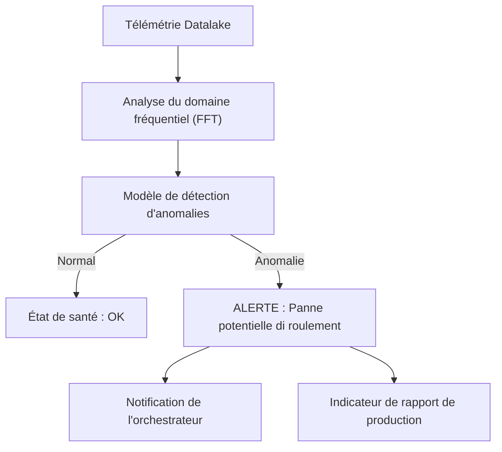

<!-- =============================================================================
HYDRA-UMC-ANOMALY-DETECTOR - Statistical anomaly detector
Copyright (C) JuanenRac (Electro Hobby 3D) <electrohobby3d@gmail.com>
GPL-3.0-or-later - see LICENSE
============================================================================= -->

<p align="center">
  
</p>

# 📈 HYDRA-UMC-ANOMALY-DETECTOR

<p align="center"><a href="README.md">🇺🇸 English</a> | <a href="README_spa.md">🇪🇸 Español</a> | 🇫🇷 <b>Français</b> | <a href="README_ita.md">🇮🇹 Italiano</a> | <a href="README_deu.md">🇩🇪 Deutsch</a> | <a href="README_zho.md">🇨🇳 简体中文</a> | <a href="README_jpn.md">🇯🇵 日本語</a> | <a href="README_por.md">🇵🇹 Português</a></p>

### 🧠 Détection statistique d'anomalies et analyse des vibrations des moteurs (aucun modèle d'apprentissage automatique)

<p align="center">
  
  
  
  
  
  
</p>

---

> **Vérification d'honnêteté - ce qui fonctionne réellement aujourd'hui :** le spectre FFT (`fft.py`), la ligne de base statistique par bin (`baseline.py`), le détecteur d'anomalies par max-z-score (`detector.py`), les métriques précision/rappel/F1 sur une fixture étiquetée (`metrics.py`), la détection de dérive par moyenne mobile (`drift.py`), le vrai client HTTP HYDRA-UMC-DATALAKE (`datalake_client.py`), et l'API JSON/HTTP simple (`api.py`) sont réels et testés (87 tests qui passent : `pytest tests/` - `test_fft.py`, `test_baseline.py`, `test_detector.py`, `test_metrics.py`, `test_drift.py`, `test_datalake_client.py`, `test_api.py`). « AI-driven » et « Learning Models » ci-dessous décrivent du vrai traitement du signal plus une ligne de base statistique ajustée à partir de fenêtres connues comme saines - pas un réseau de neurones entraîné, et pas un apprentissage continu en arrière-plan : une ligne de base est ajustée une fois, soit au démarrage à partir du véritable historique DATALAKE, soit via un appel explicite à `POST /baseline/fit`, et reste exactement cette version de modèle jusqu'au prochain réajustement explicite (voir le versionnement de modèle propre à `detector.py`). Les Phases 3 et 4 de la ROADMAP ci-dessous (apprentissage non supervisé, analyse acoustique) sont entièrement aspirationnelles - aucun code n'existe encore pour l'une ou l'autre dans ce dépôt. Voir `CHANGELOG.md` pour ce qui a été exactement livré jusqu'à présent.

> **État de la sûreté et de la cybersécurité :** cet écosystème n'est pas un système de sécurité certifié. Il n'existe pas encore de chaîne d'E-STOP matérielle, ni de limites ou de verrouillages imposés par le firmware, ni de commande de mouvement vérifiée ; les images de firmware sont contrôlées par CRC-32 et une signature Ed25519, et une compilation de version refuse les clés de développement publiées (les têtes d'outil et les cartes d'extension derrière le relais utilisent encore les chargeurs d'URTC, qui prennent un HMAC-SHA256 à clé partagée au lieu d'une signature) ; TLS et TLS mutuel sont optionnels et désactivés par défaut ; aucune carte propre n'a encore été assemblée ni testée. Lisez la [base de sécurité](https://github.com/JuanenRac/HYDRA-UMC-DOCS/blob/main/docs/SECURITY_BASELINE.md) et le [modèle de menaces](https://github.com/JuanenRac/HYDRA-UMC-DOCS/blob/main/docs/THREAT_MODEL.md) avant de vous fier à une affirmation d'ici pour la sécurité d'une personne.

---

## 📋 En un coup d'œil

| | |
|---|---|
| Version | `0.2.0` |
| Maturité | Fonctionnel |
| Tests | 179 (`python -m pytest -q tests`) |
| Technologie | Python / FFT / statistical baseline detection |
| Cible | Le Raspberry Pi CM5 d'une cellule HYDRA-UMC |
| Sur matériel réel | Pas encore : aucune exécution sur du matériel réel n'est consignée pour cette version |

**Aller à :** [Présentation](#-présentation) · [Architecture](#-architecture) · [Fonctionnalités](#-fonctionnalités) · [Sécurité et protection](#-sécurité-et-protection) · [Interfaces](#-interfaces) · [Configuration](#-configuration) · [Démarrage rapide](#-démarrage-rapide) · [Tests](#-tests) · [Dépannage](#-dépannage) · [Structure du dépôt](#-structure-du-dépôt) · [Projets liés](#-projets-liés)

## 🚦 État du projet

Chaque ligne est une partie de ce dépôt et le feu dit où elle en est aujourd'hui. Elle est écrite d'après ce que le dépôt peut montrer (tests, compilations, exécutions), pas d'après ce qui est prévu.

🟢 Fait et vérifié · 🟡 Fonctionne, avec des limites connues · 🟠 À moitié fait ou pas encore vérifié · 🔴 Pas fait ou ne fonctionne pas

| Domaine | État | Ce que cela veut dire ici |
|---|---|---|
| Logiciel | 🟡 | Fonctionne pour son usage principal ; la vérification d'honnêteté ci-dessus liste ce qui manque encore |
| Tests | 🟢 | 179 tests automatiques, exécutés à chaque modification |
| Matériel réel | 🔴 | Pas encore : aucune exécution sur du matériel réel n'est consignée pour cette version |
| Documentation | 🟢 | README en huit langues, vérifié par rapport au manifeste à chaque modification |

## 🎯 Présentation

**HYDRA-UMC-ANOMALY-DETECTOR** est destiné à devenir le gardien proactif de la santé robotique. Il applique une FFT et une base de référence statistique (aucun modèle d'apprentissage automatique) à des échantillons de télémétrie (vibrations, signatures de courant moteur et profils thermiques) et signale les écarts par rapport à une base saine ; il ne prédit pas encore les pannes.

L'objectif est de surveiller l'« empreinte numérique » de chaque moteur et tête d'outil afin de pouvoir repérer l'usure des roulements, les courroies desserrées ou les défaillances de refroidissement des semaines à l'avance, pour permettre une maintenance programmée au lieu de réparations d'urgence (prévu : aucun code de prédiction de pannes n'existe encore).

## 🧩 Rôle dans HYDRA-UMC

**HYDRA-UMC-ANOMALY-DETECTOR** lit la télémétrie que garde HYDRA-UMC-DATALAKE, repère les séries qui ne se comportent plus comme avant (un roulement qui se met à chanter, un entraînement qui dérive) et le dit en HTTP, dans le data lake et par des alarmes MQTT. Il surveille ; il ne commande jamais une machine.

## 🏛️ Architecture

<p align="center">
  
</p>

<details>
<summary>Version texte du diagramme (Mermaid)</summary>



</details>

**Pourquoi il est construit ainsi**

* **Pourquoi c'est un frère, pas un sous-module, de HYDRA-UMC-DATALAKE.** La détection d'anomalies est une charge de travail analytique en lecture seule sur de la télémétrie déjà stockée - la garder séparée signifie qu'un plantage du détecteur ou une inférence de modèle lente ne bloquent jamais les propres écritures de HYDRA-UMC-TELEMETRY-COLLECTOR dans le même entrepôt.
* **Pourquoi FFT + une base statistique aujourd'hui, pas encore un réseau de neurones entraîné.** Le README appelle cela « piloté par l'IA » - ce qui est réel et fonctionne dans cette première passe est une véritable technique de traitement du signal (`src/hydra_umc_anomaly_detector/fft.py`, la propre FFT de numpy) plus une base statistique par bin de fréquence apprise à partir de fenêtres connues comme saines (`baseline.py`) et un verdict de max-z-score (`detector.py`) - pas un modèle de deep learning entraîné. Cela fonctionne, c'est testé contre de vraies signatures de panne synthétiques, et c'est la bonne fondation sur laquelle construire un modèle appris plus tard (voir la section FEUILLE DE ROUTE ci-dessous) - mais l'appeler réseau de neurones ici exagérerait ce qui tourne réellement.
* **Pourquoi un max-z-score sur tous les bins, pas un seuil fixe.** Un seuil fixe ('température moteur > 80C') rate la dérive graduelle et déclenche de fausses alarmes sur des pics de charge légitimes - comparer chaque bin du spectre EN DIRECT à la propre base saine APPRISE de ce moteur précis détecte un pic de fréquence nouveau/décalé (une véritable signature de défaut de roulement) sans aucun de ces deux modes d'échec. Le seuil par défaut (10.0) a été choisi à partir d'une séparation empirique réelle, pas deviné - voir le docstring propre de `detector.py` pour les chiffres réels des fixtures de test synthétiques sain-vs-défectueux de ce projet.
* **Comment cela s'intègre dans le reste de l'écosystème.** Un service frère sous HYDRA-UMC-DATALAKE - exécute la détection d'anomalies sur la télémétrie que HYDRA-UMC-TELEMETRY-COLLECTOR y a déjà écrite.
* **Pourquoi `DriftMonitor` est un mécanisme séparé de `AnomalyDetector.score()`, et non un seuil plus grand.** Ils répondent à des questions réelles différentes : « cette fenêtre-CI est-elle anormale » (un verdict ponctuel) contre « la moyenne RÉCENTE a-t-elle discrètement dérivé » (une tendance glissante, robuste face à une seule fenêtre aberrante bruitée). Un véritable test de dérive simulée a découvert et documente honnêtement que, pour la conception max-z-score de ce détecteur, le propre signal d'une seule fenêtre se déclenche en réalité *avant* le signal de dérive glissante pour un défaut d'un nouveau type de fréquence - la vraie valeur de `DriftMonitor` ici est une confirmation de tendance soutenue, pas une alerte plus précoce, et le code le dit ainsi plutôt que de survendre la chose.
* **Pourquoi `metrics.py` calcule precision/recall plutôt que de laisser la qualité du seuil en prose.** Le docstring propre de `detector.py` n'affirmait auparavant que « sain noté jusqu'à ~5.3, défectueux noté dans les centaines » - réel, mais pas un chiffre contre lequel un futur réajustement pourrait faire un test de non-régression. `precision_recall()` sur le même jeu de données réel donne à cela une valeur réelle et vérifiable (1.0/1.0 aujourd'hui).

## ✨ Fonctionnalités

* **Un détecteur par série (`/detectors/{sourceId}/{kind}/{field}/...`).** Un moteur et une broche ne vibrent pas pareil, et une seule base de référence partagée appelait anormal l'autre. `POST /detectors/{sourceId}/{kind}/{field}/fit` ajuste la base de référence de cette série (le triplet sous lequel DATALAKE la range), `.../detect` note une fenêtre contre elle, `.../drift/init` et `.../drift/observe` lui donnent son propre moniteur de dérive, et `GET /detectors` liste les séries et si chacune est ajustée. Une série est créée par son premier ajustement réussi et il y en a au plus `--max-series` (64) ; noter une série jamais ajustée donne `409`, jamais un verdict d'une autre base ; ajuster une série ne touche jamais une autre ni la partagée. Écrire exige le jeton comme la base partagée, noter aussi dès qu'un jeton est configuré (`--no-protect-reads` le laisse ouvert). `--baseline-dir` enregistre une base par série et les restaure au démarrage. Les routes d'origine ne changent pas. *(implémenté, testé dans `tests/test_series.py`)*
* **Les lectures sont protégées par défaut (`--protect-reads`).** Avec un jeton configuré, `POST /detect` exige aussi `Authorization: Bearer <token>` ; seul `GET /stats`, le chemin de santé, reste ouvert. C'est le comportement par défaut dès qu'il y a un jeton (`--no-protect-reads` ou `HYDRA_UMC_ANOMALY_PROTECT_READS=0` laissent les lectures ouvertes ; `HYDRA_UMC_ANOMALY_PROTECT_READS=1` refuse de démarrer sans jeton). Sans jeton (loopback uniquement), il n'y a rien à exiger. Les appelants qui lisent via HYDRA-UMC-SERVER envoient déjà le jeton.
* 🔍 **Analyse de signature :** FFT (Fast Fourier Transform) d'échantillons de courant moteur pour détecter un déséquilibre mécanique. *(implémenté)*
* 📉 **Maintenance prédictive :** Estimation de la RUL (Remaining Useful Life) pour les moteurs NEMA et les outils URTC - aspirationnel, aucun code n'existe encore pour cela dans ce dépôt.
* 🚨 **Système d'alerte précoce :** Afficher des alertes directement dans les interfaces Studio et Watch - aspirationnel ; aujourd'hui le détecteur expose ses verdicts via sa propre API HTTP et, en mode continu, comme échantillons `anomaly_score` dans DATALAKE et comme messages MQTT. DASHBOARD-AI le lit via HYDRA-UMC-SERVER (même origine, donc pas besoin de CORS) ; les interfaces Studio et Watch n'affichent pas encore ses alarmes.
* **Mode service continu (`--follow-config FICHIER`).** Lit chaque série configurée dans DATALAKE à mesure qu'elle grandit, la coupe là où l'échantillonnage est irrégulier, note chaque fenêtre complète avec le détecteur de cette série, réécrit le verdict comme un échantillon de type `anomaly_score` et, avec `mqtt` configuré, publie un message d'état conservé quand une série change d'état et une alarme pour chaque fenêtre anormale. Tout ce qui se règle (séries, taille de fenêtre, intervalle, topics, broker) est dans le fichier JSON ; un DATALAKE ou un broker hors service est compté dans `GET /stats` et n'arrête jamais la boucle. *(implémenté ; testé contre un faux DATALAKE HTTP réel et un faux broker TCP réel, jamais lancé contre les vrais services)*
* 🧬 **Apprentissage de la ligne de base :** Ajuste sa ligne de base statistique à partir de l'historique réel connu comme sain du Datalake - pas un apprentissage continu en arrière-plan, mais un réajustement réel et explicite à chaque demande. *(implémenté)*
* 🏷️ **Versionnage du modèle :** Chaque `Verdict` porte la version de modèle réelle et monotone, ainsi que le seuil sur lequel il a été noté - un réajustement (refit) est un événement réel et traçable. Il indique aussi avec combien de fenêtres saines la ligne de base a été calibrée, afin qu'une alarme soit explicable et reproductible. *(implémenté)*
* 📐 **Métriques précision/rappel :** Precision/recall/F1 réels, calculés sur un jeu de données étiqueté (`metrics.py`), pas seulement des affirmations en prose sur la séparation des scores. *(implémenté)*
* 📈 **Détection de dérive simulée :** `DriftMonitor` signale une élévation soutenue réelle de la moyenne glissante, distincte du propre signal d'anomalie d'une seule fenêtre. *(implémenté)*

Une base de référence demande au moins dix fenêtres saines et utilise l'écart type d'échantillon (`ddof=1`) ; le seuil d'alarme ne change pas, donc une vraie anomalie n'est pas masquée. Les bases enregistrées auparavant continuent de fonctionner telles quelles.

## 🔒 Sécurité et protection

| Menace | Défense | Où |
|---|---|---|
| N'importe qui réécrivant une base ou l'état de dérive | Un jeton Bearer, comparé en temps constant, protège `/baseline/fit`, `/drift/init`, `/drift/observe` et les routes d'écriture de `/detectors/...` ; sans jeton configuré l'API est ouverte (le défaut en loopback) | `api.py` |
| Noter avec les données d'autrui et un corps énorme | `POST /detect` demande le jeton quand il y en a un (`--no-protect-reads` ou `HYDRA_UMC_ANOMALY_PROTECT_READS=0` l'ouvre) ; seul `GET /stats` reste ouvert ; un corps fait 1 MiB au plus | `api.py` |
| Beaucoup de séries épuisant la mémoire | Un détecteur par série, 64 au plus (`--max-series`), avec des identifiants conformes à `^[A-Za-z0-9][A-Za-z0-9._:-]{0,95}$` ; l'entraînement lit 200 000 points au plus (`--max-train-points`) ; l'API écoute sur `127.0.0.1` par défaut | `registry.py`, `main.py` |

**Ce qu'il ne fait jamais :** c'est un détecteur statistique classique (un z-score par bin FFT, seuil 10 par défaut), pas un modèle d'IA entraîné, et il ne commande jamais une machine.

## 🔌 Interfaces

HTTP sur `127.0.0.1:8097` par défaut ; la référence complète est `docs/API.md`.

| Topic ou route | Ce qu'il porte |
|---|---|
| `POST /baseline/fit`, `POST /detect` | apprendre la base du signal, puis noter une fenêtre par rapport à elle |
| `POST /drift/init`, `POST /drift/observe` | démarrer et alimenter la surveillance de dérive |
| `POST /detectors/{sourceId}/{kind}/{field}/...` | les mêmes opérations pour une série du data lake |
| `GET /stats`, `GET /detectors` | santé et liste des détecteurs |
| `--follow-config FILE.json` | mode continu : lit chaque série configurée à mesure qu'elle grandit (toutes les 5 s, 20 fenêtres au plus par cycle), réécrit le verdict et envoie des alarmes MQTT sous `hydra/anomaly` |

`serve --legacy-baseline` (ou `AnomalyDetector(legacy_baseline=True)`) rétablit l'ajustement précédent à partir de deux fenêtres avec l'écart type de population ; désactivé par défaut.

## ⚙️ Configuration

| Variable | Par défaut | Ce qu'elle définit |
|---|---|---|
| `--addr`, `--port` | `127.0.0.1`, `8097` | où écoute l'API HTTP |
| `--sample-rate`, `--threshold` | `1000.0`, `10.0` | fréquence d'échantillonnage en Hz ; le plus grand z-score qu'un bin peut avoir |
| `--window`, `--window-size` | `none` | `none` ou `hann` avant la FFT ; échantillons par fenêtre (requis avec `--datalake-url`) |
| `--datalake-url`, `--source-id`, `--kind`, `--field`, `--train-start`, `--train-end` | non défini | ajuster une nouvelle base au démarrage depuis le data lake (les quatre premiers vont ensemble) |
| `--max-train-points`, `--max-series` | `200000`, `64` | maximum de points lus à l'entraînement ; maximum de détecteurs |
| `--token-file`, `HYDRA_UMC_ANOMALY_TOKEN` | pas de jeton | le jeton Bearer de l'API |
| `HYDRA_UMC_ANOMALY_PROTECT_READS` | protégé si un jeton est défini | `0` ouvre `POST /detect`, `1` le protège |
| `HYDRA_UMC_DATALAKE_INGEST_TOKEN`, `HYDRA_UMC_DATALAKE_TOKEN`, `HYDRA_UMC_DATALAKE_READ_TOKEN` | non défini | les jetons avec lesquels le détecteur parle au data lake (ou `ingestTokenFile` dans la configuration de suivi) |

## 🚀 Démarrage rapide

Nécessite Python 3.10 ou plus récent et NumPy 1.24 ou plus récent (`pip install -e .` l'installe).

```bash
bash run.sh        # Linux, macOS (run.bat on Windows)
python -m hydra_umc_anomaly_detector.main --datalake-url http://127.0.0.1:8095 --source-id press1 --kind vibration --field accel --window-size 1024
curl http://127.0.0.1:8097/stats
```

## 🧪 Tests

179 tests automatiques s'exécutent avec `python -m pytest -q tests`. Ils utilisent des signaux réalistes, des contrôles de faux positifs et un faux data lake ; ni matériel ni réseau extérieur.

| Fichier de tests | Tests | Ce qu'il couvre |
|---|---|---|
| `test_fft.py`, `test_baseline.py`, `test_detector.py`, `test_drift.py`, `test_metrics.py` | - | le spectre, la base, le z-score, la dérive et précision/rappel |
| `test_realistic_false_positives.py`, `realistic_signals.py`, `signal_fixtures.py` | - | signaux réalistes qui ne doivent pas déclencher d'alarme |
| `test_api.py`, `test_series.py`, `test_follower.py`, `test_datalake_client.py`, `test_window_token_fetch.py` | - | l'interface HTTP, un détecteur par série, le mode continu et le client du data lake contre un faux data lake |

La CI exécute `HYDRA_UMC_CI=1 python tools/ci_validate.py`, qui vérifie le manifeste, les documents, les huit README et les images.

## 🏗️ Compilation et publication

Nécessite Python >= 3.10. Une véritable détection d'anomalies basée sur
la FFT avec une API HTTP, pas seulement un squelette qui s'importe.

```bash
# Linux/macOS
./build.sh
./run.sh --port 8097

# Windows
build.bat
run.bat --port 8097
```

`build` crée/active un `.venv` local, installe le paquet (éditable, avec
les extras de dev, y compris `numpy`) dedans, vérifie l'import, et exécute
la véritable suite de tests (`pytest`). `run` démarre l'API HTTP et
transmet tout indicateur (`--addr`, `--port`, `--sample-rate`,
`--threshold`, `--baseline-path`,
`--datalake-url`/`--source-id`/`--kind`/`--field`/`--window-size`).

Trois options de plus, toutes prudentes par défaut : `--window hann` retire la moyenne et applique une fenêtre de Hann avant la FFT (la valeur par défaut `none` est le comportement d'origine ; les chiffres diffèrent, donc une baseline se souvient de sa fenêtre, un détecteur refuse d'en restaurer une faite avec une autre, et `--threshold` doit être recalibré avec de vrais enregistrements sains avant de se fier à Hann). L'historique d'entraînement lu dans DATALAKE est désormais paginé (le plus ancien d'abord), coupé là où les horodatages ne sont pas espacés d'environ `1/sample-rate` et débarrassé des horodatages répétés, et une lecture qui s'arrête à `--max-train-points` le dit (`--train-start`/`--train-end` choisissent la plage). `--token-file` (ou `HYDRA_UMC_ANOMALY_TOKEN`) fait exiger un jeton Bearer à `POST /baseline/fit`, `/drift/init` et `/drift/observe`, et une `--addr` hors loopback est refusée sans lui. Testé contre des simulacres ; jamais avec de vrais enregistrements de machines.

La baseline ajustée peut désormais survivre à un redémarrage, et peut
être ajustée à partir de l'historique réel de HYDRA-UMC-DATALAKE au lieu
de coller des tableaux à la main :

```bash
# Persister chaque ajustement sur disque, et le restaurer automatiquement au prochain démarrage
./run.sh --port 8097 --baseline-path /var/lib/hydra-umc-anomaly-detector/baseline.npz

# Ajuster une nouvelle baseline au démarrage à partir de l'historique réel de DATALAKE, puis la persister
./run.sh --port 8097 --baseline-path baseline.npz \
  --datalake-url http://127.0.0.1:8095 --source-id motor-1 --kind vibration --field value --window-size 200
```

```bash
# Calibrer contre des fenêtres de signal connues comme saines (tableaux JSON de floats,
# même fréquence d'échantillonnage que --sample-rate)
curl -X POST localhost:8097/baseline/fit -d '{"windows": [[...], [...], ...]}'

# Noter une fenêtre en direct contre le baseline ajusté
curl -X POST localhost:8097/detect -d '{"window": [...]}'
# -> {"score": 6.3, "anomalous": false, "worstBinFreqHz": 276.0}

curl localhost:8097/stats
```

```bash
python -m pytest tests/ -v   # fft.py (le pic d'une onde sinusoïdale
                              # connue est correctement trouvé, le DC est
                              # vraiment supprimé), baseline.py (moyenne/
                              # écart-type corrects, le plancher d'écart-type
                              # nul évite une vraie division par zéro),
                              # detector.py (la promesse réelle : un signal
                              # de panne synthétique est signalé, un signal
                              # d'apparence saine ne l'est pas, avec une
                              # vraie marge de séparation, pas un seuil au
                              # couteau), et api.py (allers-retours HTTP
                              # réels via un vrai ThreadingHTTPServer)
```

## 🩺 Dépannage

| Vous voyez | Parce que | Faites |
|---|---|---|
| `401` | L'API a un jeton et la requête n'en a pas, ou un mauvais | Envoyez `Authorization: Bearer <token>` |
| `--window-size` is required | `--datalake-url` a été donné sans taille de fenêtre, source, type et champ | Donnez `--source-id`, `--kind`, `--field` et `--window-size` avec lui |
| false alarms on a healthy machine | La base a été ajustée sur trop peu de données ou des données peu représentatives, ou le seuil est trop bas | Entraînez sur une plus longue période normale (`--train-start`, `--train-end`), utilisez `--window hann` et relevez `--threshold` |

## 📂 Structure du dépôt

<p align="center">
  
</p>

<details>
<summary>Version texte de l'arborescence</summary>

```text
HYDRA-UMC-ANOMALY-DETECTOR/
├── src/hydra_umc_anomaly_detector/
│   ├── fft.py                                   extraction de traits par FFT, fenêtres
│   ├── baseline.py                              profil statistique par bin
│   ├── detector.py                              détecteur par z-score, seuil
│   ├── drift.py                                 surveillance de la dérive
│   ├── registry.py                              un détecteur par série
│   ├── follower.py                              mode continu sur DATALAKE
│   ├── api.py main.py                           interface HTTP et point d'entrée
│   ├── datalake_client.py                       client HTTP de DATALAKE
│   ├── mqtt_publish.py                          éditeur minimal d'alarmes MQTT
│   └── metrics.py                               précision, rappel et F1
├── tests/                                       154 tests, avec des signaux réalistes
├── docs/                                        la référence de l'API
├── systemd/                                     unité de service pour la CM5
├── tools/                                       exécuteur de build et de tests, montée de version, validateur CI, générateurs et vérifications des README et des images
├── images/                                      bannière et images du README
├── .github/                                     workflow CI et modèles de tickets
├── pyproject.toml                               métadonnées du paquet et dépendances
├── hydra-umc.project.json                       manifeste : version, maturité, famille
├── CHANGELOG.md                                 ce qui a changé à chaque version
├── build.sh build.bat                           scripts de build (ils ne changent jamais la version)
├── build-test.sh build-test.bat                 scripts de build (ils ne changent jamais la version)
├── test.sh test.bat                             lancent les tests
├── bump_version.py / bump_manifest_version.py   montée de version explicite
├── Dockerfile                                   image de conteneur
├── run.sh run.bat                               démarrer le service
└── SECURITY.md SUPPORT.md CONTRIBUTING.md CODE_OF_CONDUCT.md LICENSE LICENSE.md
```

</details>

## 🗺️ Feuille de route et limites connues

**Limites connues aujourd'hui**

* **Phase 1 :** Ingestion à haut débit du Datalake et indexation pour l'analyse historique.
* **Phase 2 :** Compression à la périphérie du collecteur de télémétrie et protocoles de transmission sécurisés.
* **Phase 3 :** Détection d'anomalies à l'aide de l'apprentissage non supervisé et analyse des vibrations du moteur.
* **Phase 4 :** Intégration de l'analyse acoustique pour « entendre » les problèmes mécaniques précoces et informations prédictives de l'IA.

## 🌍 Langues

Ce README et les documents du dépôt existent en huit langues : anglais, espagnol, allemand, français, italien, japonais, chinois et portugais (Portugal). Ils sont écrits ensemble et la CI vérifie que les huit fichiers ont les mêmes sections et les mêmes liens. Ce dépôt n'a ni écran ni catalogue de messages propre, il n'y a donc aucune chaîne d'interface à traduire.

## 🔗 Projets liés

Ce projet fait partie de l'écosystème robotique HYDRA-UMC du même auteur (JuanenRac / Electro Hobby 3D). Bon à savoir, car une demande pourrait en réalité concerner l'un de ceux-ci plutôt que ce dépôt.

**Projet Parent**
- **[HYDRA-UMC-DATALAKE](https://github.com/JuanenRac/HYDRA-UMC-DATALAKE)** — vrai magasin de séries temporelles basé sur sqlite3, avec une vraie API HTTP d'ingestion/requête ; le parent dont ce dépôt est un service d'analytique spécifique, au sein de sa propre couche de données et analytique.

**Projets Frères** — les autres services d'analytique de la propre couche de données et analytique de HYDRA-UMC-DATALAKE
- **[HYDRA-UMC-TELEMETRY-COLLECTOR](https://github.com/JuanenRac/HYDRA-UMC-TELEMETRY-COLLECTOR)** — vrai pipeline d'ingestion CAN/WebSocket vers DATALAKE, avec déduplication par séquence.
- **[HYDRA-UMC-PRODUCTION-REPORTS](https://github.com/JuanenRac/HYDRA-UMC-PRODUCTION-REPORTS)** — vrai calcul OEE/disponibilité sur l'historique de DATALAKE, avec export CSV reproductible.

**Directement Liés**
- **[HYDRA-UMC-STUDIO](https://github.com/JuanenRac/HYDRA-UMC-STUDIO)** — tableau de bord de contrôle web avec visualisation 3D multi-robot en temps réel — affiche les vraies alertes précoces de ce détecteur directement dans l'interface de contrôle.
- **[HYDRA-UMC-WATCH](https://github.com/JuanenRac/HYDRA-UMC-WATCH)** — application compagnon WearOS avec des motifs d'alerte haptique et un relais vocal vers le téléphone jumelé (pas encore exécutée sur une montre physique) — la même surface d'alerte, pour quiconque surveille la santé de la flotte plutôt que de piloter un robot.
- **[URTC](https://github.com/JuanenRac/URTC)** — firmware pour la carte physique Universal Robot Tool Controller, plus de 25 profils d'outil sur bus CAN — l'estimation de la RUL couvre ici aussi les propres têtes d'outil d'URTC, pas seulement les moteurs NEMA des bras eux-mêmes.

**Fait Également Partie de l'Écosystème**

*Matériel & Plateforme de Base*
- **[HYDRA-UMC](https://github.com/JuanenRac/HYDRA-UMC)** — la conception de la carte mère du bras robotique : hôte CM5 + coprocesseur STM32H745 double cœur, destinée à coordonner jusqu'à 8 bras-outils via CAN-OTA/SPI-OTA (firmware à un stade précoce ; aucune carte assemblée pour l'instant).
- **[HYDRA-UMC-OS](https://github.com/JuanenRac/HYDRA-UMC-OS)** — couche produit reproductible sur Raspberry Pi OS pour le CM5 : agent en lecture seule, config/profils validés, provisionnement WiFi de premier contact.
- **[HYDRA-UMC-SDK](https://github.com/JuanenRac/HYDRA-UMC-SDK)** — le contrat JSON-Schema partagé et la barrière logicielle de contrôle des jobs contre laquelle chaque bridge valide ses commandes (pas une fonction de sécurité certifiée).
- **[HYDRA-UMC-CONNECTOR-HUB](https://github.com/JuanenRac/HYDRA-UMC-CONNECTOR-HUB)** — registre déclaratif et validateur de manifestes d'adaptateur pour les connecteurs de machines externes ; étend la propre idée de contrat du SDK aux machines externes sans remplacer les projets de passerelle industrielle.

*Backend Central & Clients*
- **[HYDRA-UMC-SERVER](https://github.com/JuanenRac/HYDRA-UMC-SERVER)** — le vrai backend headless (REST/WebSocket) auquel parle réellement chaque client de contrôle.
- **[HYDRA-UMC-SUITE](https://github.com/JuanenRac/HYDRA-UMC-SUITE)** — centre de commande d'essaim de bureau (PySide6) pour plusieurs serveurs à la fois, empaqueté en exécutable autonome.
- **[HYDRA-UMC-ANDROID-CONTROL](https://github.com/JuanenRac/HYDRA-UMC-ANDROID-CONTROL)** — application de contrôle Android native avec connexion biométrique et un compagnon Wear OS jumelé.
- **[HYDRA-UMC-IOS-CONTROL](https://github.com/JuanenRac/HYDRA-UMC-IOS-CONTROL)** — application de contrôle iOS/iPadOS (Flutter) avec synchronisation WebSocket en temps réel.
- **[HYDRA-UMC-DSI](https://github.com/JuanenRac/HYDRA-UMC-DSI)** — interface tactile native pour l'écran tactile DSI 7" embarqué, intégrée directement sur le CM5.
- **[HYDRA-UMC-EDITOR-URDF](https://github.com/JuanenRac/HYDRA-UMC-EDITOR-URDF)** — créateur/éditeur graphique de bureau pour URDF qui envoie les modèles terminés vers le propre catalogue de STUDIO.
- **[HYDRA-UMC-EDITOR-STL](https://github.com/JuanenRac/HYDRA-UMC-EDITOR-STL)** — éditeur de bureau de modèles STL, transformant/remplaçant/retirant/ajoutant de vraies pièces dans le même catalogue de modèles qu'édite aussi HYDRA-UMC-EDITOR-URDF.
- **[HYDRA-UMC-BRIDGE-AMR](https://github.com/JuanenRac/HYDRA-UMC-BRIDGE-AMR)** — frontière de coordination pour les flottes AGV/AMR via un éditeur MQTT VDA 5050 (testé uniquement contre une flotte émulée).
- **[HYDRA-UMC-BRIDGE-CNC](https://github.com/JuanenRac/HYDRA-UMC-BRIDGE-CNC)** — coordinateur haut niveau pour cellules CNC avec accès au statut/octets de contrôle GRBL (testé uniquement contre un émulateur).
- **[HYDRA-UMC-BRIDGE-DROIDS](https://github.com/JuanenRac/HYDRA-UMC-BRIDGE-DROIDS)** — frontière de coordination pour droïdes à pattes/humanoïdes, avec un émetteur de commandes Boston Dynamics Spot (testé uniquement contre un émulateur).
- **[HYDRA-UMC-BRIDGE-LASER](https://github.com/JuanenRac/HYDRA-UMC-BRIDGE-LASER)** — coordinateur de cellules laser lisant 3 signaux GPIO de clé/enceinte/verrouillage (testé uniquement contre une puce simulée ; il ne peut ni armer ni tirer un laser).
- **[HYDRA-UMC-BRIDGE-OPENPNP](https://github.com/JuanenRac/HYDRA-UMC-BRIDGE-OPENPNP)** — coordinateur haut niveau sûr pour le flux de cartes du pick-and-place OpenPnP.
- **[HYDRA-UMC-BRIDGE-PRINTER3D](https://github.com/JuanenRac/HYDRA-UMC-BRIDGE-PRINTER3D)** — frontière de coordination sûre pour imprimantes 3D Moonraker/Klipper, avec de vraies commandes de tâche contrôlées.
- **[HYDRA-UMC-BRIDGE-ROS2](https://github.com/JuanenRac/HYDRA-UMC-BRIDGE-ROS2)** — coordinateur avec un transport ROS 2 rclpy à importation paresseuse (pas encore exécuté contre une installation ROS 2).
- **[HYDRA-UMC-BRIDGE-UAV](https://github.com/JuanenRac/HYDRA-UMC-BRIDGE-UAV)** — frontière de coordination pour UAV équipés de caméra, avec un émetteur de commandes MAVLink (testé uniquement contre un émulateur).

*Plateforme d'Outils URTC*
- **[URTC-FLASHER](https://github.com/JuanenRac/URTC-FLASHER)** — outil de bureau à interface graphique pour flasher les cartes URTC, CAN-OTA plus SWD/JTAG puce complète.
- **[URTC-TESTER](https://github.com/JuanenRac/URTC-TESTER)** — outil de bureau de diagnostic CAN-bus en direct pour cartes URTC, un panneau par profil d'outil.
- **[URTC-WEB-STUDIO](https://github.com/JuanenRac/URTC-WEB-STUDIO)** — alternative basée navigateur à URTC-TESTER via la Web Serial API, sans installation locale.
- **[URTC-GATEWAY](https://github.com/JuanenRac/URTC-GATEWAY)** — passerelle devant le bus CAN d'URTC : liste d'identifiants autorisés, limite de débit et clé de session ; logiciel testé sur ordinateur, pas encore sur un bus réel.

*Nœud IA de Vision (Hailo-8)*
- **[HYDRA-UMC-VISION-NODE](https://github.com/JuanenRac/HYDRA-UMC-VISION-NODE)** — hub d'intégration pour le pipeline de vision Hailo-8, avec une vraie vérification de disponibilité matérielle par étape.
- **[HYDRA-UMC-DETECTION-HEF](https://github.com/JuanenRac/HYDRA-UMC-DETECTION-HEF)** — registre réel de modèles compilés avec vérification de chargement sécurisé par architecture Hailo/checksum.
- **[HYDRA-UMC-VISION-STREAMER](https://github.com/JuanenRac/HYDRA-UMC-VISION-STREAMER)** — générateur réel de pipeline GStreamer + config MediaMTX, avec une vraie frontière d'intégration HailoRT.
- **[HYDRA-UMC-VISUAL-SERVOING-API](https://github.com/JuanenRac/HYDRA-UMC-VISUAL-SERVOING-API)** — loi de correction Position-Based Visual Servoing avec autorisation conditionnée à l'état de zone ; pas encore d'estimation de pose par caméra.
- **[HYDRA-UMC-SAFETY-ZONES](https://github.com/JuanenRac/HYDRA-UMC-SAFETY-ZONES)** — logique v0 de violation de zone, de fraîcheur de calibration et de demande d'E-STOP qui lit les positions d'objets dans un fichier ; aucun détecteur ne l'alimente et aucun E-STOP physique n'y est encore relié.

*Nœud IA Cognitif (Hailo-10)*
- **[HYDRA-UMC-COGNITIVE-NODE](https://github.com/JuanenRac/HYDRA-UMC-COGNITIVE-NODE)** — hub d'intégration pour le pipeline cognitif Hailo-10 (orchestration LLM/VLA/voix).
- **[HYDRA-UMC-VLA-ENGINE](https://github.com/JuanenRac/HYDRA-UMC-VLA-ENGINE)** — vrai encodage/décodage de jetons d'action et génération de trajectoire pour un modèle Vision-Language-Action.
- **[HYDRA-UMC-VOICE-UI](https://github.com/JuanenRac/HYDRA-UMC-VOICE-UI)** — vrai front-end vocal (VAD + analyseur d'intention) avec un relais Watch borné et soumis à confirmation.
- **[HYDRA-UMC-SEMANTIC-PLANNER](https://github.com/JuanenRac/HYDRA-UMC-SEMANTIC-PLANNER)** — vraie décomposition de tâches basée sur des règles et récupération sémantique d'erreurs sur les codes d'erreur MCU.
- **[HYDRA-UMC-DOCS-QA](https://github.com/JuanenRac/HYDRA-UMC-DOCS-QA)** — vraie recherche documentaire TF-IDF (bibliothèque standard uniquement) sur les propres documents Markdown de cet écosystème.
- **[HYDRA-UMC-LOCAL-TECHNICIAN](https://github.com/JuanenRac/HYDRA-UMC-LOCAL-TECHNICIAN)** — technicien de maintenance IA local et à portes de politique pour l'écosystème lui-même - observe, diagnostique et propose des corrections ; les deux niveaux de risque les plus élevés ne sont délibérément pas encore implémentés.

*Orchestration & Essaim*
- **[HYDRA-UMC-ORCHESTRATOR](https://github.com/JuanenRac/HYDRA-UMC-ORCHESTRATOR)** — hub d'intégration avec un vrai contrat de rapport de santé gRPC/Protobuf et une machine à états de mission.
- **[HYDRA-UMC-JOB-DISPATCHER](https://github.com/JuanenRac/HYDRA-UMC-JOB-DISPATCHER)** — vraie file de tâches basée sur la priorité avec déduplication, via une vraie API HTTP.
- **[HYDRA-UMC-NODE-HEALING](https://github.com/JuanenRac/HYDRA-UMC-NODE-HEALING)** — vrai chien de garde de santé de flotte basé sur gRPC, avec retry/backoff et détection d'incohérence d'identité.
- **[HYDRA-UMC-PATH-PLANNER-3D](https://github.com/JuanenRac/HYDRA-UMC-PATH-PLANNER-3D)** — vrai planificateur de trajectoire 3D basé sur RRT, avec vraie validation des collisions obstacle/espace de travail.
- **[HYDRA-UMC-SWARM-SYNC](https://github.com/JuanenRac/HYDRA-UMC-SWARM-SYNC)** — vraie synchronisation d'état CRDT LWW-Element-Map, testée par propriétés pour la convergence multi-cellule.

*Jumeau Numérique & Simulation*
- **[HYDRA-UMC-TWIN](https://github.com/JuanenRac/HYDRA-UMC-TWIN)** — hub d'intégration pour le moteur de jumeau numérique, avec un vrai contrat de synchronisation par compatibilité de version.
- **[HYDRA-UMC-HIL-BRIDGE](https://github.com/JuanenRac/HYDRA-UMC-HIL-BRIDGE)** — routeur hardware-in-the-loop avec un verrouillage logiciel de collision entre simulation et matériel réel (testé sans matériel réel).
- **[HYDRA-UMC-PHYSICS-REPLICA](https://github.com/JuanenRac/HYDRA-UMC-PHYSICS-REPLICA)** — vraie cinématique directe et validation des limites articulaires sur un vrai sous-ensemble URDF.
- **[HYDRA-UMC-SYNTHETIC-DATA-GEN](https://github.com/JuanenRac/HYDRA-UMC-SYNTHETIC-DATA-GEN)** — vrai générateur procédural de scènes 2D avec export d'annotations YOLO/COCO.

*Passerelle Industrielle*
- **[HYDRA-UMC-GATEWAY-INDUSTRIAL](https://github.com/JuanenRac/HYDRA-UMC-GATEWAY-INDUSTRIAL)** — hub d'intégration relayant vers les protocoles industriels, avec une vraie couche de liste blanche de commandes/contre-pression.
- **[HYDRA-UMC-OPCUA-SERVER](https://github.com/JuanenRac/HYDRA-UMC-OPCUA-SERVER)** — vrai espace d'adressage OPC-UA, vérifié avec une vraie session client du protocole binaire.
- **[HYDRA-UMC-MQTT-BROKER](https://github.com/JuanenRac/HYDRA-UMC-MQTT-BROKER)** — vrai broker MQTT avec authentification par client optionnelle et ACL de sujets.
- **[HYDRA-UMC-MTCONNECT-ADAPTER](https://github.com/JuanenRac/HYDRA-UMC-MTCONNECT-ADAPTER)** — vrais points de terminaison XML MTConnect `/probe` et `/current`, avec sortie en mode dégradé.

*Outils Complémentaires & Opérations de l'Écosystème*
- **[HYDRA-UMC-DASHBOARD-AI](https://github.com/JuanenRac/HYDRA-UMC-DASHBOARD-AI)** — panneaux Smart Summaries et Anomaly Highlighting sur DATALAKE/ANOMALY-DETECTOR, avec un repli statistique honnête.
- **[HYDRA-UMC-TOOL-CLI](https://github.com/JuanenRac/HYDRA-UMC-TOOL-CLI)** — CLI de flotte avec un vrai contrat de codes de sortie stable, un vrai client en direct de la propre API de HYDRA-UMC-SERVER.
- **[URTC-SMART-RACK](https://github.com/JuanenRac/URTC-SMART-RACK)** — firmware pour un rack de montage de cartes avec décodage réel d'ID d'outil et logique de préchauffage Smart Idle.
- **[URTC-VISION-TOOL](https://github.com/JuanenRac/URTC-VISION-TOOL)** — firmware plus un vrai compagnon de vision Python pour une tête d'outil d'inspection thermique/RGB.
- **[HYDRA-UMC-UPDATER](https://github.com/JuanenRac/HYDRA-UMC-UPDATER)** — outil administratif de bureau qui découvre, clone et met à jour chaque dépôt de cet écosystème.
- **[HYDRA-UMC-OS-REBUILDER](https://github.com/JuanenRac/HYDRA-UMC-OS-REBUILDER)** — outil de bureau Windows/Linux qui construit une image de la CM5 prête à graver, préchargée avec les versions les plus actuelles de l'écosystème, avec une configuration de premier démarrage Wi-Fi/utilisateur/SSH façon Raspberry Pi Imager.
- **[HYDRA-UMC-OPS-AGENT](https://github.com/JuanenRac/HYDRA-UMC-OPS-AGENT)** — coordinateur d'incidents de maintenance : un rôle edge à faible privilège collecte un instantané d'inventaire/santé assaini, un rôle control-plane le rend en lecture seule et demande à un fournisseur d'IA de suggérer un diagnostic - n'applique jamais de correctif ni ne déploie rien.
- **[HYDRA-UMC-DEV-SERVER](https://github.com/JuanenRac/HYDRA-UMC-DEV-SERVER)** — hôte de développement reproductible (Raspberry Pi 5 / CM5) qui héberge le code source de l'écosystème et exécute des tâches de compilation/test délimitées via une file d'attente durable ; un rôle de développement dédié, explicitement distinct d'un CM5 opérationnel.

## 📚 Documentation

Où lire la suite :

* [docs/API.md](docs/API.md) - chaque route, sa règle de jeton et ses erreurs
* [Base de sécurité de l'écosystème](https://github.com/JuanenRac/HYDRA-UMC-DOCS/blob/main/docs/SECURITY_BASELINE.md)
* [Modèle de menaces de l'écosystème](https://github.com/JuanenRac/HYDRA-UMC-DOCS/blob/main/docs/THREAT_MODEL.md)
* [Journal des modifications de ce dépôt](CHANGELOG.md)
* [Licence de ce dépôt](LICENSE.md)

## 🤝 Contribuer et communauté

* Avant une pull request, exécutez `HYDRA_UMC_CI=1 py -3 tools/ci_validate.py` (ou `HYDRA_UMC_CI=1 python3 tools/ci_validate.py`) : il doit afficher `CI_VALIDATION=PASS`. N'exécutez pas `build.sh` ni `build.bat` pour cette vérification ; compiler n'est pas vérifier.
* Les huit README sont écrits à partir d'une source unique dans HYDRA-UMC-DOCS ; ne les modifiez pas à la main. Changez la source et réécrivez-les avec `tools/make_readmes.py`.
* N'affirmez pas dans un README ce qui n'a pas tourné : écrivez « simulé » ou « non essayé sur matériel » quand c'est la vérité.
* Voir [CONTRIBUTING.md](CONTRIBUTING.md), le [code de conduite](CODE_OF_CONDUCT.md), [SECURITY.md](SECURITY.md) et [SUPPORT.md](SUPPORT.md).

## 👤 AUTEUR

**JuanenRac (Electro Hobby 3D)** · electrohobby3d@gmail.com

## 📜 LICENCE

GPL-3.0-or-later - [LICENSE](LICENSE).
