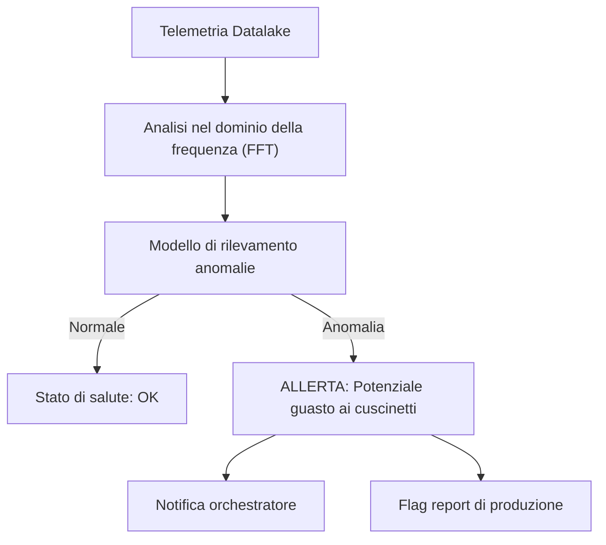

<!-- =============================================================================
HYDRA-UMC-ANOMALY-DETECTOR - Statistical anomaly detector
Copyright (C) JuanenRac (Electro Hobby 3D) <electrohobby3d@gmail.com>
GPL-3.0-or-later - see LICENSE
============================================================================= -->

<p align="center">
  
</p>

# 📈 HYDRA-UMC-ANOMALY-DETECTOR

<p align="center"><a href="README.md">🇺🇸 English</a> | <a href="README_spa.md">🇪🇸 Español</a> | <a href="README_fra.md">🇫🇷 Français</a> | 🇮🇹 <b>Italiano</b> | <a href="README_deu.md">🇩🇪 Deutsch</a> | <a href="README_zho.md">🇨🇳 简体中文</a> | <a href="README_jpn.md">🇯🇵 日本語</a> | <a href="README_por.md">🇵🇹 Português</a></p>

### 🧠 Rilevamento statistico di anomalie e analisi delle vibrazioni del motore (nessun modello di machine learning)

<p align="center">
  
  
  
  
  
  
</p>

---

> **Verifica di onestà - cosa funziona davvero oggi:** lo spettro FFT (`fft.py`), la baseline statistica per bin (`baseline.py`), il rilevatore di anomalie a max-z-score (`detector.py`), le metriche precisione/recall/F1 su una fixture etichettata (`metrics.py`), il rilevamento della deriva a media mobile (`drift.py`), il vero client HTTP di HYDRA-UMC-DATALAKE (`datalake_client.py`), e la semplice API JSON/HTTP (`api.py`) sono reali e testati (87 test superati: `pytest tests/` - `test_fft.py`, `test_baseline.py`, `test_detector.py`, `test_metrics.py`, `test_drift.py`, `test_datalake_client.py`, `test_api.py`). "AI-driven" e "Learning Models" qui sotto descrivono vera elaborazione del segnale più una baseline statistica adattata da finestre note come sane - non una rete neurale addestrata, e non un apprendimento continuo in background: una baseline viene adattata una sola volta, all'avvio a partire dalla vera cronologia DATALAKE oppure tramite una chiamata esplicita a `POST /baseline/fit`, e resta esattamente quella versione di modello fino al prossimo riadattamento esplicito (vedi il versionamento del modello proprio di `detector.py`). Le Fasi 3 e 4 della ROADMAP qui sotto (apprendimento non supervisionato, analisi acustica) sono completamente aspirazionali - non esiste ancora codice per nessuna delle due in questo repository. Vedi `CHANGELOG.md` per cosa è stato esattamente consegnato finora.

> **Stato di sicurezza (safety e security):** questo ecosistema non è un sistema di sicurezza certificato. Non esiste ancora un percorso E-STOP hardware, né limiti o interblocchi imposti dal firmware, né un comando di movimento verificato; le immagini firmware sono controllate con CRC-32 e una firma Ed25519, e una compilazione di rilascio rifiuta le chiavi di sviluppo pubblicate (le teste utensile e le schede di espansione dietro il relè usano ancora i bootloader di URTC, che accettano un HMAC-SHA256 a chiave condivisa invece di una firma); TLS e TLS reciproco sono opzionali e disattivati per impostazione predefinita; nessuna scheda propria è stata ancora assemblata o provata. Leggi la [base di sicurezza](https://github.com/JuanenRac/HYDRA-UMC-DOCS/blob/main/docs/SECURITY_BASELINE.md) e il [modello delle minacce](https://github.com/JuanenRac/HYDRA-UMC-DOCS/blob/main/docs/THREAT_MODEL.md) prima di fidarti di qualsiasi affermazione qui per la sicurezza di una persona.

---

## 📋 In breve

| | |
|---|---|
| Versione | `0.1.8` |
| Maturità | Funzionale |
| Test | 160 (`python -m pytest -q tests`) |
| Tecnologia | Python / FFT / statistical baseline detection |
| Destinazione | Il Raspberry Pi CM5 di una cella HYDRA-UMC |
| Su hardware reale | Non ancora: per questa versione non risulta alcuna esecuzione su hardware reale |

**Vai a:** [Panoramica](#-panoramica) · [Architettura](#-architettura) · [Funzionalità](#-funzionalità) · [Sicurezza e protezione](#-sicurezza-e-protezione) · [Interfacce](#-interfacce) · [Configurazione](#-configurazione) · [Avvio rapido](#-avvio-rapido) · [Test](#-test) · [Risoluzione dei problemi](#-risoluzione-dei-problemi) · [Struttura del repository](#-struttura-del-repository) · [Progetti correlati](#-progetti-correlati)

## 🚦 Stato del progetto

Ogni riga è una parte di questo repository e il semaforo dice a che punto è oggi. È scritta in base a ciò che il repository può mostrare (test, compilazioni, esecuzioni), non a ciò che è previsto.

🟢 Fatto e verificato · 🟡 Funziona, con limiti noti · 🟠 Fatto a metà o non ancora verificato · 🔴 Non fatto o non funzionante

| Area | Stato | Cosa significa qui |
|---|---|---|
| Software | 🟡 | Funziona per il suo scopo principale; la verifica di onestà qui sopra elenca ciò che manca ancora |
| Test | 🟢 | 160 test automatici, eseguiti a ogni modifica |
| Hardware reale | 🔴 | Non ancora: per questa versione non risulta alcuna esecuzione su hardware reale |
| Documentazione | 🟢 | README in otto lingue, verificato rispetto al manifesto a ogni modifica |

## 🎯 Panoramica

**HYDRA-UMC-ANOMALY-DETECTOR** è pensato per diventare il guardiano proattivo della salute robotica. Applica una FFT e una linea di base statistica (nessun modello di machine learning) a campioni di telemetria (vibrazioni, firme di corrente del motore e profili termici) e segnala gli scostamenti da una linea di base sana; non prevede ancora i guasti.

L'obiettivo è monitorare l'«impronta digitale» di ogni motore e testina dello strumento per poter individuare l'usura dei cuscinetti, le cinghie allentate o i guasti al raffreddamento con settimane di anticipo, consentendo una manutenzione programmata invece di riparazioni di emergenza (previsto: non esiste ancora codice di previsione dei guasti).

## 🧩 Ruolo in HYDRA-UMC

**HYDRA-UMC-ANOMALY-DETECTOR** legge la telemetria che conserva HYDRA-UMC-DATALAKE, trova le serie che non si comportano più come prima (un cuscinetto che inizia a cantare, un azionamento che deriva) e lo dice via HTTP, nel data lake e come allarmi MQTT. Osserva; non comanda mai una macchina.

## 🏛️ Architettura

<p align="center">
  
</p>

<details>
<summary>Versione testuale del diagramma (Mermaid)</summary>



</details>

**Perché è fatto così**

* **Perché è fratello, non un sottomodulo, di HYDRA-UMC-DATALAKE.** Il rilevamento anomalie è un carico di lavoro analitico di sola lettura su telemetria già memorizzata - tenerlo separato significa che un crash del rilevatore o un'inferenza di modello lenta non bloccano mai le scritture proprie di HYDRA-UMC-TELEMETRY-COLLECTOR nello stesso archivio.
* **Perché FFT + una base statistica oggi, non ancora una rete neurale addestrata.** Il README lo chiama "guidato dall'IA" - ciò che è reale e funzionante in questa prima passata è una vera tecnica di elaborazione del segnale (`src/hydra_umc_anomaly_detector/fft.py`, la FFT propria di numpy) più una base statistica per bin di frequenza appresa da finestre note come sane (`baseline.py`) e un verdetto di max-z-score (`detector.py`) - non un modello di deep learning addestrato. Funziona, è testato contro vere firme di guasto sintetiche, ed è la base corretta su cui costruire un modello appreso più avanti (vedi la sezione TABELLA DI MARCIA più sotto) - ma chiamarlo rete neurale qui esagererebbe ciò che realmente gira.
* **Perché un max-z-score su tutti i bin, non una soglia fissa.** Una soglia fissa ('temperatura motore > 80C') si perde la deriva graduale e genera falsi allarmi su picchi di carico legittimi - confrontare ogni bin dello spettro DAL VIVO con la base sana APPRESA propria di questo motore rileva un picco di frequenza nuovo/spostato (una vera firma di guasto ai cuscinetti) senza nessuna di queste due modalità di fallimento. La soglia predefinita (10.0) è stata scelta a partire da una separazione empirica reale, non indovinata - vedi il docstring proprio di `detector.py` per i numeri reali dai fixture di test sintetici sano-vs-difettoso di questo progetto.
* **Come si inserisce nel resto dell'ecosistema.** Un servizio fratello sotto HYDRA-UMC-DATALAKE - esegue il rilevamento anomalie sulla telemetria che HYDRA-UMC-TELEMETRY-COLLECTOR ha già scritto lì.
* **Perché `DriftMonitor` è un meccanismo separato da `AnomalyDetector.score()`, e non una soglia più grande.** Rispondono a domande reali diverse: "questa finestra è anomala" (un verdetto puntuale) contro "la media RECENTE si è spostata silenziosamente" (una tendenza mobile, robusta rispetto a una singola finestra anomala rumorosa). Un vero test di deriva simulata ha scoperto e documenta onestamente che, per il design max-z-score di questo rilevatore, il flag proprio di una singola finestra scatta in realtà *prima* del segnale di deriva mobile per un guasto di un nuovo tipo di frequenza - il vero valore di `DriftMonitor` qui è una conferma di tendenza sostenuta, non un allarme più precoce, e il codice lo dichiara così invece di sopravvenderlo.
* **Perché `metrics.py` calcola precision/recall invece di lasciare la qualità della soglia come prosa.** Il docstring proprio di `detector.py` prima affermava solo "sano valutato fino a ~5.3, difettoso valutato nelle centinaia" - reale, ma non un numero contro cui un futuro ritaratura potesse fare un test di regressione. `precision_recall()` sullo stesso fixture reale dà a questo un valore reale e verificabile (1.0/1.0 oggi).

## ✨ Funzionalità

* **Un rilevatore per serie (`/detectors/{sourceId}/{kind}/{field}/...`).** Un motore e un mandrino non vibrano allo stesso modo, e un'unica linea di base condivisa chiamava anomalo l'altro. `POST /detectors/{sourceId}/{kind}/{field}/fit` adatta la linea di base di quella serie (la terna con cui DATALAKE la conserva), `.../detect` valuta una finestra contro di essa, `.../drift/init` e `.../drift/observe` le danno un proprio monitor di deriva, e `GET /detectors` elenca le serie e se ciascuna è adattata. Una serie nasce con il suo primo adattamento riuscito e ce ne sono al massimo `--max-series` (64); valutare una serie mai adattata dà `409`, mai un verdetto di un'altra linea di base; adattare una serie non tocca mai un'altra né quella condivisa. Scrivere richiede il token come la linea di base condivisa, valutare anche quando c'è un token (`--no-protect-reads` lo lascia aperto). `--baseline-dir` salva una linea di base per serie e le ripristina all'avvio. Le rotte originali non cambiano. *(implementato, testato in `tests/test_series.py`)*
* **Le letture sono protette per impostazione predefinita (`--protect-reads`).** Con un token impostato, anche `POST /detect` richiede `Authorization: Bearer <token>`; solo `GET /stats`, il percorso di salute, resta aperto. È il comportamento predefinito quando c'è un token (`--no-protect-reads` o `HYDRA_UMC_ANOMALY_PROTECT_READS=0` lasciano le letture aperte; `HYDRA_UMC_ANOMALY_PROTECT_READS=1` rifiuta di avviarsi senza token). Senza token (solo loopback) non c'è nulla da richiedere. Chi legge tramite HYDRA-UMC-SERVER invia già il token.
* 🔍 **Analisi della firma:** FFT (Fast Fourier Transform) di campioni della corrente del motore per rilevare squilibri meccanici. *(implementato)*
* 📉 **Manutenzione predittiva:** Stima RUL (Remaining Useful Life) per motori NEMA e strumenti URTC - aspirazionale, non esiste ancora codice per questo in questo repository.
* 🚨 **Sistema di allerta precoce:** Mostrare avvisi direttamente nelle interfacce Studio e Watch - aspirazionale; oggi il rilevatore espone i propri verdetti tramite la propria API HTTP e, in modalità continua, come campioni `anomaly_score` in DATALAKE e come messaggi MQTT. DASHBOARD-AI lo legge tramite HYDRA-UMC-SERVER (stessa origine, quindi il CORS non serve); le interfacce Studio e Watch non mostrano ancora i suoi allarmi.
* **Modalità servizio continuo (`--follow-config FILE`).** Legge ogni serie configurata da DATALAKE mentre cresce, la taglia dove il campionamento è irregolare, valuta ogni finestra completa con il rilevatore di quella serie, riscrive il verdetto come campione di tipo `anomaly_score` e, con `mqtt` configurato, pubblica un messaggio di stato trattenuto quando una serie cambia stato e un allarme per ogni finestra anomala. Tutto ciò che si regola (serie, dimensione della finestra, intervallo, topic, broker) sta nel file JSON; un DATALAKE o un broker fermo viene contato in `GET /stats` e non ferma mai il ciclo. *(implementato; provato contro un finto DATALAKE HTTP reale e un finto broker TCP reale, mai eseguito contro i servizi veri)*
* 🧬 **Apprendimento della baseline:** Adatta la propria baseline statistica dalla cronologia reale nota come sana del Datalake - non è apprendimento continuo in background, ma un riadattamento reale ed esplicito ogni volta che viene richiesto. *(implementato)*
* 🏷️ **Versionamento del modello:** Ogni `Verdict` porta con sé la versione reale e monotona del modello e la soglia rispetto a cui è stato valutato - un riadattamento (refit) è un evento reale e tracciabile. Indica inoltre con quante finestre sane è stata calibrata la baseline, così un allarme è spiegabile e riproducibile. *(implementato)*
* 📐 **Metriche di precisione/recall:** Precision/recall/F1 reali, calcolati su un fixture etichettato (`metrics.py`), non solo affermazioni in prosa sulla separazione dei punteggi. *(implementato)*
* 📈 **Rilevamento di deriva simulata:** `DriftMonitor` segnala un innalzamento sostenuto reale della media mobile, distinto dal flag di anomalia proprio di una singola finestra. *(implementato)*

Una linea di base richiede almeno dieci finestre sane e usa la deviazione standard campionaria (`ddof=1`); la soglia di allarme non cambia, quindi una vera anomalia non viene nascosta. Le linee di base salvate in precedenza continuano a funzionare così come sono.

## 🔒 Sicurezza e protezione

| Minaccia | Difesa | Dove |
|---|---|---|
| Chiunque riscriva una baseline o lo stato di deriva | Un token Bearer, confrontato in tempo costante, protegge `/baseline/fit`, `/drift/init`, `/drift/observe` e le rotte di scrittura di `/detectors/...`; senza token configurato l'API è aperta (il predefinito in loopback) | `api.py` |
| Valutare con dati altrui e un corpo enorme | `POST /detect` chiede il token quando ce n'è uno configurato (`--no-protect-reads` o `HYDRA_UMC_ANOMALY_PROTECT_READS=0` lo apre); resta aperto solo `GET /stats`; un corpo è al massimo 1 MiB | `api.py` |
| Molte serie che esauriscono la memoria | Un rilevatore per serie, al massimo 64 (`--max-series`), con identificatori conformi a `^[A-Za-z0-9][A-Za-z0-9._:-]{0,95}$`; l'addestramento legge al massimo 200 000 punti (`--max-train-points`); l'API ascolta su `127.0.0.1` per impostazione predefinita | `registry.py`, `main.py` |

**Cosa non fa mai:** è un rilevatore statistico classico (uno z-score per bin FFT, soglia 10 per impostazione predefinita), non un modello di IA addestrato, e non comanda mai una macchina.

## 🔌 Interfacce

HTTP su `127.0.0.1:8097` per impostazione predefinita; il riferimento completo è `docs/API.md`.

| Topic o rotta | Cosa porta |
|---|---|
| `POST /baseline/fit`, `POST /detect` | imparare la baseline del segnale e poi valutare una finestra rispetto a essa |
| `POST /drift/init`, `POST /drift/observe` | avviare e alimentare il monitoraggio della deriva |
| `POST /detectors/{sourceId}/{kind}/{field}/...` | le stesse operazioni per una serie del data lake |
| `GET /stats`, `GET /detectors` | stato e elenco dei rilevatori |
| `--follow-config FILE.json` | modo continuo: legge ogni serie configurata man mano che cresce (ogni 5 s, al massimo 20 finestre per ciclo), riscrive il verdetto e invia allarmi MQTT sotto `hydra/anomaly` |

`serve --legacy-baseline` (o `AnomalyDetector(legacy_baseline=True)`) ripristina l'adattamento precedente con due finestre e la deviazione di popolazione; è spento per impostazione predefinita.

## ⚙️ Configurazione

| Variabile | Predefinito | Cosa imposta |
|---|---|---|
| `--addr`, `--port` | `127.0.0.1`, `8097` | dove ascolta l'API HTTP |
| `--sample-rate`, `--threshold` | `1000.0`, `10.0` | frequenza di campionamento in Hz; il massimo z-score che un bin può avere |
| `--window`, `--window-size` | `none` | `none` o `hann` prima della FFT; campioni per finestra (necessario con `--datalake-url`) |
| `--datalake-url`, `--source-id`, `--kind`, `--field`, `--train-start`, `--train-end` | non impostato | calcolare una baseline nuova all'avvio dal data lake (i primi quattro vanno insieme) |
| `--max-train-points`, `--max-series` | `200000`, `64` | massimo di punti letti per l'addestramento; massimo di rilevatori |
| `--token-file`, `HYDRA_UMC_ANOMALY_TOKEN` | nessun token | il token Bearer dell'API |
| `HYDRA_UMC_ANOMALY_PROTECT_READS` | protetto se c'è un token | `0` apre `POST /detect`, `1` lo protegge |
| `HYDRA_UMC_DATALAKE_INGEST_TOKEN`, `HYDRA_UMC_DATALAKE_TOKEN`, `HYDRA_UMC_DATALAKE_READ_TOKEN` | non impostato | i token con cui il rilevatore parla con il data lake (o `ingestTokenFile` nella configurazione di follow) |

## 🚀 Avvio rapido

Richiede Python 3.10 o successivo e NumPy 1.24 o successivo (`pip install -e .` lo installa).

```bash
bash run.sh        # Linux, macOS (run.bat on Windows)
python -m hydra_umc_anomaly_detector.main --datalake-url http://127.0.0.1:8095 --source-id press1 --kind vibration --field accel --window-size 1024
curl http://127.0.0.1:8097/stats
```

## 🧪 Test

160 test automatici si eseguono con `python -m pytest -q tests`. Usano segnali realistici, controlli dei falsi positivi e un data lake finto; né hardware né rete esterna.

| File di test | Test | Cosa copre |
|---|---|---|
| `test_fft.py`, `test_baseline.py`, `test_detector.py`, `test_drift.py`, `test_metrics.py` | - | lo spettro, la baseline, lo z-score, la deriva e precisione/richiamo |
| `test_realistic_false_positives.py`, `realistic_signals.py`, `signal_fixtures.py` | - | segnali realistici che non devono far scattare un allarme |
| `test_api.py`, `test_series.py`, `test_follower.py`, `test_datalake_client.py`, `test_window_token_fetch.py` | - | l'interfaccia HTTP, un rilevatore per serie, il modo continuo e il client del data lake contro un data lake finto |

La CI esegue `HYDRA_UMC_CI=1 python tools/ci_validate.py`, che controlla il manifesto, i documenti, gli otto README e le immagini.

## 🏗️ Compilazione e rilascio

Richiede Python >= 3.10. Rilevamento reale di anomalie basato su FFT con
API HTTP, non solo uno scheletro che si importa.

```bash
# Linux/macOS
./build.sh
./run.sh --port 8097

# Windows
build.bat
run.bat --port 8097
```

`build` crea/attiva un `.venv` locale, installa il pacchetto (editable, con
gli extra di dev, incluso `numpy`) al suo interno, verifica l'import, ed
esegue la vera suite di test (`pytest`). `run` avvia l'API HTTP e inoltra
qualsiasi flag (`--addr`, `--port`, `--sample-rate`, `--threshold`,
`--baseline-path`,
`--datalake-url`/`--source-id`/`--kind`/`--field`/`--window-size`).

Altre tre opzioni, tutte prudenti per impostazione predefinita: `--window hann` toglie la media e applica una finestra di Hann prima della FFT (il valore predefinito `none` è il comportamento originale; i numeri cambiano, quindi una baseline ricorda la sua finestra, un rilevatore rifiuta di ripristinarne una fatta con un'altra, e `--threshold` va ricalibrata con vere registrazioni sane prima di fidarsi di Hann). Lo storico di addestramento letto da DATALAKE ora è paginato (dal più vecchio), tagliato dove i timestamp non distano circa `1/sample-rate` e privato dei timestamp ripetuti, e una lettura che si ferma a `--max-train-points` lo dice (`--train-start`/`--train-end` scelgono l'intervallo). `--token-file` (o `HYDRA_UMC_ANOMALY_TOKEN`) fa richiedere un token Bearer a `POST /baseline/fit`, `/drift/init` e `/drift/observe`, e un `--addr` non loopback viene rifiutato senza di esso. Provato contro simulacri; mai con vere registrazioni di macchine.

La baseline calibrata ora può sopravvivere a un riavvio, e può essere
calibrata a partire dallo storico reale di HYDRA-UMC-DATALAKE invece di
incollare array a mano:

```bash
# Persistere ogni calibrazione su disco, e ripristinarla automaticamente al prossimo avvio
./run.sh --port 8097 --baseline-path /var/lib/hydra-umc-anomaly-detector/baseline.npz

# Calibrare una nuova baseline all'avvio a partire dallo storico reale di DATALAKE, poi persisterla
./run.sh --port 8097 --baseline-path baseline.npz \
  --datalake-url http://127.0.0.1:8095 --source-id motor-1 --kind vibration --field value --window-size 200
```

```bash
# Calibrare contro finestre di segnale note come sane (array JSON di float,
# stessa frequenza di campionamento di --sample-rate)
curl -X POST localhost:8097/baseline/fit -d '{"windows": [[...], [...], ...]}'

# Valutare una finestra dal vivo contro il baseline adattato
curl -X POST localhost:8097/detect -d '{"window": [...]}'
# -> {"score": 6.3, "anomalous": false, "worstBinFreqHz": 276.0}

curl localhost:8097/stats
```

```bash
python -m pytest tests/ -v   # fft.py (il picco di un'onda sinusoidale
                              # nota viene trovato correttamente, la DC
                              # viene davvero scartata), baseline.py
                              # (media/std corrette, il pavimento di std
                              # zero evita una vera divisione per zero),
                              # detector.py (la vera promessa: un segnale
                              # di guasto sintetico viene segnalato, uno
                              # dall'aspetto sano no, con un vero margine
                              # di separazione, non una soglia sul filo),
                              # e api.py (round-trip HTTP reali via un
                              # vero ThreadingHTTPServer)
```

## 🩺 Risoluzione dei problemi

| Vedi | Perché | Fai |
|---|---|---|
| `401` | L'API ha un token e la richiesta non ne ha uno, o ne ha uno sbagliato | Invia `Authorization: Bearer <token>` |
| `--window-size` is required | `--datalake-url` è stato dato senza dimensione finestra, sorgente, tipo e campo | Dai `--source-id`, `--kind`, `--field` e `--window-size` insieme |
| false alarms on a healthy machine | La baseline è stata calcolata con pochi dati o dati non rappresentativi, o la soglia è troppo bassa | Addestra su un periodo normale più lungo (`--train-start`, `--train-end`), usa `--window hann` e alza `--threshold` |

## 📂 Struttura del repository

<p align="center">
  
</p>

<details>
<summary>Versione testuale dell'albero</summary>

```text
HYDRA-UMC-ANOMALY-DETECTOR/
├── src/hydra_umc_anomaly_detector/
│   ├── fft.py                                   estrazione di caratteristiche FFT, finestre
│   ├── baseline.py                              profilo statistico per bin
│   ├── detector.py                              rilevatore z-score, soglia
│   ├── drift.py                                 monitoraggio della deriva
│   ├── registry.py                              un rilevatore per serie
│   ├── follower.py                              modo continuo su DATALAKE
│   ├── api.py main.py                           interfaccia HTTP e ingresso
│   ├── datalake_client.py                       client HTTP di DATALAKE
│   ├── mqtt_publish.py                          publisher minimo di allarmi MQTT
│   └── metrics.py                               precisione, richiamo e F1
├── tests/                                       154 test, con segnali realistici
├── docs/                                        il riferimento dell'API
├── systemd/                                     unità di servizio per la CM5
├── tools/                                       esecutore di build e test, aumento di versione, validatore CI, generatori e controlli di README e immagini
├── images/                                      banner e immagini del README
├── .github/                                     workflow CI e modelli di segnalazione
├── pyproject.toml                               metadati del pacchetto e dipendenze
├── hydra-umc.project.json                       manifesto: versione, maturità, famiglia
├── CHANGELOG.md                                 cosa è cambiato in ogni versione
├── build.sh build.bat                           script di build (non cambiano mai la versione)
├── build-test.sh build-test.bat                 script di build (non cambiano mai la versione)
├── test.sh test.bat                             eseguono i test
├── bump_version.py / bump_manifest_version.py   aumento di versione esplicito
├── Dockerfile                                   immagine di container
├── run.sh run.bat                               avviare il servizio
└── SECURITY.md SUPPORT.md CONTRIBUTING.md CODE_OF_CONDUCT.md LICENSE LICENSE.md
```

</details>

## 🗺️ Roadmap e limiti noti

**Limiti noti oggi**

* **Fase 1:** Ingestione ad alto throughput del Datalake e indicizzazione per l'analisi storica.
* **Fase 2:** Compressione edge del collettore di telemetria e protocolli di trasmissione sicuri.
* **Fase 3:** Rilevamento delle anomalie tramite apprendimento non supervisionato e analisi delle vibrazioni del motore.
* **Fase 4:** Integrazione dell'analisi acustica per «sentire» tempestivamente i problemi meccanici e approfondimenti predittivi dell'IA.

## 🌍 Lingue

Questo README e i documenti del repository esistono in otto lingue: inglese, spagnolo, tedesco, francese, italiano, giapponese, cinese e portoghese (Portogallo). Sono scritti insieme e la CI verifica che gli otto file abbiano le stesse sezioni e gli stessi link. Questo repository non ha uno schermo né un catalogo di messaggi propri, quindi non ci sono stringhe di interfaccia da tradurre.

## 🔗 Progetti correlati

Questo progetto fa parte dell'ecosistema robotico HYDRA-UMC dello stesso autore (JuanenRac / Electro Hobby 3D). Vale la pena conoscerlo, poiché una richiesta potrebbe in realtà riguardare uno di questi invece di questo repository.

**Progetto Padre**
- **[HYDRA-UMC-DATALAKE](https://github.com/JuanenRac/HYDRA-UMC-DATALAKE)** — vero archivio di serie temporali basato su sqlite3, con una vera API HTTP di ingestione/query; il genitore di cui questo repository è un servizio di analisi specifico, all'interno del proprio livello di dati e analisi.

**Progetti Fratelli** — gli altri servizi di analisi del livello di dati e analisi proprio di HYDRA-UMC-DATALAKE
- **[HYDRA-UMC-TELEMETRY-COLLECTOR](https://github.com/JuanenRac/HYDRA-UMC-TELEMETRY-COLLECTOR)** — vera pipeline di ingestione CAN/WebSocket verso DATALAKE, con deduplicazione per sequenza.
- **[HYDRA-UMC-PRODUCTION-REPORTS](https://github.com/JuanenRac/HYDRA-UMC-PRODUCTION-REPORTS)** — vero calcolo OEE/disponibilità sullo storico di DATALAKE, con esportazione CSV riproducibile.

**Direttamente Correlati**
- **[HYDRA-UMC-STUDIO](https://github.com/JuanenRac/HYDRA-UMC-STUDIO)** — dashboard di controllo web con visualizzazione 3D multi-robot in tempo reale — mostra i veri avvisi di allerta precoce di questo rilevatore direttamente nell'interfaccia di controllo.
- **[HYDRA-UMC-WATCH](https://github.com/JuanenRac/HYDRA-UMC-WATCH)** — app companion WearOS con schemi di avviso aptico e un relay vocale verso il telefono abbinato (non ancora eseguita su un orologio fisico) — la stessa superficie di allerta, per chi sta monitorando la salute della flotta invece di guidare un robot.
- **[URTC](https://github.com/JuanenRac/URTC)** — firmware per la scheda fisica dell'Universal Robot Tool Controller, oltre 25 profili utensile su bus CAN — la stima RUL qui copre anche le proprie teste utensile di URTC, non solo i motori NEMA dei bracci stessi.

**Fa Anche Parte dell'Ecosistema**

*Hardware e Piattaforma di Base*
- **[HYDRA-UMC](https://github.com/JuanenRac/HYDRA-UMC)** — il progetto della scheda madre del braccio robotico: host CM5 + coprocessore STM32H745 dual-core, pensato per coordinare fino a 8 bracci utensile via CAN-OTA/SPI-OTA (firmware in fase iniziale; nessuna scheda assemblata per ora).
- **[HYDRA-UMC-OS](https://github.com/JuanenRac/HYDRA-UMC-OS)** — livello prodotto riproducibile su Raspberry Pi OS per il CM5: agente in sola lettura, config/profili validati, provisioning WiFi al primo contatto.
- **[HYDRA-UMC-SDK](https://github.com/JuanenRac/HYDRA-UMC-SDK)** — il contratto JSON-Schema condiviso e la barriera software di controllo dei job contro cui ogni bridge valida i propri comandi (non è una funzione di sicurezza certificata).
- **[HYDRA-UMC-CONNECTOR-HUB](https://github.com/JuanenRac/HYDRA-UMC-CONNECTOR-HUB)** — registro dichiarativo e validatore di manifesti adattatore per connettori di macchine esterne; estende la propria idea di contratto dell'SDK alle macchine esterne senza sostituire i progetti di gateway industriale.

*Backend Centrale e Client*
- **[HYDRA-UMC-SERVER](https://github.com/JuanenRac/HYDRA-UMC-SERVER)** — il vero backend headless (REST/WebSocket) con cui parla davvero ogni client di controllo.
- **[HYDRA-UMC-SUITE](https://github.com/JuanenRac/HYDRA-UMC-SUITE)** — centro di comando sciame desktop (PySide6) per più server contemporaneamente, pacchettizzato come eseguibile standalone.
- **[HYDRA-UMC-ANDROID-CONTROL](https://github.com/JuanenRac/HYDRA-UMC-ANDROID-CONTROL)** — app di controllo nativa per Android con login biometrico e un companion Wear OS abbinato.
- **[HYDRA-UMC-IOS-CONTROL](https://github.com/JuanenRac/HYDRA-UMC-IOS-CONTROL)** — app di controllo per iOS/iPadOS (Flutter) con sincronizzazione WebSocket in tempo reale.
- **[HYDRA-UMC-DSI](https://github.com/JuanenRac/HYDRA-UMC-DSI)** — interfaccia touch nativa per il touchscreen DSI da 7" a bordo, incorporata direttamente nel CM5.
- **[HYDRA-UMC-EDITOR-URDF](https://github.com/JuanenRac/HYDRA-UMC-EDITOR-URDF)** — creatore/editor grafico desktop di URDF che invia i modelli finiti al catalogo di STUDIO.
- **[HYDRA-UMC-EDITOR-STL](https://github.com/JuanenRac/HYDRA-UMC-EDITOR-STL)** — editor desktop di modelli STL, che trasforma/sostituisce/rimuove/aggiunge veri pezzi nello stesso catalogo di modelli modificato anche da HYDRA-UMC-EDITOR-URDF.
- **[HYDRA-UMC-BRIDGE-AMR](https://github.com/JuanenRac/HYDRA-UMC-BRIDGE-AMR)** — barriera di coordinamento per flotte AGV/AMR tramite un publisher MQTT VDA 5050 (testato solo contro una flotta emulata).
- **[HYDRA-UMC-BRIDGE-CNC](https://github.com/JuanenRac/HYDRA-UMC-BRIDGE-CNC)** — coordinatore ad alto livello per celle CNC con accesso a stato/byte di controllo GRBL (testato solo contro un emulatore).
- **[HYDRA-UMC-BRIDGE-DROIDS](https://github.com/JuanenRac/HYDRA-UMC-BRIDGE-DROIDS)** — barriera di coordinamento per droidi con zampe/umanoidi, con un mittente di comandi per Boston Dynamics Spot (testato solo contro un emulatore).
- **[HYDRA-UMC-BRIDGE-LASER](https://github.com/JuanenRac/HYDRA-UMC-BRIDGE-LASER)** — coordinatore per celle laser che legge 3 segnali GPIO di chiave/involucro/interblocco (testato solo contro un chip simulato; non può armare né far partire un laser).
- **[HYDRA-UMC-BRIDGE-OPENPNP](https://github.com/JuanenRac/HYDRA-UMC-BRIDGE-OPENPNP)** — coordinatore ad alto livello sicuro per il flusso schede del pick-and-place OpenPnP.
- **[HYDRA-UMC-BRIDGE-PRINTER3D](https://github.com/JuanenRac/HYDRA-UMC-BRIDGE-PRINTER3D)** — barriera di coordinamento sicura per stampanti 3D Moonraker/Klipper, con comandi di lavoro reali e controllati.
- **[HYDRA-UMC-BRIDGE-ROS2](https://github.com/JuanenRac/HYDRA-UMC-BRIDGE-ROS2)** — coordinatore con un trasporto ROS 2 rclpy importato in modo lazy (non ancora eseguito contro un'installazione ROS 2).
- **[HYDRA-UMC-BRIDGE-UAV](https://github.com/JuanenRac/HYDRA-UMC-BRIDGE-UAV)** — barriera di coordinamento per UAV dotati di fotocamera, con un mittente di comandi MAVLink (testato solo contro un emulatore).

*Piattaforma Strumenti URTC*
- **[URTC-FLASHER](https://github.com/JuanenRac/URTC-FLASHER)** — strumento desktop con GUI per il flashing delle schede URTC, CAN-OTA più SWD/JTAG a chip intero.
- **[URTC-TESTER](https://github.com/JuanenRac/URTC-TESTER)** — strumento desktop di diagnostica CAN-bus dal vivo per schede URTC, un pannello per profilo utensile.
- **[URTC-WEB-STUDIO](https://github.com/JuanenRac/URTC-WEB-STUDIO)** — alternativa basata su browser a URTC-TESTER tramite la Web Serial API, senza installazione locale.
- **[URTC-GATEWAY](https://github.com/JuanenRac/URTC-GATEWAY)** — gateway davanti al bus CAN di URTC: elenco di identificatori consentiti, limite di frequenza e chiave di sessione; software provato su computer, non ancora su un bus reale.

*Nodo IA Visione (Hailo-8)*
- **[HYDRA-UMC-VISION-NODE](https://github.com/JuanenRac/HYDRA-UMC-VISION-NODE)** — hub di integrazione per la pipeline di visione Hailo-8, con un vero controllo di prontezza hardware per fase.
- **[HYDRA-UMC-DETECTION-HEF](https://github.com/JuanenRac/HYDRA-UMC-DETECTION-HEF)** — registro reale di modelli compilati con verifica di caricamento sicuro per architettura Hailo/checksum.
- **[HYDRA-UMC-VISION-STREAMER](https://github.com/JuanenRac/HYDRA-UMC-VISION-STREAMER)** — generatore reale di pipeline GStreamer + config MediaMTX, con una vera barriera di integrazione HailoRT.
- **[HYDRA-UMC-VISUAL-SERVOING-API](https://github.com/JuanenRac/HYDRA-UMC-VISUAL-SERVOING-API)** — legge di correzione Position-Based Visual Servoing con autorizzazione condizionata allo stato di zona; ancora nessuna stima di posa da telecamera.
- **[HYDRA-UMC-SAFETY-ZONES](https://github.com/JuanenRac/HYDRA-UMC-SAFETY-ZONES)** — logica v0 di violazione zona, freschezza di calibrazione e richiesta E-STOP che legge le posizioni degli oggetti da un file; nessun rilevatore la alimenta e nessun E-STOP fisico è ancora collegato.

*Nodo IA Cognitivo (Hailo-10)*
- **[HYDRA-UMC-COGNITIVE-NODE](https://github.com/JuanenRac/HYDRA-UMC-COGNITIVE-NODE)** — hub di integrazione per la pipeline cognitiva Hailo-10 (orchestrazione LLM/VLA/voce).
- **[HYDRA-UMC-VLA-ENGINE](https://github.com/JuanenRac/HYDRA-UMC-VLA-ENGINE)** — vera codifica/decodifica di token d'azione e generazione di traiettoria per un modello Vision-Language-Action.
- **[HYDRA-UMC-VOICE-UI](https://github.com/JuanenRac/HYDRA-UMC-VOICE-UI)** — vero front-end vocale (VAD + parser di intenti) con un relay verso Watch limitato e soggetto a conferma.
- **[HYDRA-UMC-SEMANTIC-PLANNER](https://github.com/JuanenRac/HYDRA-UMC-SEMANTIC-PLANNER)** — vera scomposizione dei task basata su regole e recupero semantico degli errori sui codici errore MCU.
- **[HYDRA-UMC-DOCS-QA](https://github.com/JuanenRac/HYDRA-UMC-DOCS-QA)** — vera ricerca documentale TF-IDF (solo libreria standard) sui documenti Markdown di questo ecosistema.
- **[HYDRA-UMC-LOCAL-TECHNICIAN](https://github.com/JuanenRac/HYDRA-UMC-LOCAL-TECHNICIAN)** — tecnico di manutenzione IA locale e con cancelli di policy per l'ecosistema stesso - osserva, diagnostica e propone correzioni; i due livelli di rischio più alti non sono deliberatamente ancora implementati.

*Orchestrazione e Sciame*
- **[HYDRA-UMC-ORCHESTRATOR](https://github.com/JuanenRac/HYDRA-UMC-ORCHESTRATOR)** — hub di integrazione con un vero contratto di health-report gRPC/Protobuf e una macchina a stati di missione.
- **[HYDRA-UMC-JOB-DISPATCHER](https://github.com/JuanenRac/HYDRA-UMC-JOB-DISPATCHER)** — vera coda di lavori basata su priorità con deduplicazione, su una vera API HTTP.
- **[HYDRA-UMC-NODE-HEALING](https://github.com/JuanenRac/HYDRA-UMC-NODE-HEALING)** — vero watchdog di salute della flotta basato su gRPC, con retry/backoff e rilevamento di discrepanza d'identità.
- **[HYDRA-UMC-PATH-PLANNER-3D](https://github.com/JuanenRac/HYDRA-UMC-PATH-PLANNER-3D)** — vero pianificatore di percorsi 3D basato su RRT, con vera validazione delle collisioni ostacolo/spazio di lavoro.
- **[HYDRA-UMC-SWARM-SYNC](https://github.com/JuanenRac/HYDRA-UMC-SWARM-SYNC)** — vera sincronizzazione di stato CRDT LWW-Element-Map, con property test per la convergenza multi-cella.

*Gemello Digitale e Simulazione*
- **[HYDRA-UMC-TWIN](https://github.com/JuanenRac/HYDRA-UMC-TWIN)** — hub di integrazione per il motore di gemello digitale, con un vero contratto di sincronizzazione per compatibilità di versione.
- **[HYDRA-UMC-HIL-BRIDGE](https://github.com/JuanenRac/HYDRA-UMC-HIL-BRIDGE)** — router hardware-in-the-loop con un interblocco software di collisione tra simulazione e hardware reale (testato senza hardware reale).
- **[HYDRA-UMC-PHYSICS-REPLICA](https://github.com/JuanenRac/HYDRA-UMC-PHYSICS-REPLICA)** — vera cinematica diretta e validazione dei limiti articolari su un vero sottoinsieme URDF.
- **[HYDRA-UMC-SYNTHETIC-DATA-GEN](https://github.com/JuanenRac/HYDRA-UMC-SYNTHETIC-DATA-GEN)** — vero generatore procedurale di scene 2D con esportazione di annotazioni YOLO/COCO.

*Gateway Industriale*
- **[HYDRA-UMC-GATEWAY-INDUSTRIAL](https://github.com/JuanenRac/HYDRA-UMC-GATEWAY-INDUSTRIAL)** — hub di integrazione che inoltra ai protocolli industriali, con un vero livello di allowlist dei comandi/backpressure.
- **[HYDRA-UMC-OPCUA-SERVER](https://github.com/JuanenRac/HYDRA-UMC-OPCUA-SERVER)** — vero spazio di indirizzi OPC-UA, verificato con una vera sessione client del protocollo binario.
- **[HYDRA-UMC-MQTT-BROKER](https://github.com/JuanenRac/HYDRA-UMC-MQTT-BROKER)** — vero broker MQTT con autenticazione opzionale per client e ACL sui topic.
- **[HYDRA-UMC-MTCONNECT-ADAPTER](https://github.com/JuanenRac/HYDRA-UMC-MTCONNECT-ADAPTER)** — veri endpoint XML `/probe` e `/current` di MTConnect, con output in modalità degradata.

*Strumenti Complementari e Operazioni dell'Ecosistema*
- **[HYDRA-UMC-DASHBOARD-AI](https://github.com/JuanenRac/HYDRA-UMC-DASHBOARD-AI)** — pannelli Smart Summaries e Anomaly Highlighting su DATALAKE/ANOMALY-DETECTOR, con un fallback statistico onesto.
- **[HYDRA-UMC-TOOL-CLI](https://github.com/JuanenRac/HYDRA-UMC-TOOL-CLI)** — CLI di flotta con un vero e stabile contratto di exit-code, un client live reale della stessa API di HYDRA-UMC-SERVER.
- **[URTC-SMART-RACK](https://github.com/JuanenRac/URTC-SMART-RACK)** — firmware per un rack di montaggio schede con decodifica reale dell'ID utensile e logica di preriscaldamento Smart Idle.
- **[URTC-VISION-TOOL](https://github.com/JuanenRac/URTC-VISION-TOOL)** — firmware più un vero companion di visione Python per una testa utensile di ispezione termica/RGB.
- **[HYDRA-UMC-UPDATER](https://github.com/JuanenRac/HYDRA-UMC-UPDATER)** — strumento amministrativo desktop che scopre, clona e aggiorna ogni repository di questo ecosistema.
- **[HYDRA-UMC-OS-REBUILDER](https://github.com/JuanenRac/HYDRA-UMC-OS-REBUILDER)** — strumento desktop Windows/Linux che costruisce un'immagine della CM5 pronta da scrivere, precaricata con le versioni più aggiornate dell'ecosistema, con configurazione di primo avvio Wi-Fi/utente/SSH in stile Raspberry Pi Imager.
- **[HYDRA-UMC-OPS-AGENT](https://github.com/JuanenRac/HYDRA-UMC-OPS-AGENT)** — coordinatore di incidenti di manutenzione: un ruolo edge a basso privilegio raccoglie uno snapshot di inventario/salute sanificato, un ruolo control-plane lo rende in sola lettura e chiede a un provider di IA di suggerire una diagnosi - non applica mai una patch né distribuisce nulla.
- **[HYDRA-UMC-DEV-SERVER](https://github.com/JuanenRac/HYDRA-UMC-DEV-SERVER)** — host di sviluppo riproducibile (Raspberry Pi 5 / CM5) che conserva il codice sorgente dell'ecosistema ed esegue attività delimitate di build/test tramite una coda durevole; un ruolo di sviluppo dedicato, esplicitamente distinto da un CM5 operativo.

## 📚 Documentazione

Dove leggere di più:

* [docs/API.md](docs/API.md) - ogni rotta, la sua regola di token e i suoi errori
* [Base di sicurezza dell'ecosistema](https://github.com/JuanenRac/HYDRA-UMC-DOCS/blob/main/docs/SECURITY_BASELINE.md)
* [Modello delle minacce dell'ecosistema](https://github.com/JuanenRac/HYDRA-UMC-DOCS/blob/main/docs/THREAT_MODEL.md)
* [Registro delle modifiche di questo repository](CHANGELOG.md)
* [Licenza di questo repository](LICENSE.md)

## 🤝 Contribuire e comunità

* Prima di una pull request esegui `HYDRA_UMC_CI=1 py -3 tools/ci_validate.py` (oppure `HYDRA_UMC_CI=1 python3 tools/ci_validate.py`): deve stampare `CI_VALIDATION=PASS`. Non eseguire `build.sh` né `build.bat` per questa verifica; compilare non è verificare.
* I otto README sono scritti da un'unica fonte in HYDRA-UMC-DOCS; non modificarli a mano. Cambia la fonte e riscrivili con `tools/make_readmes.py`.
* Non affermare in un README ciò che non è stato eseguito: scrivi «simulato» o «non provato su hardware» quando è la verità.
* Vedi [CONTRIBUTING.md](CONTRIBUTING.md), il [codice di condotta](CODE_OF_CONDUCT.md), [SECURITY.md](SECURITY.md) e [SUPPORT.md](SUPPORT.md).

## 👤 AUTORE

**JuanenRac (Electro Hobby 3D)** · electrohobby3d@gmail.com

## 📜 LICENZA

GPL-3.0-or-later - [LICENSE](LICENSE).
