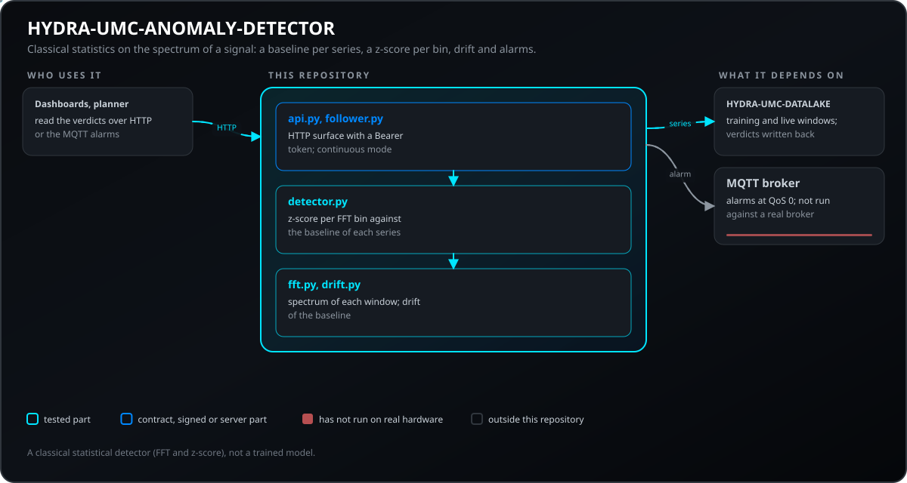
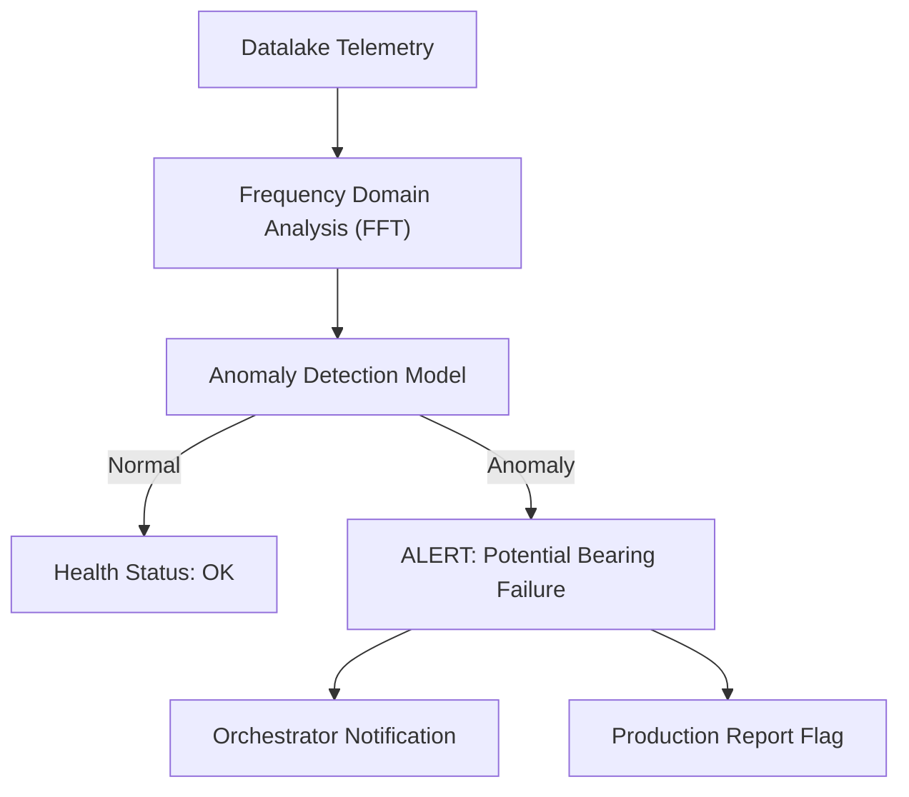
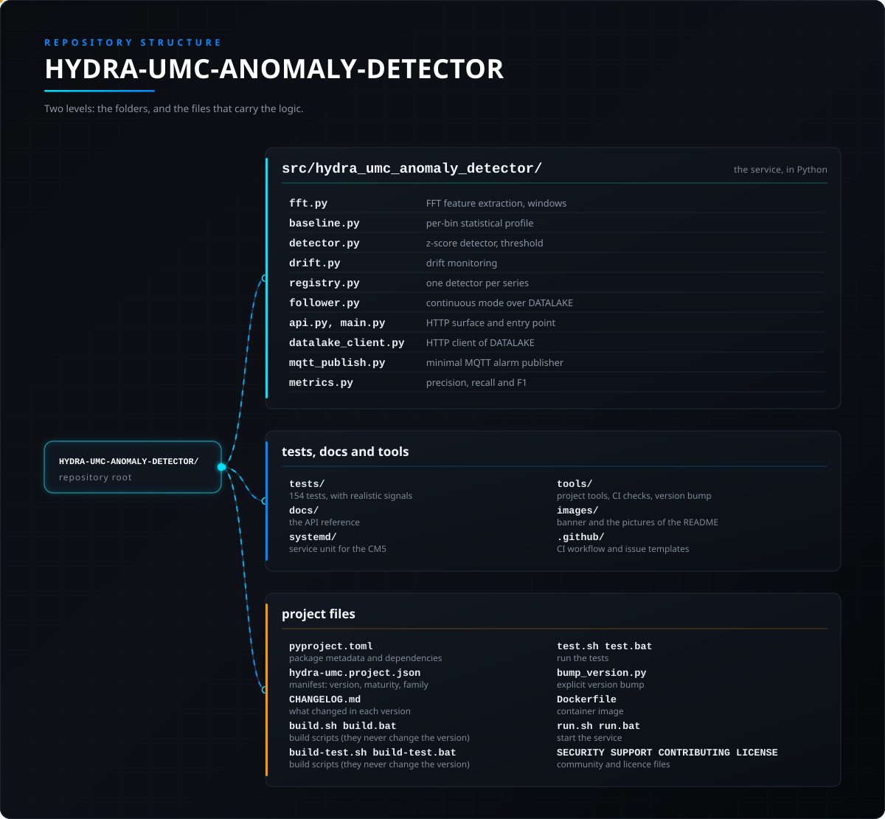

<!-- =============================================================================
HYDRA-UMC-ANOMALY-DETECTOR - Statistical anomaly detector
Copyright (C) JuanenRac (Electro Hobby 3D) <electrohobby3d@gmail.com>
GPL-3.0-or-later - see LICENSE
============================================================================= -->

<p align="center">
  
</p>

# 📈 HYDRA-UMC-ANOMALY-DETECTOR

<p align="center"><a href="README.md">🇺🇸 English</a> | <a href="README_spa.md">🇪🇸 Español</a> | <a href="README_fra.md">🇫🇷 Français</a> | <a href="README_ita.md">🇮🇹 Italiano</a> | <a href="README_deu.md">🇩🇪 Deutsch</a> | <a href="README_zho.md">🇨🇳 简体中文</a> | 🇯🇵 <b>日本語</b> | <a href="README_por.md">🇵🇹 Português</a></p>

### 🧠 統計的な異常検知とモーター振動分析(機械学習モデルは使用していません)

<p align="center">
  
  
  
  
  
  
</p>

---

> **誠実性チェック - 今日実際に動くもの:** FFT スペクトル（`fft.py`）、ビンごとの統計ベースライン（`baseline.py`）、max-z-score 異常検知器（`detector.py`）、ラベル付きフィクスチャ上での精度/再現率/F1 指標（`metrics.py`）、移動平均によるドリフト検知（`drift.py`）、本物の HYDRA-UMC-DATALAKE HTTP クライアント（`datalake_client.py`）、そして素の JSON/HTTP API（`api.py`）は本物であり、テスト済みである（87件のテストが通過：`pytest tests/` - `test_fft.py`、`test_baseline.py`、`test_detector.py`、`test_metrics.py`、`test_drift.py`、`test_datalake_client.py`、`test_api.py`）。以下の「AI-driven」および「Learning Models」は、健全と分かっているウィンドウから適合させた統計ベースラインを伴う本物の信号処理を指しており、学習済みのニューラルネットワークでも、バックグラウンドでの継続的な学習でもない：ベースラインは一度だけ適合され、起動時に本物の DATALAKE 履歴から、あるいは明示的な `POST /baseline/fit` 呼び出しによって適合し、次に明示的に再適合されるまでそのモデルバージョンのまま保たれる（`detector.py` 自身のモデルバージョン管理を参照）。以下の ROADMAP のフェーズ3・4（教師なし学習、音響解析）は完全に構想段階であり、本リポジトリにはどちらのコードもまだ存在しない。これまでに実際に出荷された内容は `CHANGELOG.md` を参照。

> **安全性とセキュリティの現状:** このエコシステムは認証された安全システムではありません。ハードウェアの E-STOP 経路、ファームウェアが強制する制限やインターロック、検証済みの動作コマンドはまだありません。ファームウェアイメージは CRC-32 と Ed25519 署名で検査し、リリースビルドは公開済みの開発用鍵を拒否します(リレーの先のツールヘッドと拡張ボードは引き続き URTC のブートローダーを使い、署名ではなく共有鍵の HMAC-SHA256 を使います)。TLS と相互 TLS は任意で、既定では無効です。独自基板はまだ実装も試験もされていません。ここに書かれた内容を人の安全のために頼る前に、[セキュリティベースライン](https://github.com/JuanenRac/HYDRA-UMC-DOCS/blob/main/docs/SECURITY_BASELINE.md)と[脅威モデル](https://github.com/JuanenRac/HYDRA-UMC-DOCS/blob/main/docs/THREAT_MODEL.md)をお読みください。

---

## 📋 ひと目で

| | |
|---|---|
| バージョン | `0.2.0` |
| 成熟度 | 機能する |
| テスト | 179 (`python -m pytest -q tests`) |
| 技術 | Python / FFT / statistical baseline detection |
| 対象 | HYDRA-UMC セルの Raspberry Pi CM5 |
| 実機での確認 | まだです：このバージョンについて実機での動作記録はありません |

**移動：** [概要](#-概要) · [アーキテクチャ](#-アーキテクチャ) · [機能](#-機能) · [セキュリティと安全](#-セキュリティと安全) · [インターフェース](#-インターフェース) · [設定](#-設定) · [クイックスタート](#-クイックスタート) · [テスト](#-テスト) · [トラブルシューティング](#-トラブルシューティング) · [リポジトリの構成](#-リポジトリの構成) · [関連プロジェクト](#-関連プロジェクト)

## 🚦 プロジェクトの状況

各行はこのリポジトリの一部分で、信号は今日どこまで進んでいるかを示します。計画ではなく、リポジトリが示せるもの（テスト、ビルド、実行）に基づいて書かれています。

🟢 完了・検証済み · 🟡 動作する（既知の制限あり） · 🟠 一部のみ、または未検証 · 🔴 未実装または動作しない

| 領域 | 状態 | ここでの意味 |
|---|---|---|
| ソフトウェア | 🟡 | 主な目的では動作します。足りない点は上の正直さの確認に書かれています |
| テスト | 🟢 | 自動テスト 179 件。変更のたびに実行されます |
| 実機 | 🔴 | まだです：このバージョンについて実機での動作記録はありません |
| ドキュメント | 🟢 | 8 言語の README。変更のたびにマニフェストと照合されます |

## 🎯 概要

**HYDRA-UMC-ANOMALY-DETECTOR** は、ロボットの健全性を守る積極的な守護者を目指しています。テレメトリのサンプル（振動、モーター電流の特徴、熱プロファイル）に FFT と統計的ベースライン（機械学習モデルは使用しません）を適用し、健全なベースラインからの逸脱を検知します。故障の予測はまだ行いません。

すべてのモーターとツールヘッドの「デジタル指紋」を監視し、軸受の摩耗、ベルトの緩み、冷却系の故障を数週間前から見つけて、緊急修理ではなく計画的な保守を可能にすることを目指しています(計画中:故障予測のコードはまだありません)。

## 🧩 HYDRA-UMC での役割

**HYDRA-UMC-ANOMALY-DETECTOR** は HYDRA-UMC-DATALAKE が保管するテレメトリを読み、以前と違う挙動の系列（鳴き始めたベアリング、ドリフトするドライブ）を見つけ、HTTP、データレイクへの書き戻し、MQTT 警報で知らせます。監視するだけで、機械に指令は出しません。

## 🏛️ アーキテクチャ

<p align="center">
  
</p>

<details>
<summary>図のテキスト版（Mermaid）</summary>



</details>

**この作りにした理由**

* **HYDRA-UMC-DATALAKE のサブモジュールではなく兄弟プロジェクトである理由。** 異常検知は、既に保存されたテレメトリに対する読み取り専用の分析ワークロードです——独立させておくことで、検出器のクラッシュや遅いモデル推論が、HYDRA-UMC-TELEMETRY-COLLECTOR による同じストアへの書き込みをブロックすることは決してありません。
* **今日は FFT + 統計的ベースラインであり、まだ学習済みニューラルネットワークではない理由。** README はこれを「AI 駆動」と呼んでいます——この最初のパスで本物であり実際に動いているのは、本物の信号処理技術(`src/hydra_umc_anomaly_detector/fft.py`、numpy 自体の FFT)に加え、既知の健全なウィンドウから学習した周波数ビンごとの統計的ベースライン(`baseline.py`)、そして max-z-score による判定(`detector.py`)です——学習済みのディープラーニングモデルではありません。実際に動作し、本プロジェクト自身の合成的な故障信号に対して実際にテストされており、後で学習モデルを構築する際の正しい土台です(下記の「ロードマップ」セクションを参照)——しかしここでニューラルネットワークと呼ぶと、実際に動いている内容を過大に評価することになります。
* **固定閾値ではなく、すべてのビンにわたる max-z-score である理由。** 固定閾値(「モーター温度 > 80°C」)は、緩やかなドリフトを見逃し、正当な負荷スパイクに誤警報を出します——ライブのスペクトルの各ビンを、この特定のモーター自体の学習済みの健全なベースラインと比較することで、新しい/シフトした周波数ピーク(本物の軸受欠陥の特徴)を、この 2 つの失敗モードのいずれも発生させずに検知できます。デフォルトの閾値(10.0)は、実際の経験的な分離度から選ばれたものであり、推測ではありません——実際の数値は、このプロジェクトの合成の健全 vs 故障テストフィクスチャの実データとして `detector.py` 自身の docstring を参照してください。
* **エコシステムの他の部分との関係。** HYDRA-UMC-DATALAKE の下の兄弟サービスです——HYDRA-UMC-TELEMETRY-COLLECTOR が既にそこに書き込んだテレメトリに対して異常検知を実行します。
* **`DriftMonitor` が `AnomalyDetector.score()` とは別のメカニズムであり、単に大きな閾値ではない理由。** 両者は異なる本物の問いに答えます——「このウィンドウが異常かどうか」(一回限りの判定)と、「直近の平均が静かにシフトしたかどうか」(単一のノイズの多い外れ値ウィンドウに対して頑健な、移動的な傾向)です。実際のシミュレートされたドリフトテストにより、この検出器の max-z-score 設計では、新しい周波数タイプの故障に対して、単一ウィンドウ自体のフラグが移動ドリフト信号よりも*先に*発火することが判明し、その事実が正直に文書化されています——ここでの `DriftMonitor` の本当の価値は、より早い警告ではなく持続的な傾向の確認であり、コード自体もそれを誇張せずそのように述べています。
* **`metrics.py` が閾値の品質を文章のままにせず precision/recall を計算する理由。** `detector.py` 自身の docstring は、以前は「健全なものは最大で約 5.3、故障のあるものは数百のスコアになる」としか主張していませんでした——本物ではありますが、将来の再調整に対して回帰テストできる数値ではありませんでした。同じ本物のフィクスチャに対する `precision_recall()` は、これに本物の、検証可能な値(現在は 1.0/1.0)を与えます。

## ✨ 機能

* **系列ごとに 1 つの検知器(`/detectors/{sourceId}/{kind}/{field}/...`)。** モーターと主軸は同じようには振動せず、共有のベースライン 1 つでは一方がもう一方を異常と判定していました。`POST /detectors/{sourceId}/{kind}/{field}/fit` はその系列(DATALAKE が保存するときの 3 つ組)のベースラインを学習し、`.../detect` はそれに対してウィンドウを採点し、`.../drift/init` と `.../drift/observe` は専用のドリフト監視を与え、`GET /detectors` は系列と学習済みかどうかを一覧します。系列は最初に成功した学習で作られ、最大 `--max-series`(64)件です。一度も学習していない系列の採点は `409` で、別のベースラインによる判定にはなりません。ある系列の学習が別の系列や共有のものに触れることはありません。書き込みは共有ベースラインと同じくトークンが必要で、採点もトークンが設定されている限り必要です（`--no-protect-reads` で開放）。`--baseline-dir` は系列ごとにベースラインを保存し、起動時に復元します。従来のルートは変わりません。*(実装済み、`tests/test_series.py` でテスト済み)*
* **読み取りは既定で保護されます（`--protect-reads`）。** トークンを設定すると、`POST /detect` も `Authorization: Bearer <token>` を要求します。ヘルスパスの `GET /stats` だけは開いたままです。トークンがある限りこれが既定です（`--no-protect-reads` または `HYDRA_UMC_ANOMALY_PROTECT_READS=0` で読み取りを開放、`HYDRA_UMC_ANOMALY_PROTECT_READS=1` はトークンなしでは起動を拒否）。トークンがない場合（ループバックのみ）は要求するものがありません。HYDRA-UMC-SERVER 経由で読む呼び出し元はすでにトークンを送っています。
* 🔍 **特徴分析：** モーター電流サンプルの FFT（高速フーリエ変換）による機械的不均衡の検知。*(実装済み)*
* 📉 **予知保全：** NEMA モーターと URTC 工具向けの RUL（残存有効寿命）推定——構想段階であり、本リポジトリにはまだこのためのコードは存在しない。
* 🚨 **早期警報システム：** Studio と Watch インターフェースに直接アラートを表示すること——構想段階であり、現状この検知器は自身の HTTP API で判定結果を公開し、常時モードでは DATALAKE の `anomaly_score` サンプルと MQTT メッセージとしても公開します。DASHBOARD-AI は HYDRA-UMC-SERVER 経由で読みます（同一オリジンなので CORS は不要）。Studio と Watch のインターフェースはまだそのアラームを表示しません。
* **常時サービスモード（`--follow-config FILE`）。** 設定した各系列を、DATALAKE から増えていくそばから読み、サンプリングが不規則な箇所で切り、その系列の検知器で完全な窓ごとに採点し、判定を種別 `anomaly_score` のサンプルとして書き戻します。`mqtt` を設定すると、系列の状態が変わったときに保持される状態メッセージを、異常な窓ごとにアラームを公開します。調整する値（系列、窓サイズ、間隔、トピック、ブローカー）はすべて JSON ファイルにあり、止まっている DATALAKE やブローカーは `GET /stats` で数えられるだけでループを止めません。*（実装済み。実物の HTTP DATALAKE 代役と実物の TCP ブローカー代役に対してテスト済みで、本物のサービスでは未実行）*
* 🧬 **ベースライン学習：** データレイクの実際の健全な履歴からその統計ベースラインを適合させる——バックグラウンドでの継続的な学習ではなく、要求されるたびに行われる本物の明示的な再適合である。*(実装済み)*
* 🏷️ **モデルバージョニング：** すべての `Verdict` は、実際に採点されたモデルバージョンと閾値を、単調増加する本物の値として保持します——リフィット（再学習）は本物の、追跡可能なイベントです。また、ベースラインを何個の正常ウィンドウで較正したかも報告するため、アラームを説明・再現できます。*(実装済み)*
* 📐 **精度/再現率メトリクス：** ラベル付きフィクスチャ(`metrics.py`)に基づいて計算された本物の precision/recall/F1 であり、スコアの分離についての文章による主張だけではありません。*(実装済み)*
* 📈 **シミュレートされたドリフト検知：** `DriftMonitor` は、個々のウィンドウ自体の異常フラグとは異なる、本物の持続的な移動平均の上昇を検知します。*(実装済み)*

ベースラインには健全なウィンドウが少なくとも 10 個必要で、標本標準偏差（`ddof=1`）を使います。警報のしきい値は変わらないため、本物の異常が隠れることはありません。以前に保存したベースラインはそのまま使えます。

## 🔒 セキュリティと安全

| 脅威 | 防御 | 場所 |
|---|---|---|
| 誰でもベースラインやドリフト状態を書き換えられる | 定数時間で比較される Bearer トークンが `/baseline/fit`・`/drift/init`・`/drift/observe` と `/detectors/...` の書き込みルートを守ります。トークン未設定なら API は開放です（ループバックの既定） | `api.py` |
| 他人のデータでの採点と巨大なボディ | `POST /detect` はトークンが設定されていれば要求します（`--no-protect-reads` または `HYDRA_UMC_ANOMALY_PROTECT_READS=0` で開放）。開放のままなのは `GET /stats` だけで、ボディは最大 1 MiB です | `api.py` |
| 多数の系列によるメモリ枯渇 | 系列ごとに 1 つの検知器で最大 64（`--max-series`）、識別子は `^[A-Za-z0-9][A-Za-z0-9._:-]{0,95}$` に一致。学習が読む点は最大 200 000（`--max-train-points`）で、API は既定で `127.0.0.1` を待ち受けます | `registry.py`, `main.py` |

**絶対にしないこと：** 古典的な統計検知器（FFT ビンごとの z スコア、既定のしきい値 10）であり、学習済みの AI モデルではなく、機械に指令を出すこともありません。

## 🔌 インターフェース

既定は `127.0.0.1:8097` の HTTP。詳しくは `docs/API.md` を参照してください。

| トピックまたはルート | 内容 |
|---|---|
| `POST /baseline/fit`, `POST /detect` | 信号のベースラインを学習し、窓をそれに対して採点 |
| `POST /drift/init`, `POST /drift/observe` | ドリフト監視の開始と入力 |
| `POST /detectors/{sourceId}/{kind}/{field}/...` | データレイクの 1 系列に対する同じ操作 |
| `GET /stats`, `GET /detectors` | 稼働状況と検知器の一覧 |
| `--follow-config FILE.json` | 連続モード：設定した各系列が増えるたびに読み（5 秒ごと、1 回に最大 20 窓）、判定を書き戻し、`hydra/anomaly` 以下に MQTT 警報を送ります |

`serve --legacy-baseline`（または `AnomalyDetector(legacy_baseline=True)`）は、2 ウィンドウと母標準偏差による以前の当てはめに戻します。既定ではオフです。

## ⚙️ 設定

| 変数 | 既定値 | 設定する内容 |
|---|---|---|
| `--addr`, `--port` | `127.0.0.1`, `8097` | HTTP API の待ち受け先 |
| `--sample-rate`, `--threshold` | `1000.0`, `10.0` | サンプリング周波数（Hz）、ビンが取りうる最大の z スコア |
| `--window`, `--window-size` | `none` | FFT の前に `none` か `hann`、窓あたりのサンプル数（`--datalake-url` と併用で必須） |
| `--datalake-url`, `--source-id`, `--kind`, `--field`, `--train-start`, `--train-end` | 未設定 | 起動時にデータレイクから新しいベースラインを作る（最初の 4 つはセット） |
| `--max-train-points`, `--max-series` | `200000`, `64` | 学習で読む最大点数、検知器の最大数 |
| `--token-file`, `HYDRA_UMC_ANOMALY_TOKEN` | トークンなし | API の Bearer トークン |
| `HYDRA_UMC_ANOMALY_PROTECT_READS` | トークンがあれば保護 | `0` で `POST /detect` を開放、`1` で保護 |
| `HYDRA_UMC_DATALAKE_INGEST_TOKEN`, `HYDRA_UMC_DATALAKE_TOKEN`, `HYDRA_UMC_DATALAKE_READ_TOKEN` | 未設定 | 検知器がデータレイクと話すためのトークン（または follow 設定の `ingestTokenFile`） |

## 🚀 クイックスタート

Python 3.10 以上と NumPy 1.24 以上が必要です（`pip install -e .` で入ります）。

```bash
bash run.sh        # Linux, macOS (run.bat on Windows)
python -m hydra_umc_anomaly_detector.main --datalake-url http://127.0.0.1:8095 --source-id press1 --kind vibration --field accel --window-size 1024
curl http://127.0.0.1:8097/stats
```

## 🧪 テスト

`python -m pytest -q tests` で自動テスト 179 件を実行します。現実的な信号、誤検知の確認、偽のデータレイクを使い、ハードウェアも外部ネットワークも不要です。

| テストファイル | テスト数 | 対象 |
|---|---|---|
| `test_fft.py`, `test_baseline.py`, `test_detector.py`, `test_drift.py`, `test_metrics.py` | - | スペクトル、ベースライン、z スコア、ドリフト、適合率/再現率 |
| `test_realistic_false_positives.py`, `realistic_signals.py`, `signal_fixtures.py` | - | 警報を出してはならない現実的な信号 |
| `test_api.py`, `test_series.py`, `test_follower.py`, `test_datalake_client.py`, `test_window_token_fetch.py` | - | HTTP の窓口、系列ごとの検知器、連続モード、偽のデータレイクに対するデータレイククライアント |

CI は `HYDRA_UMC_CI=1 python tools/ci_validate.py` を実行し、マニフェスト、文書、8 つの README、図を検査します。

## 🏗️ ビルドとリリース

Python >= 3.10 が必要です。コンパイルできるだけの骨組みではなく、
HTTP API を備えた本物の FFT ベースの異常検知です。

```bash
# Linux/macOS
./build.sh
./run.sh --port 8097

# Windows
build.bat
run.bat --port 8097
```

`build` はローカルの `.venv` を作成/アクティブ化し、パッケージを
(editable、`numpy` を含む dev 拡張込みで)その中にインストールし、
インポートを検証し、本物のテストスイート(`pytest`)を実行します。
`run` は HTTP API を起動し、すべてのフラグ(`--addr`、`--port`、
`--sample-rate`、`--threshold`、`--baseline-path`、
`--datalake-url`/`--source-id`/`--kind`/`--field`/`--window-size`)を
そのまま渡します。

既定ではどれも保守的な、さらに 3 つのオプション:`--window hann` は FFT の前に平均を除去してハン窓を掛けます(既定の `none` は従来の動作です。数値が変わるため、ベースラインは自分の窓を記憶し、別の窓で作られたものを検出器は復元を拒否し、Hann を信頼する前に実際の正常な記録で `--threshold` を再調整する必要があります)。DATALAKE から読む学習用履歴はページ単位(古い順)で読み、タイムスタンプの間隔が約 `1/sample-rate` でない箇所で分割し、重複するタイムスタンプを除きます。`--max-train-points` で止まった読み込みはそう報告します(`--train-start`/`--train-end` で範囲を指定)。`--token-file`(または `HYDRA_UMC_ANOMALY_TOKEN`)を指定すると `POST /baseline/fit`、`/drift/init`、`/drift/observe` が Bearer トークンを要求し、ループバック以外の `--addr` はトークンなしでは拒否されます。代用品に対してテスト済みで、実際の機械の記録には未実施です。

適合済みのベースラインは再起動を乗り越えられるようになり、配列を手で
貼り付ける代わりに実際の HYDRA-UMC-DATALAKE の履歴から適合させること
もできます:

```bash
# すべての適合結果をディスクに永続化し、次回起動時に自動的に復元する
./run.sh --port 8097 --baseline-path /var/lib/hydra-umc-anomaly-detector/baseline.npz

# 起動時に実際の DATALAKE 履歴から新しいベースラインを適合させ、それを永続化する
./run.sh --port 8097 --baseline-path baseline.npz \
  --datalake-url http://127.0.0.1:8095 --source-id motor-1 --kind vibration --field value --window-size 200
```

```bash
# 既知の健全な信号ウィンドウに対してキャリブレーションする(float の JSON 配列、--sample-rate と同じサンプルレート)
curl -X POST localhost:8097/baseline/fit -d '{"windows": [[...], [...], ...]}'

# フィットした baseline に対してライブウィンドウを採点する
curl -X POST localhost:8097/detect -d '{"window": [...]}'
# -> {"score": 6.3, "anomalous": false, "worstBinFreqHz": 276.0}

curl localhost:8097/stats
```

```bash
python -m pytest tests/ -v   # fft.py(既知の正弦波のピーク周波数が正しく
                              # 検出され、DC が本当に除外されることを検証)、
                              # baseline.py(正しい平均/標準偏差、ゼロ標準偏差
                              # の下限が本物のゼロ除算を防ぐことを検証)、
                              # detector.py(実際の約束：合成の故障信号が
                              # フラグ付けされ、健全に見える信号はされない、
                              # 際どい閾値ではなく本物の分離マージンを伴う)、
                              # そして api.py(本物の ThreadingHTTPServer に
                              # 対する本物の HTTP 往復テスト)
```

## 🩺 トラブルシューティング

| 表示 | 原因 | 対処 |
|---|---|---|
| `401` | API にトークンがあるのに、リクエストにないか誤っています | `Authorization: Bearer <token>` を送ります |
| `--window-size` is required | `--datalake-url` に窓サイズ・ソース・種類・フィールドが付いていません | `--source-id`・`--kind`・`--field`・`--window-size` を一緒に指定します |
| false alarms on a healthy machine | ベースラインのデータが少ない・代表的でない、またはしきい値が低すぎます | より長い正常期間で学習し（`--train-start`、`--train-end`）、`--window hann` を使い、`--threshold` を上げます |

## 📂 リポジトリの構成

<p align="center">
  
</p>

<details>
<summary>ツリーのテキスト版</summary>

```text
HYDRA-UMC-ANOMALY-DETECTOR/
├── src/hydra_umc_anomaly_detector/
│   ├── fft.py                                   FFT による特徴抽出、窓関数
│   ├── baseline.py                              ビンごとの統計プロファイル
│   ├── detector.py                              z スコア検知器としきい値
│   ├── drift.py                                 ドリフト監視
│   ├── registry.py                              系列ごとに 1 つの検知器
│   ├── follower.py                              DATALAKE 上の連続モード
│   ├── api.py main.py                           HTTP の窓口とエントリー
│   ├── datalake_client.py                       DATALAKE の HTTP クライアント
│   ├── mqtt_publish.py                          最小限の MQTT 警報発行
│   └── metrics.py                               適合率・再現率・F1
├── tests/                                       154 件（現実的な信号付き）
├── docs/                                        API リファレンス
├── systemd/                                     CM5 用のサービスユニット
├── tools/                                       ビルド・テスト実行、バージョン引き上げ、CI 検証、README と図の生成・検査
├── images/                                      バナーと README の図
├── .github/                                     CI ワークフローと Issue テンプレート
├── pyproject.toml                               パッケージのメタデータと依存関係
├── hydra-umc.project.json                       マニフェスト：バージョン・成熟度・ファミリー
├── CHANGELOG.md                                 各バージョンの変更点
├── build.sh build.bat                           ビルドスクリプト（バージョンは変えません）
├── build-test.sh build-test.bat                 ビルドスクリプト（バージョンは変えません）
├── test.sh test.bat                             テストを実行
├── bump_version.py / bump_manifest_version.py   明示的なバージョン引き上げ
├── Dockerfile                                   コンテナイメージ
├── run.sh run.bat                               サービスを起動
└── SECURITY.md SUPPORT.md CONTRIBUTING.md CODE_OF_CONDUCT.md LICENSE LICENSE.md
```

</details>

## 🗺️ ロードマップと既知の制限

**現時点の既知の制限**

* **フェーズ 1：** 履歴分析のためのデータレイクの高スループット取り込みとインデックス作成。
* **フェーズ 2：** テレメトリコレクターのエッジ圧縮と安全な送信プロトコル。
* **フェーズ 3：** 教師なし学習とモーター振動分析を用いた異常検知。
* **フェーズ 4：** 早期の機械的問題を「聞き取る」音響分析の統合と、AI 駆動の予測的インサイト。

## 🌍 言語

この README とリポジトリの文書は、英語・スペイン語・ドイツ語・フランス語・イタリア語・日本語・中国語・ポルトガル語（ポルトガル）の 8 言語で提供されています。8 つのファイルは同時に書かれ、同じ節と同じリンクを持つことを CI が確認します。 このリポジトリには独自の画面もメッセージカタログもないため、翻訳すべきインターフェース文字列はありません。

## 🔗 関連プロジェクト

本プロジェクトは、同じ作者(JuanenRac / Electro Hobby 3D)による HYDRA-UMC ロボティクスエコシステムの一部です。リクエストが実はこの中のどれかについてのものである可能性があるため、知っておく価値があります。

**親プロジェクト**
- **[HYDRA-UMC-DATALAKE](https://github.com/JuanenRac/HYDRA-UMC-DATALAKE)** — 実際の取り込み/クエリ HTTP API を備えた、実際の sqlite3 ベースの時系列ストア。本リポジトリは、その自身のデータ&分析レイヤー内における特定の分析サービスとして、この親の一部を成す。

**兄弟プロジェクト** —— HYDRA-UMC-DATALAKE 自身のデータ&分析レイヤーにおける他の分析サービス
- **[HYDRA-UMC-TELEMETRY-COLLECTOR](https://github.com/JuanenRac/HYDRA-UMC-TELEMETRY-COLLECTOR)** — シーケンス重複排除機能を備えた、DATALAKE への実際の CAN/WebSocket 取り込みパイプライン。
- **[HYDRA-UMC-PRODUCTION-REPORTS](https://github.com/JuanenRac/HYDRA-UMC-PRODUCTION-REPORTS)** — DATALAKE の履歴に対する実際の OEE/稼働率計算、再現可能な CSV エクスポート付き。

**直接関連**
- **[HYDRA-UMC-STUDIO](https://github.com/JuanenRac/HYDRA-UMC-STUDIO)** — リアルタイムのマルチロボット 3D 可視化を備えたウェブ制御ダッシュボード ——本検知器の実際の早期警告アラートを制御 UI に直接表示する。
- **[HYDRA-UMC-WATCH](https://github.com/JuanenRac/HYDRA-UMC-WATCH)** — 触覚アラートのパターンとペアリング済みスマートフォンへの音声リレーを備えた WearOS コンパニオンアプリ(物理的なウォッチではまだ実行していない) ——ロボットを操縦するのではなく、フリートの健全性を見守る人向けの同じアラートサーフェス。
- **[URTC](https://github.com/JuanenRac/URTC)** — 物理的な Universal Robot Tool Controller 基板向けファームウェア、CAN バス経由の 25 以上のツールプロファイル ——ここでの RUL(残存耐用寿命)推定は、アーム自体の NEMA モーターだけでなく URTC 自身のツールヘッドもカバーする。

**エコシステムの他のプロジェクト**

*コアハードウェア&プラットフォーム*
- **[HYDRA-UMC](https://github.com/JuanenRac/HYDRA-UMC)** — ロボットアームのマザーボードの設計——CM5 ホスト + デュアルコア STM32H745、CAN-OTA/SPI-OTA 経由で最大 8 本のツールアームを統括することを目指す(ファームウェアは初期段階で、実装済みの基板はまだない)。
- **[HYDRA-UMC-OS](https://github.com/JuanenRac/HYDRA-UMC-OS)** — CM5 向けの再現可能な Raspberry Pi OS プロダクト層——読み取り専用エージェント、検証済み設定/プロファイル、WiFi 初回接続プロビジョニング。
- **[HYDRA-UMC-SDK](https://github.com/JuanenRac/HYDRA-UMC-SDK)** — すべてのブリッジが自身のコマンドを検証する共有 JSON-Schema 契約とソフトウェアのジョブゲート境界(認証済みの安全機能ではない)。
- **[HYDRA-UMC-CONNECTOR-HUB](https://github.com/JuanenRac/HYDRA-UMC-CONNECTOR-HUB)** — 外部マシン用コネクタのための宣言的アダプターマニフェストのレジストリとバリデーター。SDK 自身の契約という発想を外部マシンにまで拡張し、産業用ゲートウェイ系のプロジェクトを置き換えることはありません。

*コアバックエンド&クライアント*
- **[HYDRA-UMC-SERVER](https://github.com/JuanenRac/HYDRA-UMC-SERVER)** — すべての制御クライアントが実際に通信する、本物のヘッドレスバックエンド(REST/WebSocket)。
- **[HYDRA-UMC-SUITE](https://github.com/JuanenRac/HYDRA-UMC-SUITE)** — 複数のサーバーを同時に扱えるデスクトップ(PySide6)スウォームコマンドセンター、スタンドアロン実行ファイルとしてパッケージ化。
- **[HYDRA-UMC-ANDROID-CONTROL](https://github.com/JuanenRac/HYDRA-UMC-ANDROID-CONTROL)** — 生体認証ログインとペアリングされた Wear OS コンパニオンを備えたネイティブ Android 制御アプリ。
- **[HYDRA-UMC-IOS-CONTROL](https://github.com/JuanenRac/HYDRA-UMC-IOS-CONTROL)** — リアルタイム WebSocket 同期を備えた iOS/iPadOS 制御アプリ(Flutter)。
- **[HYDRA-UMC-DSI](https://github.com/JuanenRac/HYDRA-UMC-DSI)** — 本体搭載の 7 インチ DSI タッチスクリーン向けネイティブタッチ UI、CM5 自体に組み込み。
- **[HYDRA-UMC-EDITOR-URDF](https://github.com/JuanenRac/HYDRA-UMC-EDITOR-URDF)** — 完成したモデルを STUDIO 自身のカタログへ送信するデスクトップ用グラフィカル URDF 作成/編集ツール。
- **[HYDRA-UMC-EDITOR-STL](https://github.com/JuanenRac/HYDRA-UMC-EDITOR-STL)** — HYDRA-UMC-EDITOR-URDF も編集する同じモデルカタログ内で、実在するパーツを変換/置換/削除/追加するデスクトップ STL モデルエディタ。
- **[HYDRA-UMC-BRIDGE-AMR](https://github.com/JuanenRac/HYDRA-UMC-BRIDGE-AMR)** — VDA 5050 MQTT パブリッシャーによる AGV/AMR フリートの調整境界(エミュレートしたフリートに対してのみテスト済み)。
- **[HYDRA-UMC-BRIDGE-CNC](https://github.com/JuanenRac/HYDRA-UMC-BRIDGE-CNC)** — GRBL ステータス/制御バイトへのアクセスを持つ、CNC セルの高レベルコーディネーター(エミュレーターに対してのみテスト済み)。
- **[HYDRA-UMC-BRIDGE-DROIDS](https://github.com/JuanenRac/HYDRA-UMC-BRIDGE-DROIDS)** — Boston Dynamics Spot コマンド送信機能を持つ、脚型/ヒューマノイドドロイドの調整境界(エミュレーターに対してのみテスト済み)。
- **[HYDRA-UMC-BRIDGE-LASER](https://github.com/JuanenRac/HYDRA-UMC-BRIDGE-LASER)** — キー/筐体/インターロックの GPIO 信号 3 系統を読み取るレーザーセルのコーディネーター(模擬チップに対してのみテスト済み。レーザーの武装や発射はできない)。
- **[HYDRA-UMC-BRIDGE-OPENPNP](https://github.com/JuanenRac/HYDRA-UMC-BRIDGE-OPENPNP)** — OpenPnP ピックアンドプレースの基板フローを安全に統括する高レベルコーディネーター。
- **[HYDRA-UMC-BRIDGE-PRINTER3D](https://github.com/JuanenRac/HYDRA-UMC-BRIDGE-PRINTER3D)** — 実際にゲート制御されたジョブコマンドを持つ、Moonraker/Klipper 3D プリンター向けの安全な調整境界。
- **[HYDRA-UMC-BRIDGE-ROS2](https://github.com/JuanenRac/HYDRA-UMC-BRIDGE-ROS2)** — 遅延インポートの rclpy ROS 2 トランスポートを持つコーディネーター(ROS 2 環境ではまだ実行していない)。
- **[HYDRA-UMC-BRIDGE-UAV](https://github.com/JuanenRac/HYDRA-UMC-BRIDGE-UAV)** — MAVLink コマンド送信機能を持つ、カメラ搭載 UAV の調整境界(エミュレーターに対してのみテスト済み)。

*URTC ツールプラットフォーム*
- **[URTC-FLASHER](https://github.com/JuanenRac/URTC-FLASHER)** — URTC 基板用のデスクトップ GUI 書き込みツール、CAN-OTA およびフルチップ SWD/JTAG。
- **[URTC-TESTER](https://github.com/JuanenRac/URTC-TESTER)** — URTC 基板向けのデスクトップ CAN バスライブ診断ツール、ツールプロファイルごとに 1 パネル。
- **[URTC-WEB-STUDIO](https://github.com/JuanenRac/URTC-WEB-STUDIO)** — Web Serial API を使ったブラウザベースの URTC-TESTER の代替、ローカルインストール不要。
- **[URTC-GATEWAY](https://github.com/JuanenRac/URTC-GATEWAY)** — URTC の CAN バスの前に置くゲートウェイ：許可する識別子のリスト、レート制限、セッション鍵。コンピューター上でテスト済みで、実際のバスではまだ試していません。

*ビジョン AI ノード(Hailo-8)*
- **[HYDRA-UMC-VISION-NODE](https://github.com/JuanenRac/HYDRA-UMC-VISION-NODE)** — Hailo-8 ビジョンパイプラインの統合ハブ、段階ごとの実際のハードウェア準備状況チェック付き。
- **[HYDRA-UMC-DETECTION-HEF](https://github.com/JuanenRac/HYDRA-UMC-DETECTION-HEF)** — Hailo アーキテクチャ/チェックサムによる安全読み込み検証を備えた、実際のコンパイル済みモデルレジストリ。
- **[HYDRA-UMC-VISION-STREAMER](https://github.com/JuanenRac/HYDRA-UMC-VISION-STREAMER)** — 実際の HailoRT 統合境界を持つ、実際の GStreamer パイプライン + MediaMTX 設定生成器。
- **[HYDRA-UMC-VISUAL-SERVOING-API](https://github.com/JuanenRac/HYDRA-UMC-VISUAL-SERVOING-API)** — ゾーン状態を条件に承認する Position-Based Visual Servoing 補正則。カメラによる姿勢推定はまだない。
- **[HYDRA-UMC-SAFETY-ZONES](https://github.com/JuanenRac/HYDRA-UMC-SAFETY-ZONES)** — ファイルから物体位置を受け取る、ゾーン侵入・キャリブレーション鮮度・E-STOP 要求の v0 ロジック。検出器は接続されておらず、物理 E-STOP もまだ配線されていない。

*コグニティブ AI ノード(Hailo-10)*
- **[HYDRA-UMC-COGNITIVE-NODE](https://github.com/JuanenRac/HYDRA-UMC-COGNITIVE-NODE)** — Hailo-10 コグニティブパイプライン(LLM/VLA/音声オーケストレーション)の統合ハブ。
- **[HYDRA-UMC-VLA-ENGINE](https://github.com/JuanenRac/HYDRA-UMC-VLA-ENGINE)** — Vision-Language-Action モデル向けの、実際のアクショントークンのエンコード/デコードと軌道生成。
- **[HYDRA-UMC-VOICE-UI](https://github.com/JuanenRac/HYDRA-UMC-VOICE-UI)** — 確認ゲート付きの限定的な Watch リレーを備えた、実際の音声フロントエンド(VAD + 意図解析)。
- **[HYDRA-UMC-SEMANTIC-PLANNER](https://github.com/JuanenRac/HYDRA-UMC-SEMANTIC-PLANNER)** — MCU エラーコードに対する、実際のルールベースのタスク分解と意味的エラー復旧。
- **[HYDRA-UMC-DOCS-QA](https://github.com/JuanenRac/HYDRA-UMC-DOCS-QA)** — このエコシステム自身の Markdown ドキュメントに対する、標準ライブラリのみの実際の TF-IDF 文書検索。
- **[HYDRA-UMC-LOCAL-TECHNICIAN](https://github.com/JuanenRac/HYDRA-UMC-LOCAL-TECHNICIAN)** — エコシステム自身のための、ローカルでポリシーゲート付きのAIメンテナンス技術者 — 観察、診断し、修正を提案する;最上位の2つのリスクレベルは意図的にまだ実装されていない。

*オーケストレーション&スウォーム*
- **[HYDRA-UMC-ORCHESTRATOR](https://github.com/JuanenRac/HYDRA-UMC-ORCHESTRATOR)** — 実際の gRPC/Protobuf ヘルスレポート契約とミッションステートマシンを持つ統合ハブ。
- **[HYDRA-UMC-JOB-DISPATCHER](https://github.com/JuanenRac/HYDRA-UMC-JOB-DISPATCHER)** — 実際の HTTP API 上に構築された、優先度ベースの実際のジョブキュー(重複排除付き)。
- **[HYDRA-UMC-NODE-HEALING](https://github.com/JuanenRac/HYDRA-UMC-NODE-HEALING)** — リトライ/バックオフとアイデンティティ不一致検出を備えた、実際の gRPC ベースのフリートヘルスウォッチドッグ。
- **[HYDRA-UMC-PATH-PLANNER-3D](https://github.com/JuanenRac/HYDRA-UMC-PATH-PLANNER-3D)** — 実際の障害物/ワークスペース衝突検証を備えた、実際の RRT ベースの 3D 経路プランナー。
- **[HYDRA-UMC-SWARM-SYNC](https://github.com/JuanenRac/HYDRA-UMC-SWARM-SYNC)** — 複数セルの収束についてプロパティテストされた、実際の CRDT LWW-Element-Map 状態同期。

*デジタルツイン&シミュレーション*
- **[HYDRA-UMC-TWIN](https://github.com/JuanenRac/HYDRA-UMC-TWIN)** — 実際のバージョン互換性同期契約を持つ、デジタルツインエンジンの統合ハブ。
- **[HYDRA-UMC-HIL-BRIDGE](https://github.com/JuanenRac/HYDRA-UMC-HIL-BRIDGE)** — シミュレーションと実機の間にソフトウェアの衝突インターロックを備えたハードウェア・イン・ザ・ループのルーター(実機なしでテスト済み)。
- **[HYDRA-UMC-PHYSICS-REPLICA](https://github.com/JuanenRac/HYDRA-UMC-PHYSICS-REPLICA)** — 実際の URDF サブセットに対する、実際の順運動学と関節限界検証。
- **[HYDRA-UMC-SYNTHETIC-DATA-GEN](https://github.com/JuanenRac/HYDRA-UMC-SYNTHETIC-DATA-GEN)** — YOLO/COCO アノテーションのエクスポート機能を持つ、実際のプロシージャル 2D シーンジェネレーター。

*産業用ゲートウェイ*
- **[HYDRA-UMC-GATEWAY-INDUSTRIAL](https://github.com/JuanenRac/HYDRA-UMC-GATEWAY-INDUSTRIAL)** — 実際のコマンド許可リスト/バックプレッシャー層を持つ、産業用プロトコルへ中継する統合ハブ。
- **[HYDRA-UMC-OPCUA-SERVER](https://github.com/JuanenRac/HYDRA-UMC-OPCUA-SERVER)** — 実際のバイナリプロトコルクライアントセッションで検証された、実際の OPC-UA アドレス空間。
- **[HYDRA-UMC-MQTT-BROKER](https://github.com/JuanenRac/HYDRA-UMC-MQTT-BROKER)** — クライアント単位のオプション認証とトピック ACL を備えた、実際の MQTT ブローカー。
- **[HYDRA-UMC-MTCONNECT-ADAPTER](https://github.com/JuanenRac/HYDRA-UMC-MTCONNECT-ADAPTER)** — 縮退モード出力を備えた、実際の MTConnect `/probe` および `/current` XML エンドポイント。

*補完ツール&エコシステム運用*
- **[HYDRA-UMC-DASHBOARD-AI](https://github.com/JuanenRac/HYDRA-UMC-DASHBOARD-AI)** — 誠実な統計フォールバックを備えた、DATALAKE/ANOMALY-DETECTOR 上のスマートサマリーと異常ハイライトパネル。
- **[HYDRA-UMC-TOOL-CLI](https://github.com/JuanenRac/HYDRA-UMC-TOOL-CLI)** — 実際の安定した終了コード契約を持つフリート CLI、HYDRA-UMC-SERVER 自身の API の本物のライブクライアント。
- **[URTC-SMART-RACK](https://github.com/JuanenRac/URTC-SMART-RACK)** — 実際の工具 ID デコードと Smart Idle 予熱ロジックを備えた、基板搭載ラック用ファームウェア。
- **[URTC-VISION-TOOL](https://github.com/JuanenRac/URTC-VISION-TOOL)** — サーマル/RGB 検査ツールヘッド向けの、ファームウェアと実際の Python ビジョンコンパニオン。
- **[HYDRA-UMC-UPDATER](https://github.com/JuanenRac/HYDRA-UMC-UPDATER)** — このエコシステム内のすべてのリポジトリを検出・クローン・更新する、管理用デスクトップツール。
- **[HYDRA-UMC-OS-REBUILDER](https://github.com/JuanenRac/HYDRA-UMC-OS-REBUILDER)** — エコシステムの最新バージョンをプリロードした、書き込み可能なCM5イメージを構築するWindows/Linuxデスクトップツール。Raspberry Pi Imager方式の初回起動Wi-Fi/ユーザー/SSH設定を備える。
- **[HYDRA-UMC-OPS-AGENT](https://github.com/JuanenRac/HYDRA-UMC-OPS-AGENT)** — 保守インシデントコーディネーター: 低権限のエッジ役割がサニタイズされたインベントリ/ヘルスのスナップショットを収集し、コントロールプレーン役割がそれを読み取り専用でレンダリングして AI プロバイダーに診断の提案を依頼します - パッチを適用することも、何かをデプロイすることも決してありません。
- **[HYDRA-UMC-DEV-SERVER](https://github.com/JuanenRac/HYDRA-UMC-DEV-SERVER)** — 再現可能な開発ホスト（Raspberry Pi 5 / CM5）。エコシステムのソースコードを保管し、永続キューのもとで境界の明確なビルド/テストタスクを実行する。運用中の CM5 とは明確に異なる、開発専用の役割。

## 📚 ドキュメント

さらに読むには：

* [docs/API.md](docs/API.md) - 各ルート、トークンの規則、エラー
* [エコシステムのセキュリティ基準](https://github.com/JuanenRac/HYDRA-UMC-DOCS/blob/main/docs/SECURITY_BASELINE.md)
* [エコシステムの脅威モデル](https://github.com/JuanenRac/HYDRA-UMC-DOCS/blob/main/docs/THREAT_MODEL.md)
* [このリポジトリの変更履歴](CHANGELOG.md)
* [このリポジトリのライセンス](LICENSE.md)

## 🤝 コントリビュートとコミュニティ

* プルリクエストの前に `HYDRA_UMC_CI=1 py -3 tools/ci_validate.py`（または `HYDRA_UMC_CI=1 python3 tools/ci_validate.py`）を実行してください。`CI_VALIDATION=PASS` と表示される必要があります。この確認に `build.sh` や `build.bat` は使わないでください。ビルドは検査ではありません。
* 8 つの README は HYDRA-UMC-DOCS の 1 つのソースから書かれます。手で編集しないでください。ソースを変更し、`tools/make_readmes.py` で書き直します。
* 実行していないことを README に書かないでください。事実であれば「シミュレーションのみ」「実機では未確認」と書きます。
* [CONTRIBUTING.md](CONTRIBUTING.md)、[行動規範](CODE_OF_CONDUCT.md)、[SECURITY.md](SECURITY.md)、[SUPPORT.md](SUPPORT.md) を参照してください。

## 👤 作者

**JuanenRac (Electro Hobby 3D)** · electrohobby3d@gmail.com

## 📜 ライセンス

GPL-3.0-or-later - [LICENSE](LICENSE).
