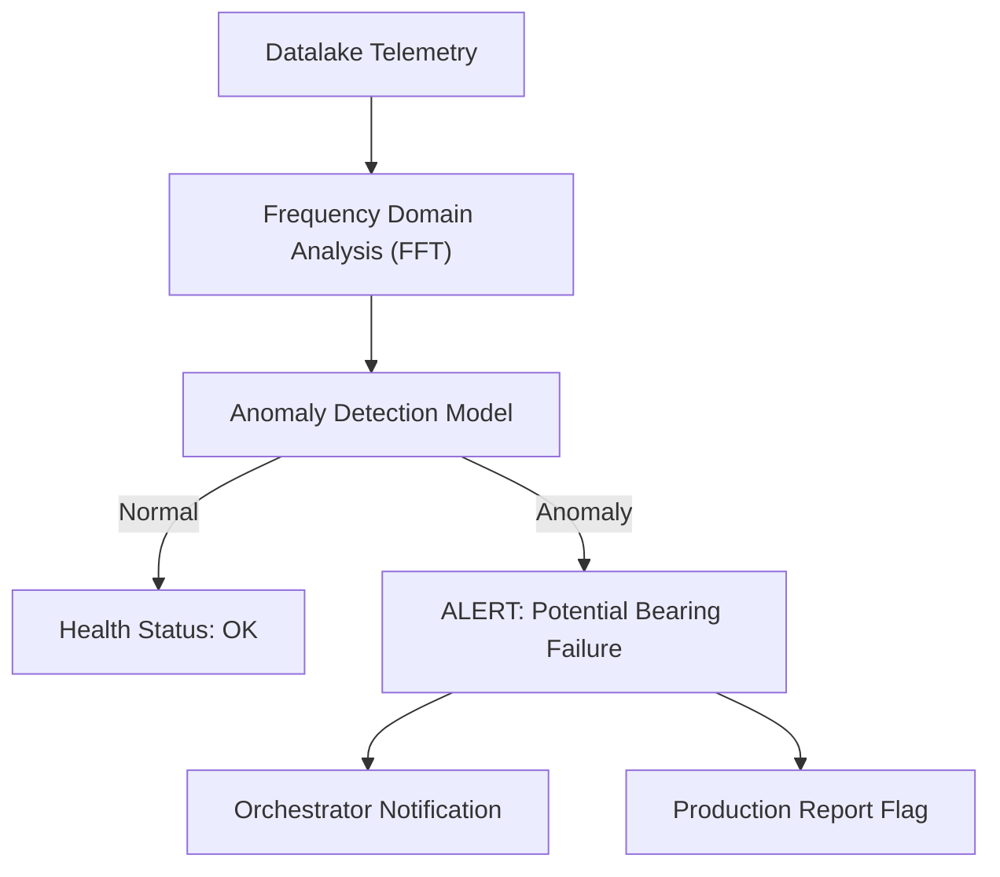

<!-- =============================================================================
HYDRA-UMC-ANOMALY-DETECTOR - Statistical anomaly detector
Copyright (C) JuanenRac (Electro Hobby 3D) <electrohobby3d@gmail.com>
GPL-3.0-or-later - see LICENSE
============================================================================= -->

<p align="center">
  
</p>

# 📈 HYDRA-UMC-ANOMALY-DETECTOR

<p align="center"><a href="README.md">🇺🇸 English</a> | <a href="README_spa.md">🇪🇸 Español</a> | <a href="README_fra.md">🇫🇷 Français</a> | <a href="README_ita.md">🇮🇹 Italiano</a> | <a href="README_deu.md">🇩🇪 Deutsch</a> | <a href="README_zho.md">🇨🇳 简体中文</a> | <a href="README_jpn.md">🇯🇵 日本語</a> | 🇵🇹 <b>Português</b></p>

### 🧠 Deteção estatística de anomalias e análise de vibração de motores (sem modelo de aprendizagem automática)

<p align="center">
  
  
  
  
  
  
</p>

---

> **Verificação de honestidade - o que realmente funciona hoje:** o espetro FFT (`fft.py`), a linha de base estatística por faixa (`baseline.py`), o detetor de anomalias por z-score máximo (`detector.py`), as métricas de precisão/recuperação/F1 sobre um conjunto etiquetado (`metrics.py`), a deteção de deriva por média móvel (`drift.py`), o cliente HTTP real do HYDRA-UMC-DATALAKE (`datalake_client.py`) e a API JSON/HTTP simples (`api.py`) são reais e testados (87 testes a passar: `pytest tests/` - `test_fft.py`, `test_baseline.py`, `test_detector.py`, `test_metrics.py`, `test_drift.py`, `test_datalake_client.py`, `test_api.py`). "Com IA" e "Modelos de aprendizagem" abaixo descrevem processamento de sinal real mais uma linha de base estatística ajustada a partir de janelas conhecidas como saudáveis - não uma rede neuronal treinada, nem aprendizagem contínua em segundo plano: uma linha de base ajusta-se uma vez, no arranque a partir do histórico real do DATALAKE ou através de uma chamada explícita a `POST /baseline/fit`, e mantém-se exatamente nessa versão do modelo até ao ajuste explícito seguinte (veja o próprio versionamento de modelos do `detector.py`). As Fases 3 e 4 do ROTEIRO abaixo (aprendizagem não supervisionada, análise acústica) são totalmente aspiracionais - não existe código para nenhuma delas neste repositório. Veja o `CHANGELOG.md` para saber exatamente o que foi entregue até agora.

> **Estado de segurança (safety e security):** este ecossistema não é um sistema de segurança certificado. Ainda não existe um caminho de E-STOP por hardware, nem limites ou interlocks impostos pelo firmware, nem um comando de movimento verificado; as imagens de firmware são verificadas com CRC-32 e uma assinatura Ed25519, e uma compilação de versão recusa as chaves de desenvolvimento publicadas (as cabeças de ferramenta e as placas de expansão atrás do relé ainda usam os bootloaders do URTC, que aceitam um HMAC-SHA256 de chave partilhada em vez de uma assinatura); TLS e TLS mútuo são opcionais e estão desativados por defeito; nenhuma placa própria foi ainda montada ou testada. Leia a [base de segurança](https://github.com/JuanenRac/HYDRA-UMC-DOCS/blob/main/docs/SECURITY_BASELINE.md) e o [modelo de ameaças](https://github.com/JuanenRac/HYDRA-UMC-DOCS/blob/main/docs/THREAT_MODEL.md) antes de confiar em qualquer afirmação aqui para a segurança de uma pessoa.

---

## 📋 Num relance

| | |
|---|---|
| Versão | `0.2.0` |
| Maturidade | Funcional |
| Testes | 179 (`python -m pytest -q tests`) |
| Tecnologia | Python / FFT / statistical baseline detection |
| Destino | O Raspberry Pi CM5 de uma célula HYDRA-UMC |
| Em hardware real | Ainda não: não há registo de execução em hardware real para esta versão |

**Ir para:** [Visão geral](#-visão-geral) · [Arquitetura](#-arquitetura) · [Funcionalidades](#-funcionalidades) · [Segurança e proteção](#-segurança-e-proteção) · [Interfaces](#-interfaces) · [Configuração](#-configuração) · [Início rápido](#-início-rápido) · [Testes](#-testes) · [Resolução de problemas](#-resolução-de-problemas) · [Estrutura do repositório](#-estrutura-do-repositório) · [Projetos relacionados](#-projetos-relacionados)

## 🚦 Estado do projeto

Cada linha é uma parte deste repositório e a luz diz até onde chega hoje. É escrita com o que o repositório consegue demonstrar (testes, compilações, execuções), não com o que está previsto.

🟢 Feito e verificado · 🟡 Funciona, com limites conhecidos · 🟠 Feito a meio ou ainda por verificar · 🔴 Por fazer ou a não funcionar

| Área | Estado | O que significa aqui |
|---|---|---|
| Software | 🟡 | Funciona para o seu propósito principal; a verificação de honestidade acima lista o que ainda falta |
| Testes | 🟢 | 179 testes automáticos, executados a cada alteração |
| Hardware real | 🔴 | Ainda não: não há registo de execução em hardware real para esta versão |
| Documentação | 🟢 | README em oito idiomas, verificado contra o manifesto a cada alteração |

## 🎯 Visão geral

O **HYDRA-UMC-ANOMALY-DETECTOR** destina-se a ser o guardião proativo da saúde robótica. Aplica uma FFT e uma linha de base estatística (sem modelo de aprendizagem automática) a amostras de telemetria (vibrações, assinaturas de corrente dos motores e perfis térmicos) e assinala desvios face a uma linha de base saudável; ainda não prevê falhas.

O objetivo é monitorizar a "impressão digital" de cada motor e cabeça de ferramenta para poder identificar desgaste de rolamentos, correias soltas ou falhas de arrefecimento com semanas de antecedência, permitindo uma manutenção programada em vez de reparações de emergência (previsto: ainda não existe código de previsão de falhas).

## 🧩 Papel no HYDRA-UMC

O **HYDRA-UMC-ANOMALY-DETECTOR** lê a telemetria que o HYDRA-UMC-DATALAKE guarda, encontra as séries que já não se comportam como antes (um rolamento que começa a cantar, um acionamento que deriva) e di-lo por HTTP, de volta no data lake e como alarmes MQTT. Vigia; nunca comanda uma máquina.

## 🏛️ Arquitetura

<p align="center">
  
</p>

<details>
<summary>Versão em texto do diagrama (Mermaid)</summary>



</details>

**Porque é construído assim**

* **Porque é um irmão, e não um submódulo, do HYDRA-UMC-DATALAKE.** A deteção de anomalias é uma carga de análise só de leitura sobre telemetria já armazenada - mantê-la separada significa que uma falha do detetor ou uma inferência lenta do modelo nunca bloqueia as escritas do próprio HYDRA-UMC-TELEMETRY-COLLECTOR no mesmo armazém.
* **Porque FFT + uma linha de base estatística hoje, e ainda não uma rede neuronal treinada.** O README chama-lhe "com IA" - o que é real e está a ser entregue nesta primeira passagem é uma técnica legítima e real de processamento de sinal (`src/hydra_umc_anomaly_detector/fft.py`, a própria FFT do numpy) mais uma linha de base estatística por faixa de frequência aprendida de janelas conhecidas como saudáveis (`baseline.py`) e um veredicto por z-score máximo (`detector.py`) - não um modelo de aprendizagem profunda treinado. Funciona, está testado contra assinaturas de falha sintéticas reais e é a base certa sobre a qual um modelo aprendido será construído mais tarde (veja a secção ROTEIRO abaixo) - mas chamar-lhe rede neuronal aqui exageraria o que realmente está a correr.
* **Porque um z-score máximo em todas as faixas e não um limiar fixo.** Um limiar fixo ("temperatura do motor > 80 °C") falha a deriva gradual e dá alarmes falsos em picos legítimos de carga - comparar cada faixa do espetro EM DIRETO com a linha de base saudável APRENDIDA deste motor específico apanha um pico de frequência novo/deslocado (uma assinatura real de defeito de rolamento) sem nenhum dos dois modos de falha. O corte por omissão (10,0) foi escolhido a partir de uma separação empírica real, não adivinhado - veja a docstring do próprio `detector.py` para os números reais dos conjuntos de teste sintéticos saudável-contra-defeituoso deste projeto.
* **Como isto se encaixa no resto do ecossistema.** Um serviço irmão sob o HYDRA-UMC-DATALAKE - executa a deteção de anomalias sobre a telemetria que o HYDRA-UMC-TELEMETRY-COLLECTOR já escreveu lá.
* **Porque o `DriftMonitor` é um mecanismo separado do `AnomalyDetector.score()` e não um limiar maior.** Respondem a perguntas reais diferentes: "ESTA janela é anómala" (um veredicto pontual) contra "a média RECENTE mudou discretamente" (uma tendência móvel, robusta a uma janela atípica ruidosa). Um teste real de deriva simulada descobriu e documenta honestamente que, para o desenho de z-score máximo deste detetor, a marca da própria janela individual dispara *antes* do sinal de deriva móvel para uma falha de tipo frequência nova - o valor real do `DriftMonitor` aqui é a confirmação de uma tendência sustentada, não um aviso mais precoce, e o código di-lo em vez de o vender em excesso.
* **Porque o `metrics.py` calcula precisão/recuperação em vez de deixar a qualidade do limiar como prosa.** A docstring do próprio `detector.py` só afirmava "o saudável pontuou até ~5,3, o defeituoso pontuou na casa das centenas" - real, mas não um número contra o qual um reajuste futuro possa testar regressões. O `precision_recall()` sobre o mesmo conjunto real dá-lhe um valor real e verificável (1,0/1,0 hoje).

## ✨ Funcionalidades

* **Um detetor por série (`/detectors/{sourceId}/{kind}/{field}/...`).** Um motor e um fuso não vibram da mesma maneira, e uma única linha de base partilhada chamava anómalo ao outro. `POST /detectors/{sourceId}/{kind}/{field}/fit` ajusta a linha de base dessa série (o trio sob o qual o DATALAKE a guarda), `.../detect` pontua uma janela contra ela, `.../drift/init` e `.../drift/observe` dão-lhe o seu próprio monitor de deriva, e `GET /detectors` lista as séries e se cada uma está ajustada. Uma série é criada pelo seu primeiro ajuste bem-sucedido e há no máximo `--max-series` (64); pontuar uma série nunca ajustada dá `409`, nunca um veredicto de outra linha de base; ajustar uma série nunca toca noutra nem na partilhada. Escrever exige o token como a linha de base partilhada, pontuar também sempre que há um token (`--no-protect-reads` deixa-o aberto). `--baseline-dir` guarda uma linha de base por série e restaura-as no arranque. As rotas originais não mudam. *(implementado, testado em `tests/test_series.py`)*
* **As leituras são protegidas por omissão (`--protect-reads`).** Com um token definido, `POST /detect` também exige `Authorization: Bearer <token>`; só `GET /stats`, o caminho de saúde, fica aberto. É o comportamento por omissão sempre que há um token (`--no-protect-reads` ou `HYDRA_UMC_ANOMALY_PROTECT_READS=0` deixam as leituras abertas; `HYDRA_UMC_ANOMALY_PROTECT_READS=1` recusa arrancar sem token). Sem token (só loopback) não há nada a exigir. Os chamadores que leem através do HYDRA-UMC-SERVER já enviam o token.
* 🔍 **Análise de assinatura:** FFT (Transformada Rápida de Fourier) de amostras da corrente dos motores para detetar desequilíbrio mecânico. *(implementado)*
* 📉 **Manutenção preditiva:** estimativa da RUL (vida útil restante) para motores NEMA e ferramentas URTC - aspiracional, ainda não existe código para isto neste repositório.
* 🚨 **Sistema de alerta precoce:** apresentar alertas diretamente nas interfaces do Studio e do Watch - aspiracional; hoje o detetor expõe os seus veredictos pela sua própria API HTTP e, em modo contínuo, como amostras `anomaly_score` no DATALAKE e como mensagens MQTT. O DASHBOARD-AI lê-o através do HYDRA-UMC-SERVER (mesma origem, pelo que não é preciso CORS); as interfaces do Studio e do Watch ainda não mostram os seus alarmes.
* **Modo de serviço contínuo (`--follow-config FICHEIRO`).** Lê cada série configurada do DATALAKE à medida que cresce, corta-a onde a amostragem é irregular, pontua cada janela completa com o detetor dessa série, escreve o veredicto de volta como amostra do tipo `anomaly_score` e, com `mqtt` configurado, publica uma mensagem de estado retida quando uma série muda de estado e um alarme por cada janela anómala. Tudo o que se afina (séries, tamanho da janela, intervalo, tópicos, broker) está no ficheiro JSON; um DATALAKE ou broker em baixo é contado em `GET /stats` e nunca pára o ciclo. *(implementado; testado contra um DATALAKE HTTP de substituição real e um broker TCP de substituição real, nunca executado contra os serviços verdadeiros)*
* 🧬 **Aprendizagem da linha de base:** ajusta a sua linha de base estatística a partir do próprio histórico conhecido como saudável do Datalake - não é aprendizagem contínua em segundo plano, mas um reajuste real e explícito sempre que é pedido. *(implementado)*
* 🏷️ **Versionamento de modelos:** cada `Verdict` transporta a versão real e monótona do modelo e o limiar contra os quais foi avaliado - um reajuste é um acontecimento real e rastreável. Reporta também com quantas janelas saudáveis a linha de base foi calibrada, para que um alarme possa ser explicado e reproduzido. *(implementado)*
* 📐 **Métricas de precisão/recuperação:** precisão/recuperação/F1 reais e calculados sobre um conjunto etiquetado (`metrics.py`), e não apenas afirmações em prosa sobre a separação das pontuações. *(implementado)*
* 📈 **Deteção simulada de deriva:** o `DriftMonitor` assinala uma elevação real e sustentada da média móvel, distinta da própria marca de anomalia de qualquer janela individual. *(implementado)*

Uma linha de base precisa de pelo menos dez janelas saudáveis e usa o desvio-padrão amostral (`ddof=1`); o limiar de alarme não muda, por isso uma anomalia real não fica escondida. As linhas de base guardadas antes continuam a funcionar tal como estão.

## 🔒 Segurança e proteção

| Ameaça | Defesa | Onde |
|---|---|---|
| Qualquer pessoa a reescrever uma linha de base ou o estado de deriva | Um token Bearer, comparado em tempo constante, protege `/baseline/fit`, `/drift/init`, `/drift/observe` e as rotas de escrita de `/detectors/...`; sem token configurado a API fica aberta (a predefinição em loopback) | `api.py` |
| Pontuar com dados alheios e um corpo enorme | `POST /detect` pede o token quando há um configurado (`--no-protect-reads` ou `HYDRA_UMC_ANOMALY_PROTECT_READS=0` abre-o); só `GET /stats` fica aberto; um corpo tem no máximo 1 MiB | `api.py` |
| Muitas séries a esgotar a memória | Um detetor por série, no máximo 64 (`--max-series`), com identificadores que cumprem `^[A-Za-z0-9][A-Za-z0-9._:-]{0,95}$`; o treino lê no máximo 200 000 pontos (`--max-train-points`); a API escuta em `127.0.0.1` por predefinição | `registry.py`, `main.py` |

**O que nunca faz:** é um detetor estatístico clássico (um z-score por bin de FFT, limiar 10 por predefinição), não um modelo de IA treinado, e nunca comanda uma máquina.

## 🔌 Interfaces

HTTP em `127.0.0.1:8097` por predefinição; a referência completa é `docs/API.md`.

| Tópico ou rota | O que leva |
|---|---|
| `POST /baseline/fit`, `POST /detect` | aprender a linha de base do sinal e depois pontuar uma janela contra ela |
| `POST /drift/init`, `POST /drift/observe` | iniciar e alimentar a monitorização de deriva |
| `POST /detectors/{sourceId}/{kind}/{field}/...` | as mesmas operações para uma série do data lake |
| `GET /stats`, `GET /detectors` | saúde e lista de detetores |
| `--follow-config FILE.json` | modo contínuo: lê cada série configurada à medida que cresce (a cada 5 s, no máximo 20 janelas por ciclo), escreve o veredicto de volta e envia alarmes MQTT sob `hydra/anomaly` |

`serve --legacy-baseline` (ou `AnomalyDetector(legacy_baseline=True)`) repõe o ajuste anterior com duas janelas e o desvio populacional; está desligado por predefinição.

## ⚙️ Configuração

| Variável | Predefinição | O que define |
|---|---|---|
| `--addr`, `--port` | `127.0.0.1`, `8097` | onde a API HTTP escuta |
| `--sample-rate`, `--threshold` | `1000.0`, `10.0` | taxa de amostragem em Hz; o maior z-score que um bin pode ter |
| `--window`, `--window-size` | `none` | `none` ou `hann` antes da FFT; amostras por janela (necessário com `--datalake-url`) |
| `--datalake-url`, `--source-id`, `--kind`, `--field`, `--train-start`, `--train-end` | por definir | ajustar uma linha de base nova no arranque a partir do data lake (os primeiros quatro vão juntos) |
| `--max-train-points`, `--max-series` | `200000`, `64` | máximo de pontos lidos no treino; máximo de detetores |
| `--token-file`, `HYDRA_UMC_ANOMALY_TOKEN` | sem token | o token Bearer da API |
| `HYDRA_UMC_ANOMALY_PROTECT_READS` | protegido se houver token | `0` abre `POST /detect`, `1` protege-o |
| `HYDRA_UMC_DATALAKE_INGEST_TOKEN`, `HYDRA_UMC_DATALAKE_TOKEN`, `HYDRA_UMC_DATALAKE_READ_TOKEN` | por definir | os tokens com que o detetor fala com o data lake (ou `ingestTokenFile` na configuração de seguimento) |

## 🚀 Início rápido

Requer Python 3.10 ou superior e NumPy 1.24 ou superior (`pip install -e .` instala-o).

```bash
bash run.sh        # Linux, macOS (run.bat on Windows)
python -m hydra_umc_anomaly_detector.main --datalake-url http://127.0.0.1:8095 --source-id press1 --kind vibration --field accel --window-size 1024
curl http://127.0.0.1:8097/stats
```

## 🧪 Testes

179 testes automáticos correm com `python -m pytest -q tests`. Usam sinais realistas, verificações de falsos positivos e um data lake simulado; sem hardware nem rede externa.

| Ficheiro de testes | Testes | O que cobre |
|---|---|---|
| `test_fft.py`, `test_baseline.py`, `test_detector.py`, `test_drift.py`, `test_metrics.py` | - | o espetro, a linha de base, o z-score, a deriva e precisão/revocação |
| `test_realistic_false_positives.py`, `realistic_signals.py`, `signal_fixtures.py` | - | sinais realistas que não devem provocar um alarme |
| `test_api.py`, `test_series.py`, `test_follower.py`, `test_datalake_client.py`, `test_window_token_fetch.py` | - | a interface HTTP, um detetor por série, o modo contínuo e o cliente do data lake contra um data lake simulado |

A CI executa `HYDRA_UMC_CI=1 python tools/ci_validate.py`, que verifica o manifesto, os documentos, os oito README e as imagens.

## 🏗️ Compilação e publicação

Requer o Python >= 3.10. Deteção de anomalias real baseada em FFT com uma API
HTTP, não apenas um esqueleto que importa.

```bash
# Linux/macOS
./build.sh
./run.sh --port 8097

# Windows
build.bat
run.bat --port 8097
```

O `build` cria/ativa um `.venv` local, instala o pacote (editável,
com os extras de desenvolvimento, incluindo o `numpy`), verifica a importação e executa
a suite de testes real (`pytest`). O `run` arranca a API HTTP e reencaminha quaisquer
opções para ela (`--addr`, `--port`, `--sample-rate`, `--threshold`,
`--baseline-path`, `--datalake-url`/`--source-id`/`--kind`/`--field`/
`--window-size`).

Mais três opções, todas conservadoras por omissão: `--window hann` retira a média e aplica uma janela de Hann antes da FFT (o valor por omissão `none` é o comportamento original; os números mudam, por isso uma linha de base lembra-se da sua janela, um detetor recusa restaurar uma feita com outra, e é preciso recalibrar `--threshold` com gravações saudáveis reais antes de confiar em Hann). O histórico de treino lido do DATALAKE passa a ser paginado (o mais antigo primeiro), cortado onde as marcas de tempo não distam cerca de `1/sample-rate` e sem marcas repetidas, e uma leitura que pára em `--max-train-points` di-lo (`--train-start`/`--train-end` escolhem o intervalo). `--token-file` (ou `HYDRA_UMC_ANOMALY_TOKEN`) faz `POST /baseline/fit`, `/drift/init` e `/drift/observe` exigirem um token Bearer, e um `--addr` fora de loopback é recusado sem ele. Testado contra simulacros; nunca com gravações reais de máquinas.

A linha de base ajustada pode agora sobreviver a um reinício, e pode ser ajustada a partir do
histórico real do HYDRA-UMC-DATALAKE em vez de colar matrizes à mão:

```bash
# Persistir cada ajuste em disco e restaurá-lo automaticamente no arranque seguinte
./run.sh --port 8097 --baseline-path /var/lib/hydra-umc-anomaly-detector/baseline.npz

# Ajustar uma linha de base nova no arranque a partir do histórico real do DATALAKE e depois persisti-la
./run.sh --port 8097 --baseline-path baseline.npz \
  --datalake-url http://127.0.0.1:8095 --source-id motor-1 --kind vibration --field value --window-size 200
```

```bash
# Calibrar contra janelas de sinal conhecidas como saudáveis (matrizes JSON de floats,
# com a mesma taxa de amostragem que --sample-rate)
curl -X POST localhost:8097/baseline/fit -d '{"windows": [[...], [...], ...]}'

# Avaliar uma janela em direto contra a linha de base ajustada
curl -X POST localhost:8097/detect -d '{"window": [...]}'
# -> {"score": 6.3, "anomalous": false, "worstBinFreqHz": 276.0}

curl localhost:8097/stats
```

```bash
python -m pytest tests/ -v   # fft.py (o pico de frequência de uma onda
                              # sinusoidal conhecida é encontrado corretamente, o DC é
                              # genuinamente descartado), baseline.py (média/desvio-padrão
                              # corretos, o piso do desvio-padrão nulo evita uma divisão
                              # real por zero), detector.py (a promessa
                              # efetiva: um sinal de falha sintético
                              # é assinalado, um de aspeto saudável não, com
                              # margem de separação real - não um limiar
                              # no fio da navalha), e api.py (idas e voltas
                              # HTTP reais através de um ThreadingHTTPServer
                              # genuíno)
```

## 🩺 Resolução de problemas

| Vê | Porque | Faça |
|---|---|---|
| `401` | A API tem um token e o pedido não traz nenhum, ou traz um errado | Envie `Authorization: Bearer <token>` |
| `--window-size` is required | `--datalake-url` foi dado sem o tamanho da janela, a origem, o tipo e o campo | Dê `--source-id`, `--kind`, `--field` e `--window-size` em conjunto com ele |
| false alarms on a healthy machine | A linha de base foi ajustada com poucos dados ou dados pouco representativos, ou o limiar é demasiado baixo | Treine num período normal mais longo (`--train-start`, `--train-end`), use `--window hann` e aumente `--threshold` |

## 📂 Estrutura do repositório

<p align="center">
  
</p>

<details>
<summary>Versão em texto da árvore</summary>

```text
HYDRA-UMC-ANOMALY-DETECTOR/
├── src/hydra_umc_anomaly_detector/
│   ├── fft.py                                   extração de caraterísticas por FFT, janelas
│   ├── baseline.py                              perfil estatístico por bin
│   ├── detector.py                              detetor por z-score, limiar
│   ├── drift.py                                 monitorização de deriva
│   ├── registry.py                              um detetor por série
│   ├── follower.py                              modo contínuo sobre o DATALAKE
│   ├── api.py main.py                           interface HTTP e ponto de entrada
│   ├── datalake_client.py                       cliente HTTP do DATALAKE
│   ├── mqtt_publish.py                          publicador mínimo de alarmes MQTT
│   └── metrics.py                               precisão, revocação e F1
├── tests/                                       154 testes, com sinais realistas
├── docs/                                        a referência da API
├── systemd/                                     unidade de serviço para o CM5
├── tools/                                       executor de compilação e testes, subida de versão, validador de CI, geradores e verificações de README e imagens
├── images/                                      faixa e imagens do README
├── .github/                                     fluxo de CI e modelos de questões
├── pyproject.toml                               metadados do pacote e dependências
├── hydra-umc.project.json                       manifesto: versão, maturidade, família
├── CHANGELOG.md                                 o que mudou em cada versão
├── build.sh build.bat                           scripts de compilação (nunca mudam a versão)
├── build-test.sh build-test.bat                 scripts de compilação (nunca mudam a versão)
├── test.sh test.bat                             executam os testes
├── bump_version.py / bump_manifest_version.py   subida de versão explícita
├── Dockerfile                                   imagem de contentor
├── run.sh run.bat                               arrancar o serviço
└── SECURITY.md SUPPORT.md CONTRIBUTING.md CODE_OF_CONDUCT.md LICENSE LICENSE.md
```

</details>

## 🗺️ Roteiro e limites conhecidos

**Limites conhecidos hoje**

* **Fase 1:** ingestão de alto débito do Datalake e indexação para análise histórica.
* **Fase 2:** compressão na periferia do telemetry collector e protocolos de transmissão seguros.
* **Fase 3:** deteção de anomalias com aprendizagem não supervisionada e análise de vibração de motores.
* **Fase 4:** integração de análise acústica para "ouvir" problemas mecânicos precoces e perceções preditivas orientadas por IA.

## 🌍 Idiomas

Este README e os documentos do repositório existem em oito idiomas: inglês, espanhol, alemão, francês, italiano, japonês, chinês e português (Portugal). São escritos em conjunto e a CI verifica que os oito ficheiros têm as mesmas secções e as mesmas ligações. Este repositório não tem ecrã nem catálogo de mensagens próprios, por isso não há textos de interface para traduzir.

## 🔗 Projetos relacionados

Este projeto faz parte do ecossistema de robótica HYDRA-UMC do mesmo autor (JuanenRac / Electro Hobby 3D). Vale a pena conhecê-los, porque um pedido pode ser, na verdade, sobre um destes e não sobre este repositório.

**Projeto-mãe**
- **[HYDRA-UMC-DATALAKE](https://github.com/JuanenRac/HYDRA-UMC-DATALAKE)** — armazém real de séries temporais sobre sqlite3 com uma API HTTP real de ingestão/consulta; o projeto-mãe de que este repositório é um serviço de análise específico, dentro da sua própria camada de dados e análise.

**Projetos irmãos** — os outros serviços de análise da própria camada de dados e análise do HYDRA-UMC-DATALAKE
- **[HYDRA-UMC-TELEMETRY-COLLECTOR](https://github.com/JuanenRac/HYDRA-UMC-TELEMETRY-COLLECTOR)** — pipeline real de ingestão CAN/WebSocket para o DATALAKE, com deduplicação por sequência.
- **[HYDRA-UMC-PRODUCTION-REPORTS](https://github.com/JuanenRac/HYDRA-UMC-PRODUCTION-REPORTS)** — cálculo real de OEE/disponibilidade sobre o histórico do DATALAKE, com exportação CSV reprodutível.

**Diretamente relacionados**
- **[HYDRA-UMC-STUDIO](https://github.com/JuanenRac/HYDRA-UMC-STUDIO)** — painel web de controlo com visualização 3D em tempo real de vários robôs — apresenta os alertas de aviso precoce reais deste detetor diretamente na interface de controlo.
- **[HYDRA-UMC-WATCH](https://github.com/JuanenRac/HYDRA-UMC-WATCH)** — aplicação companheira WearOS com padrões de alerta tátil e um relé de voz para o telemóvel emparelhado (ainda não executada num relógio físico) — a mesma superfície de alertas, para quem vigia a saúde da frota em vez de conduzir um robô.
- **[URTC](https://github.com/JuanenRac/URTC)** — firmware da placa física Universal Robot Tool Controller, mais de 25 perfis de ferramenta por barramento CAN — a estimativa da RUL aqui cobre também as cabeças de ferramenta do URTC, não apenas os motores NEMA dos próprios braços.

**Também fazem parte do ecossistema**

*Hardware e plataforma centrais*
- **[HYDRA-UMC](https://github.com/JuanenRac/HYDRA-UMC)** — o desenho da placa-mãe do braço robótico: anfitrião CM5 + STM32H745 de dois núcleos, pensado para orquestrar até 8 braços de ferramenta por CAN-OTA/SPI-OTA (firmware numa fase inicial; ainda sem placa montada).
- **[HYDRA-UMC-OS](https://github.com/JuanenRac/HYDRA-UMC-OS)** — camada de produto reproduzível do Raspberry Pi OS para o CM5: agente só de leitura, configuração/perfis validados, aprovisionamento Wi-Fi de primeiro contacto.
- **[HYDRA-UMC-SDK](https://github.com/JuanenRac/HYDRA-UMC-SDK)** — o contrato JSON-Schema partilhado e a fronteira de software de controlo de trabalhos contra a qual cada bridge valida os seus comandos (não é uma função de segurança certificada).
- **[HYDRA-UMC-CONNECTOR-HUB](https://github.com/JuanenRac/HYDRA-UMC-CONNECTOR-HUB)** — registo declarativo de manifestos de adaptador e validador para conectores de máquinas externas; estende a ideia de contrato do SDK a máquinas externas sem substituir os projetos de gateway industrial.

*Backend central e clientes*
- **[HYDRA-UMC-SERVER](https://github.com/JuanenRac/HYDRA-UMC-SERVER)** — o back-end headless real (REST/WebSocket) com que todos os clientes de controlo realmente comunicam.
- **[HYDRA-UMC-SUITE](https://github.com/JuanenRac/HYDRA-UMC-SUITE)** — centro de comando de enxame para desktop (PySide6) para vários servidores ao mesmo tempo, empacotado como executável independente.
- **[HYDRA-UMC-ANDROID-CONTROL](https://github.com/JuanenRac/HYDRA-UMC-ANDROID-CONTROL)** — aplicação Android nativa de controlo, com início de sessão biométrico e um companheiro Wear OS emparelhado.
- **[HYDRA-UMC-IOS-CONTROL](https://github.com/JuanenRac/HYDRA-UMC-IOS-CONTROL)** — aplicação de controlo para iOS/iPadOS (Flutter) com sincronização WebSocket em tempo real.
- **[HYDRA-UMC-DSI](https://github.com/JuanenRac/HYDRA-UMC-DSI)** — interface tátil nativa para o ecrã tátil DSI de 7" integrado, executada no próprio CM5.
- **[HYDRA-UMC-EDITOR-URDF](https://github.com/JuanenRac/HYDRA-UMC-EDITOR-URDF)** — criador/editor gráfico de URDF para desktop que envia os modelos concluídos para o catálogo do STUDIO.
- **[HYDRA-UMC-EDITOR-STL](https://github.com/JuanenRac/HYDRA-UMC-EDITOR-STL)** — editor de modelos STL para desktop que transforma/substitui/remove/adiciona peças reais no mesmo catálogo de modelos que o HYDRA-UMC-EDITOR-URDF também edita.
- **[HYDRA-UMC-BRIDGE-AMR](https://github.com/JuanenRac/HYDRA-UMC-BRIDGE-AMR)** — fronteira de coordenação para frotas AGV/AMR através de um publicador MQTT VDA 5050 (testado apenas contra uma frota emulada).
- **[HYDRA-UMC-BRIDGE-CNC](https://github.com/JuanenRac/HYDRA-UMC-BRIDGE-CNC)** — coordenador de células CNC de alto nível com acesso ao estado GRBL e aos bytes de controlo (testado apenas contra um emulador).
- **[HYDRA-UMC-BRIDGE-DROIDS](https://github.com/JuanenRac/HYDRA-UMC-BRIDGE-DROIDS)** — fronteira de coordenação para droides com patas/humanoides, com um emissor de comandos para o Boston Dynamics Spot (testado apenas contra um emulador).
- **[HYDRA-UMC-BRIDGE-LASER](https://github.com/JuanenRac/HYDRA-UMC-BRIDGE-LASER)** — coordenador de células laser que lê 3 sinais GPIO (chave, caixa e interlock) (testado apenas contra um chip simulado; não pode armar nem disparar um laser).
- **[HYDRA-UMC-BRIDGE-OPENPNP](https://github.com/JuanenRac/HYDRA-UMC-BRIDGE-OPENPNP)** — coordenador seguro de fluxo de placa de alto nível para pick-and-place com OpenPnP.
- **[HYDRA-UMC-BRIDGE-PRINTER3D](https://github.com/JuanenRac/HYDRA-UMC-BRIDGE-PRINTER3D)** — fronteira de coordenação segura para impressoras 3D Moonraker/Klipper, com comandos de trabalho reais protegidos por portas.
- **[HYDRA-UMC-BRIDGE-ROS2](https://github.com/JuanenRac/HYDRA-UMC-BRIDGE-ROS2)** — coordenador com um transporte ROS 2 baseado em rclpy importado sob demanda (ainda não executado contra uma instalação ROS 2).
- **[HYDRA-UMC-BRIDGE-UAV](https://github.com/JuanenRac/HYDRA-UMC-BRIDGE-UAV)** — fronteira de coordenação para UAV com câmara, com um emissor de comandos MAVLink (testado apenas contra um emulador).

*Plataforma de ferramentas URTC*
- **[URTC-FLASHER](https://github.com/JuanenRac/URTC-FLASHER)** — ferramenta gráfica de gravação para desktop das placas URTC, por CAN-OTA e também SWD/JTAG de chip completo.
- **[URTC-TESTER](https://github.com/JuanenRac/URTC-TESTER)** — ferramenta de diagnóstico CAN em tempo real para desktop das placas URTC, com um painel por perfil de ferramenta.
- **[URTC-WEB-STUDIO](https://github.com/JuanenRac/URTC-WEB-STUDIO)** — alternativa no navegador ao URTC-TESTER através da Web Serial API, sem instalação local.
- **[URTC-GATEWAY](https://github.com/JuanenRac/URTC-GATEWAY)** — gateway à frente do barramento CAN do URTC: lista de identificadores permitidos, limite de taxa e chave de sessão; software testado num computador, ainda não num barramento real.

*Nó de IA de visão (Hailo-8)*
- **[HYDRA-UMC-VISION-NODE](https://github.com/JuanenRac/HYDRA-UMC-VISION-NODE)** — centro de integração do pipeline de visão Hailo-8, com uma verificação real de prontidão de hardware por fase.
- **[HYDRA-UMC-DETECTION-HEF](https://github.com/JuanenRac/HYDRA-UMC-DETECTION-HEF)** — registo real de modelos compilados com verificação segura de carga por arquitetura Hailo e soma de verificação.
- **[HYDRA-UMC-VISION-STREAMER](https://github.com/JuanenRac/HYDRA-UMC-VISION-STREAMER)** — pipeline GStreamer real e gerador de configuração MediaMTX com uma fronteira de integração HailoRT real.
- **[HYDRA-UMC-VISUAL-SERVOING-API](https://github.com/JuanenRac/HYDRA-UMC-VISUAL-SERVOING-API)** — lei de correção de servovisão baseada em posição com autorização condicionada ao estado da zona; ainda sem estimativa de pose por câmara.
- **[HYDRA-UMC-SAFETY-ZONES](https://github.com/JuanenRac/HYDRA-UMC-SAFETY-ZONES)** — lógica v0 de violação de zonas, atualidade da calibração e pedido de E-STOP que lê as posições dos objetos de um ficheiro; nenhum detetor a alimenta e ainda não há E-STOP físico ligado.

*Nó de IA cognitiva (Hailo-10)*
- **[HYDRA-UMC-COGNITIVE-NODE](https://github.com/JuanenRac/HYDRA-UMC-COGNITIVE-NODE)** — centro de integração do pipeline cognitivo do Hailo-10 (orquestração de LLM/VLA/voz).
- **[HYDRA-UMC-VLA-ENGINE](https://github.com/JuanenRac/HYDRA-UMC-VLA-ENGINE)** — codificação/descodificação real de tokens de ação e geração de trajetórias para um modelo Visão-Linguagem-Ação.
- **[HYDRA-UMC-VOICE-UI](https://github.com/JuanenRac/HYDRA-UMC-VOICE-UI)** — front-end de voz real (VAD + analisador de intenções) com um relé para o relógio limitado e protegido por confirmação.
- **[HYDRA-UMC-SEMANTIC-PLANNER](https://github.com/JuanenRac/HYDRA-UMC-SEMANTIC-PLANNER)** — decomposição real de tarefas baseada em regras e recuperação semântica de erros sobre os códigos de erro do MCU.
- **[HYDRA-UMC-DOCS-QA](https://github.com/JuanenRac/HYDRA-UMC-DOCS-QA)** — pesquisa real de documentos TF-IDF só com a biblioteca padrão sobre a documentação Markdown deste ecossistema.
- **[HYDRA-UMC-LOCAL-TECHNICIAN](https://github.com/JuanenRac/HYDRA-UMC-LOCAL-TECHNICIAN)** — técnico de manutenção de IA local, protegido por políticas, para o próprio ecossistema: observa, diagnostica e propõe correções; os dois níveis de maior risco não estão implementados de propósito.

*Orquestração e enxame*
- **[HYDRA-UMC-ORCHESTRATOR](https://github.com/JuanenRac/HYDRA-UMC-ORCHESTRATOR)** — centro de integração com um contrato real de relatório de saúde gRPC/Protobuf e uma máquina de estados de missões.
- **[HYDRA-UMC-JOB-DISPATCHER](https://github.com/JuanenRac/HYDRA-UMC-JOB-DISPATCHER)** — fila real de trabalhos por prioridade com deduplicação, sobre uma API HTTP real.
- **[HYDRA-UMC-NODE-HEALING](https://github.com/JuanenRac/HYDRA-UMC-NODE-HEALING)** — vigilante real de saúde da frota por gRPC com repetição/recuo e deteção de identidade incoerente.
- **[HYDRA-UMC-PATH-PLANNER-3D](https://github.com/JuanenRac/HYDRA-UMC-PATH-PLANNER-3D)** — planeador real de trajetórias 3D baseado em RRT com validação real de colisões com obstáculos e espaço de trabalho.
- **[HYDRA-UMC-SWARM-SYNC](https://github.com/JuanenRac/HYDRA-UMC-SWARM-SYNC)** — sincronização real de estado CRDT LWW-Element-Map, testada por propriedades para a convergência de várias células.

*Gémeo digital e simulação*
- **[HYDRA-UMC-TWIN](https://github.com/JuanenRac/HYDRA-UMC-TWIN)** — centro de integração do motor de gémeo digital, com um contrato real de sincronização de compatibilidade de versões.
- **[HYDRA-UMC-HIL-BRIDGE](https://github.com/JuanenRac/HYDRA-UMC-HIL-BRIDGE)** — encaminhador hardware-in-the-loop com um interlock de software de colisão entre a simulação e o hardware real (testado sem hardware real).
- **[HYDRA-UMC-PHYSICS-REPLICA](https://github.com/JuanenRac/HYDRA-UMC-PHYSICS-REPLICA)** — cinemática direta real e validação de limites de juntas sobre um subconjunto real de URDF.
- **[HYDRA-UMC-SYNTHETIC-DATA-GEN](https://github.com/JuanenRac/HYDRA-UMC-SYNTHETIC-DATA-GEN)** — gerador procedural real de cenas 2D com exportação de anotações YOLO/COCO.

*Gateway industrial*
- **[HYDRA-UMC-GATEWAY-INDUSTRIAL](https://github.com/JuanenRac/HYDRA-UMC-GATEWAY-INDUSTRIAL)** — centro de integração que retransmite para protocolos industriais, com uma camada real de lista de comandos permitidos e contrapressão.
- **[HYDRA-UMC-OPCUA-SERVER](https://github.com/JuanenRac/HYDRA-UMC-OPCUA-SERVER)** — espaço de endereços OPC-UA real, verificado com uma sessão de cliente real do protocolo binário.
- **[HYDRA-UMC-MQTT-BROKER](https://github.com/JuanenRac/HYDRA-UMC-MQTT-BROKER)** — broker MQTT real com autenticação opcional por cliente e ACL de tópicos.
- **[HYDRA-UMC-MTCONNECT-ADAPTER](https://github.com/JuanenRac/HYDRA-UMC-MTCONNECT-ADAPTER)** — endpoints XML MTConnect `/probe` e `/current` reais com saída em modo degradado.

*Ferramentas complementares e operações do ecossistema*
- **[HYDRA-UMC-DASHBOARD-AI](https://github.com/JuanenRac/HYDRA-UMC-DASHBOARD-AI)** — painéis de Resumos Inteligentes e Realce de Anomalias sobre o DATALAKE/ANOMALY-DETECTOR, com um recurso estatístico honesto.
- **[HYDRA-UMC-TOOL-CLI](https://github.com/JuanenRac/HYDRA-UMC-TOOL-CLI)** — CLI da frota com um contrato de códigos de saída real e estável, um cliente vivo genuíno da API do HYDRA-UMC-SERVER.
- **[URTC-SMART-RACK](https://github.com/JuanenRac/URTC-SMART-RACK)** — firmware de um rack de montagem de placas com descodificação real do ID da ferramenta e lógica de pré-aquecimento Smart Idle.
- **[URTC-VISION-TOOL](https://github.com/JuanenRac/URTC-VISION-TOOL)** — firmware mais um companheiro de visão em Python real para uma cabeça de ferramenta de inspeção térmica/RGB.
- **[HYDRA-UMC-UPDATER](https://github.com/JuanenRac/HYDRA-UMC-UPDATER)** — ferramenta administrativa de desktop que descobre, clona e atualiza todos os repositórios deste ecossistema.
- **[HYDRA-UMC-OS-REBUILDER](https://github.com/JuanenRac/HYDRA-UMC-OS-REBUILDER)** — ferramenta de desktop para Windows/Linux que constrói uma imagem do CM5 pronta a gravar com as versões mais recentes do ecossistema, com configuração de primeiro arranque de Wi-Fi/utilizador/SSH ao estilo do Raspberry Pi Imager.
- **[HYDRA-UMC-OPS-AGENT](https://github.com/JuanenRac/HYDRA-UMC-OPS-AGENT)** — coordenador de incidentes de manutenção: um papel de borda de poucos privilégios recolhe um inventário/estado higienizado, um papel de plano de controlo mostra-o só de leitura e pede a um fornecedor de IA que sugira um diagnóstico; nunca aplica um patch nem implanta nada.
- **[HYDRA-UMC-DEV-SERVER](https://github.com/JuanenRac/HYDRA-UMC-DEV-SERVER)** — anfitrião de desenvolvimento reproduzível (Raspberry Pi 5 / CM5) que guarda o código-fonte do ecossistema e executa tarefas limitadas de compilação/teste numa fila durável; um papel de desenvolvimento dedicado, explicitamente não um CM5 operacional.

## 📚 Documentação

Onde ler mais:

* [docs/API.md](docs/API.md) - cada rota, a sua regra de token e os seus erros
* [Base de segurança do ecossistema](https://github.com/JuanenRac/HYDRA-UMC-DOCS/blob/main/docs/SECURITY_BASELINE.md)
* [Modelo de ameaças do ecossistema](https://github.com/JuanenRac/HYDRA-UMC-DOCS/blob/main/docs/THREAT_MODEL.md)
* [Registo de alterações deste repositório](CHANGELOG.md)
* [Licença deste repositório](LICENSE.md)

## 🤝 Contribuir e comunidade

* Antes de um pull request execute `HYDRA_UMC_CI=1 py -3 tools/ci_validate.py` (ou `HYDRA_UMC_CI=1 python3 tools/ci_validate.py`): tem de imprimir `CI_VALIDATION=PASS`. Não execute `build.sh` nem `build.bat` para esta verificação; compilar não é verificar.
* Os oito README são escritos a partir de uma única fonte em HYDRA-UMC-DOCS; não os edite à mão. Altere a fonte e escreva-os de novo com `tools/make_readmes.py`.
* Não afirme num README o que não foi executado: diga «simulado» ou «não testado em hardware» quando for a verdade.
* Consulte [CONTRIBUTING.md](CONTRIBUTING.md), o [código de conduta](CODE_OF_CONDUCT.md), [SECURITY.md](SECURITY.md) e [SUPPORT.md](SUPPORT.md).

## 👤 AUTOR

**JuanenRac (Electro Hobby 3D)** · electrohobby3d@gmail.com

## 📜 LICENÇA

GPL-3.0-or-later - [LICENSE](LICENSE).
