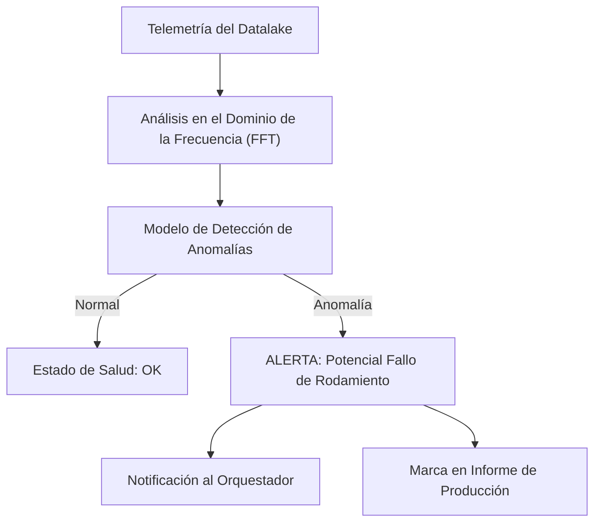

<!-- =============================================================================
HYDRA-UMC-ANOMALY-DETECTOR - Statistical anomaly detector
Copyright (C) JuanenRac (Electro Hobby 3D) <electrohobby3d@gmail.com>
GPL-3.0-or-later - see LICENSE
============================================================================= -->

<p align="center">
  
</p>

# 📈 HYDRA-UMC-ANOMALY-DETECTOR

<p align="center"><a href="README.md">🇺🇸 English</a> | 🇪🇸 <b>Español</b> | <a href="README_fra.md">🇫🇷 Français</a> | <a href="README_ita.md">🇮🇹 Italiano</a> | <a href="README_deu.md">🇩🇪 Deutsch</a> | <a href="README_zho.md">🇨🇳 简体中文</a> | <a href="README_jpn.md">🇯🇵 日本語</a> | <a href="README_por.md">🇵🇹 Português</a></p>

### 🧠 Detección estadística de anomalías y análisis de vibración de motores (sin modelo de aprendizaje automático)

<p align="center">
  
  
  
  
  
  
</p>

---

> **Comprobación de honestidad - qué funciona realmente hoy:** el espectro FFT (`fft.py`), la línea base estadística por bin (`baseline.py`), el detector de anomalías por max-z-score (`detector.py`), las métricas de precisión/recall/F1 sobre una fixture etiquetada (`metrics.py`), la detección de deriva por media móvil (`drift.py`), el cliente HTTP real de HYDRA-UMC-DATALAKE (`datalake_client.py`), y la API JSON/HTTP plana (`api.py`) son reales y están probados (87 tests que pasan: `pytest tests/` - `test_fft.py`, `test_baseline.py`, `test_detector.py`, `test_metrics.py`, `test_drift.py`, `test_datalake_client.py`, `test_api.py`). "AI-driven" y "Learning Models" más abajo describen procesamiento de señal real más una línea base estadística ajustada a partir de ventanas conocidas como sanas - no una red neuronal entrenada, y no un aprendizaje continuo en segundo plano: la línea base se ajusta una vez, ya sea al arrancar desde el histórico real de DATALAKE o mediante una llamada explícita a `POST /baseline/fit`, y permanece exactamente en esa versión de modelo hasta el siguiente reajuste explícito (ver el propio versionado de modelo de `detector.py`). Las Fases 3 y 4 del ROADMAP más abajo (aprendizaje no supervisado, análisis acústico) son completamente aspiracionales - no existe código para ninguna de las dos en este repositorio todavía. Ver `CHANGELOG.md` para lo que se ha entregado exactamente hasta ahora.

> **Estado de seguridad física y de ciberseguridad:** este ecosistema no es un sistema de seguridad certificado. Todavía no existe una ruta de E-STOP por hardware, ni límites ni enclavamientos aplicados por el firmware, ni un comando de movimiento verificado; las imágenes de firmware se comprueban con CRC-32 y una firma Ed25519, y una compilación de versión rechaza las claves de desarrollo publicadas (los cabezales de herramienta y las placas de expansión detrás del relé siguen con cargadores de URTC, que usan un HMAC-SHA256 de clave compartida en lugar de una firma); TLS y TLS mutuo son opcionales y están desactivados por defecto; aún no se ha poblado ni probado ninguna placa propia. Lee la [línea base de seguridad](https://github.com/JuanenRac/HYDRA-UMC-DOCS/blob/main/docs/SECURITY_BASELINE.md) y el [modelo de amenazas](https://github.com/JuanenRac/HYDRA-UMC-DOCS/blob/main/docs/THREAT_MODEL.md) antes de fiarte de cualquier afirmación de aquí para la seguridad de una persona.

---

## 📋 De un vistazo

| | |
|---|---|
| Versión | `0.1.8` |
| Madurez | Funcional |
| Tests | 160 (`python -m pytest -q tests`) |
| Tecnología | Python / FFT / statistical baseline detection |
| Destino | La Raspberry Pi CM5 de una celda HYDRA-UMC |
| En hardware real | Todavía no: no consta ninguna ejecución en hardware real para esta versión |

**Ir a:** [Resumen](#-resumen) · [Arquitectura](#-arquitectura) · [Funciones](#-funciones) · [Seguridad y protección](#-seguridad-y-protección) · [Interfaces](#-interfaces) · [Configuración](#-configuración) · [Inicio rápido](#-inicio-rápido) · [Pruebas](#-pruebas) · [Resolución de problemas](#-resolución-de-problemas) · [Estructura del repositorio](#-estructura-del-repositorio) · [Proyectos relacionados](#-proyectos-relacionados)

## 🚦 Estado del proyecto

Cada línea es una parte de este repositorio y la luz dice hasta dónde llega hoy. Se escribe con lo que el repositorio puede demostrar (pruebas, compilaciones, ejecuciones), no con lo previsto.

🟢 Hecho y verificado · 🟡 Funciona, con límites conocidos · 🟠 Hecho a medias o sin verificar · 🔴 Sin hacer o sin funcionar

| Área | Estado | Qué significa aquí |
|---|---|---|
| Software | 🟡 | Funciona para su propósito principal; la comprobación de honestidad de arriba lista lo que aún falta |
| Pruebas | 🟢 | 160 pruebas automáticas, ejecutadas en cada cambio |
| Hardware real | 🔴 | Todavía no: no consta ninguna ejecución en hardware real para esta versión |
| Documentación | 🟢 | README en ocho idiomas, comprobado contra el manifiesto en cada cambio |

## 🎯 Resumen

**HYDRA-UMC-ANOMALY-DETECTOR** está pensado para ser el guardián proactivo de la salud robótica. Aplica una FFT y una línea base estadística (sin modelo de aprendizaje automático) a muestras de telemetría (vibraciones, firmas de corriente de motor y perfiles térmicos) y señala desviaciones respecto a una línea base sana; todavía no predice fallos.

El objetivo es monitorizar la "huella digital" de cada motor y cabezal de herramienta para poder detectar el desgaste de rodamientos, correas sueltas o fallos de refrigeración con semanas de antelación y permitir un mantenimiento programado en lugar de reparaciones de emergencia (previsto: todavía no existe código de predicción de fallos).

## 🧩 Papel en HYDRA-UMC

**HYDRA-UMC-ANOMALY-DETECTOR** lee la telemetría que guarda HYDRA-UMC-DATALAKE, encuentra las series que ya no se comportan como antes (un rodamiento que empieza a cantar, un accionamiento que deriva) y lo dice por HTTP, de vuelta en el data lake y como alarmas MQTT. Vigila; nunca manda a una máquina.

## 🏛️ Arquitectura

<p align="center">
  
</p>

<details>
<summary>Versión en texto del diagrama (Mermaid)</summary>



</details>

**Por qué está hecho así**

* **Por qué es hermano, no un submódulo, de HYDRA-UMC-DATALAKE.** La detección de anomalías es una carga de trabajo analítica de solo lectura sobre telemetría ya almacenada - mantenerla separada significa que un fallo del detector o una inferencia de modelo lenta nunca bloquean las propias escrituras de HYDRA-UMC-TELEMETRY-COLLECTOR en el mismo almacén.
* **Por qué FFT + una base estadística hoy, no una red neuronal entrenada todavía.** El README lo llama "impulsado por IA" - lo que es real y funciona en esta primera pasada es una técnica real de procesamiento de señales (`src/hydra_umc_anomaly_detector/fft.py`, FFT propio de numpy) más una base estadística por bin de frecuencia aprendida de ventanas conocidas como sanas (`baseline.py`) y un veredicto de max-z-score (`detector.py`) - no un modelo de deep learning entrenado. Funciona, está probado contra firmas de fallo sintéticas reales, y es la base correcta sobre la que construir un modelo aprendido más adelante (ver la sección de HOJA DE RUTA más abajo) - pero llamarlo red neuronal aquí exageraría lo que realmente corre.
* **Por qué un max-z-score en todos los bins, no un umbral fijo.** Un umbral fijo ('temperatura del motor > 80C') se pierde la deriva gradual y da falsas alarmas ante picos de carga legítimos - comparar cada bin del espectro EN VIVO contra la propia base sana APRENDIDA de este motor concreto detecta un pico de frecuencia nuevo/desplazado (una firma real de fallo de rodamiento) sin ninguno de esos dos fallos. El umbral por defecto (10.0) se eligió a partir de separación empírica real, no adivinado - ver el propio docstring de `detector.py` para las cifras reales de los fixtures de test sintéticos sano-vs-defectuoso de este proyecto.
* **Cómo encaja en el resto del ecosistema.** Un servicio hermano bajo HYDRA-UMC-DATALAKE - ejecuta detección de anomalías sobre la telemetría que HYDRA-UMC-TELEMETRY-COLLECTOR ya escribió ahí.
* **Por qué `DriftMonitor` es un mecanismo separado de `AnomalyDetector.score()`, y no un umbral más grande.** Responden preguntas reales distintas: "¿es ESTA ventana anómala?" (un veredicto puntual) frente a "¿se ha desplazado silenciosamente la media RECIENTE?" (una tendencia móvil, robusta ante una única ventana atípica ruidosa). Un test real de deriva simulada encontró y documenta honestamente que, para el diseño de max-z-score de este detector, la propia marca de una ventana individual en realidad se dispara *antes* que la señal de deriva móvil ante un fallo de tipo de frecuencia nuevo - el valor real de `DriftMonitor` aquí es una confirmación de tendencia sostenida, no una alerta más temprana, y el código lo dice así en vez de sobrevenderlo.
* **Por qué `metrics.py` calcula precision/recall en lugar de dejar la calidad del umbral como prosa.** El propio docstring de `detector.py` antes solo afirmaba "sano puntuó hasta ~5.3, defectuoso puntuó en los cientos" - real, pero no una cifra contra la que un futuro reajuste pudiera hacer un test de regresión. `precision_recall()` sobre el mismo fixture real da a eso un valor real y verificable (1.0/1.0 hoy).

## ✨ Funciones

* **Un detector por serie (`/detectors/{sourceId}/{kind}/{field}/...`).** Un motor y un husillo no vibran igual, y una única línea base compartida llamaba anómalo al otro. `POST /detectors/{sourceId}/{kind}/{field}/fit` ajusta la línea base de esa serie (la terna bajo la que la guarda DATALAKE), `.../detect` puntúa una ventana contra ella, `.../drift/init` y `.../drift/observe` le dan su propio monitor de deriva, y `GET /detectors` lista las series y si cada una está ajustada. Una serie se crea con su primer ajuste correcto y hay como mucho `--max-series` (64); puntuar una serie que nunca se ajustó es `409`, nunca un veredicto de otra línea base; ajustar una serie nunca toca otra ni la compartida. Escribir exige el token como la línea base compartida, puntuar también siempre que hay un token (`--no-protect-reads` lo deja abierto). `--baseline-dir` guarda una línea base por serie y las restaura al arrancar. Las rutas originales no cambian. *(implementado, probado en `tests/test_series.py`)*
* **Las lecturas están protegidas por defecto (`--protect-reads`).** Con un token configurado, `POST /detect` también exige `Authorization: Bearer <token>`; solo `GET /stats`, la ruta de salud, queda abierta. Es el comportamiento por defecto siempre que hay un token (`--no-protect-reads` o `HYDRA_UMC_ANOMALY_PROTECT_READS=0` dejan las lecturas abiertas; `HYDRA_UMC_ANOMALY_PROTECT_READS=1` se niega a arrancar sin token). Sin token (solo loopback) no hay nada que exigir. Quienes leen a través de HYDRA-UMC-SERVER ya envían el token.
* 🔍 **Análisis de Firmas:** FFT (Transformada Rápida de Fourier) de muestras de la corriente del motor para detectar desequilibrios mecánicos. *(implementado)*
* 📉 **Mantenimiento Predictivo:** Estimación RUL (Vida Útil Remanente) para motores NEMA y herramientas URTC - aspiracional, todavía no existe código para esto en este repositorio.
* 🚨 **Sistema de Alerta Temprana:** Mostrar alertas directamente en las interfaces Studio y Watch - aspiracional; hoy el detector expone sus veredictos por su propia API HTTP y, en modo continuo, como muestras `anomaly_score` en DATALAKE y como mensajes MQTT. DASHBOARD-AI lo lee a través de HYDRA-UMC-SERVER (mismo origen, así que no hace falta CORS); las interfaces Studio y Watch todavía no muestran sus alarmas.
* **Modo de servicio continuo (`--follow-config ARCHIVO`).** Lee cada serie configurada de DATALAKE a medida que crece, la corta donde el muestreo es irregular, puntúa cada ventana completa con el detector de esa serie, escribe el veredicto de vuelta como muestra del tipo `anomaly_score` y, con `mqtt` configurado, publica un mensaje de estado retenido cuando una serie cambia de estado y una alarma por cada ventana anómala. Todo lo que se ajusta (series, tamaño de ventana, intervalo, topics, broker) está en el archivo JSON; un DATALAKE o un broker caído se cuenta en `GET /stats` y nunca para el bucle. *(implementado; probado contra un DATALAKE HTTP de sustitución real y un broker TCP de sustitución real, nunca ejecutado contra los servicios verdaderos)*
* 🧬 **Aprendizaje de la Línea Base:** Ajusta su línea base estadística a partir del histórico real de datos sanos del Datalake - no es aprendizaje continuo en segundo plano, sino un reajuste real y explícito cada vez que se solicita. *(implementado)*
* 🏷️ **Versionado de Modelo:** Cada `Verdict` lleva la versión de modelo real y monótona, y el umbral contra el que fue puntuado - un reajuste (refit) es un evento real y trazable. También indica con cuántas ventanas sanas se calibró la línea base, para que una alarma sea explicable y reproducible. *(implementado)*
* 📐 **Métricas de Precisión/Recall:** Precision/recall/F1 reales, calculados sobre un fixture etiquetado (`metrics.py`), no solo afirmaciones en prosa sobre la separación de puntuaciones. *(implementado)*
* 📈 **Detección de Deriva Simulada:** `DriftMonitor` señala una elevación sostenida real de la media móvil, distinta de la propia marca de anomalía de cualquier ventana individual. *(implementado)*

Una línea base necesita al menos diez ventanas sanas y usa la desviación típica muestral (`ddof=1`); el umbral de alarma no cambia, así que una anomalía real no queda oculta. Las líneas base guardadas antes siguen funcionando tal cual.

## 🔒 Seguridad y protección

| Amenaza | Defensa | Dónde |
|---|---|---|
| Cualquiera que reescriba una línea base o el estado de deriva | Un token Bearer, comparado en tiempo constante, protege `/baseline/fit`, `/drift/init`, `/drift/observe` y las rutas de escritura de `/detectors/...`; sin token configurado la API queda abierta (el valor por defecto en loopback) | `api.py` |
| Puntuar con datos ajenos y un cuerpo enorme | `POST /detect` pide el token cuando hay uno configurado (`--no-protect-reads` o `HYDRA_UMC_ANOMALY_PROTECT_READS=0` lo abre); solo `GET /stats` queda abierto; un cuerpo mide como máximo 1 MiB | `api.py` |
| Muchas series agotando la memoria | Un detector por serie, como máximo 64 (`--max-series`), con identificadores que cumplen `^[A-Za-z0-9][A-Za-z0-9._:-]{0,95}$`; el entrenamiento lee como máximo 200 000 puntos (`--max-train-points`); la API escucha en `127.0.0.1` por defecto | `registry.py`, `main.py` |

**Lo que nunca hace:** es un detector estadístico clásico (un z-score por bin de FFT, umbral 10 por defecto), no un modelo de IA entrenado, y nunca manda a una máquina.

## 🔌 Interfaces

HTTP en `127.0.0.1:8097` por defecto; la referencia completa es `docs/API.md`.

| Topic o ruta | Qué lleva |
|---|---|
| `POST /baseline/fit`, `POST /detect` | aprender la línea base de la señal y puntuar una ventana contra ella |
| `POST /drift/init`, `POST /drift/observe` | iniciar y alimentar la vigilancia de deriva |
| `POST /detectors/{sourceId}/{kind}/{field}/...` | las mismas operaciones para una serie del data lake |
| `GET /stats`, `GET /detectors` | salud y lista de detectores |
| `--follow-config FILE.json` | modo continuo: lee cada serie configurada según crece (cada 5 s, 20 ventanas por ciclo como máximo), escribe el veredicto de vuelta y envía alarmas MQTT bajo `hydra/anomaly` |

`serve --legacy-baseline` (o `AnomalyDetector(legacy_baseline=True)`) recupera el ajuste anterior con dos ventanas y la desviación poblacional; está apagado por defecto.

## ⚙️ Configuración

| Variable | Por defecto | Qué fija |
|---|---|---|
| `--addr`, `--port` | `127.0.0.1`, `8097` | dónde escucha la API HTTP |
| `--sample-rate`, `--threshold` | `1000.0`, `10.0` | frecuencia de muestreo en Hz; el mayor z-score que puede tener un bin |
| `--window`, `--window-size` | `none` | `none` o `hann` antes de la FFT; muestras por ventana (necesario con `--datalake-url`) |
| `--datalake-url`, `--source-id`, `--kind`, `--field`, `--train-start`, `--train-end` | sin definir | ajustar una línea base nueva al arrancar desde el data lake (los cuatro primeros van juntos) |
| `--max-train-points`, `--max-series` | `200000`, `64` | máximo de puntos leídos al entrenar; máximo de detectores |
| `--token-file`, `HYDRA_UMC_ANOMALY_TOKEN` | sin token | el token Bearer de la API |
| `HYDRA_UMC_ANOMALY_PROTECT_READS` | protegido si hay token | `0` abre `POST /detect`, `1` lo protege |
| `HYDRA_UMC_DATALAKE_INGEST_TOKEN`, `HYDRA_UMC_DATALAKE_TOKEN`, `HYDRA_UMC_DATALAKE_READ_TOKEN` | sin definir | los tokens con que el detector habla con el data lake (o `ingestTokenFile` en la configuración de seguimiento) |

## 🚀 Inicio rápido

Requiere Python 3.10 o superior y NumPy 1.24 o superior (`pip install -e .` lo instala).

```bash
bash run.sh        # Linux, macOS (run.bat on Windows)
python -m hydra_umc_anomaly_detector.main --datalake-url http://127.0.0.1:8095 --source-id press1 --kind vibration --field accel --window-size 1024
curl http://127.0.0.1:8097/stats
```

## 🧪 Pruebas

160 pruebas automáticas se ejecutan con `python -m pytest -q tests`. Usan señales realistas, comprobaciones de falsos positivos y un data lake simulado; sin hardware ni red externa.

| Fichero de pruebas | Pruebas | Qué cubre |
|---|---|---|
| `test_fft.py`, `test_baseline.py`, `test_detector.py`, `test_drift.py`, `test_metrics.py` | - | el espectro, la línea base, el z-score, la deriva y precisión/exhaustividad |
| `test_realistic_false_positives.py`, `realistic_signals.py`, `signal_fixtures.py` | - | señales realistas que no deben provocar una alarma |
| `test_api.py`, `test_series.py`, `test_follower.py`, `test_datalake_client.py`, `test_window_token_fetch.py` | - | la interfaz HTTP, un detector por serie, el modo continuo y el cliente del data lake contra un data lake simulado |

El CI ejecuta `HYDRA_UMC_CI=1 python tools/ci_validate.py`, que comprueba el manifiesto, los documentos, los ocho README y las imágenes.

## 🏗️ Compilación y publicación

Requiere Python >= 3.10. Detección de anomalías real basada en FFT con
API HTTP, no solo un esqueleto que importa.

```bash
# Linux/macOS
./build.sh
./run.sh --port 8097

# Windows
build.bat
run.bat --port 8097
```

`build` crea/activa un `.venv` local, instala el paquete (editable, con
extras de dev, incluyendo `numpy`) en él, verifica la importación, y corre
la suite de tests real (`pytest`). `run` arranca la API HTTP y reenvía
cualquier flag (`--addr`, `--port`, `--sample-rate`, `--threshold`,
`--baseline-path`, `--datalake-url`/`--source-id`/`--kind`/`--field`/
`--window-size`).

Tres opciones más, todas conservadoras por defecto: `--window hann` quita la media y aplica una ventana de Hann antes de la FFT (el valor por defecto `none` es el comportamiento original; los números cambian, así que un baseline recuerda su ventana, un detector se niega a restaurar uno hecho con otra, y hay que recalibrar `--threshold` con grabaciones sanas reales antes de fiarse de Hann). El historial de entrenamiento que se lee de DATALAKE ahora se pagina (lo más antiguo primero), se corta donde las marcas de tiempo no distan unos `1/sample-rate` y se le quitan las marcas repetidas, y una lectura que se detiene en `--max-train-points` lo dice (`--train-start`/`--train-end` eligen el rango). `--token-file` (o `HYDRA_UMC_ANOMALY_TOKEN`) hace que `POST /baseline/fit`, `/drift/init` y `/drift/observe` pidan un token Bearer, y un `--addr` que no sea de loopback se rechaza sin él. Probado con simulacros; nunca con grabaciones reales de máquinas.

El baseline ajustado ahora puede sobrevivir a un reinicio, y puede
ajustarse a partir del historial real de HYDRA-UMC-DATALAKE en vez de
pegar arrays a mano:

```bash
# Persistir cada ajuste a disco, y restaurarlo automáticamente al siguiente arranque
./run.sh --port 8097 --baseline-path /var/lib/hydra-umc-anomaly-detector/baseline.npz

# Ajustar un baseline nuevo al arrancar a partir del historial real de DATALAKE, y persistirlo
./run.sh --port 8097 --baseline-path baseline.npz \
  --datalake-url http://127.0.0.1:8095 --source-id motor-1 --kind vibration --field value --window-size 200
```

```bash
# Calibrar contra ventanas de señal conocidas como sanas (arrays JSON de floats,
# mismo sample rate que --sample-rate)
curl -X POST localhost:8097/baseline/fit -d '{"windows": [[...], [...], ...]}'

# Puntuar una ventana en vivo contra el baseline ajustado
curl -X POST localhost:8097/detect -d '{"window": [...]}'
# -> {"score": 6.3, "anomalous": false, "worstBinFreqHz": 276.0}

curl localhost:8097/stats
```

```bash
python -m pytest tests/ -v   # fft.py (el pico de una onda seno conocida
                              # se encuentra correctamente, la DC se
                              # descarta de verdad), baseline.py (media/std
                              # correctas, el suelo de std-cero evita una
                              # división por cero real), detector.py (la
                              # promesa real: una señal de fallo sintética
                              # se marca, una que parece sana no - con
                              # margen de separación real, no un umbral al
                              # filo), y api.py (round-trips HTTP reales
                              # vía un ThreadingHTTPServer genuino)
```

## 🩺 Resolución de problemas

| Ves | Porque | Haz |
|---|---|---|
| `401` | La API tiene un token y la petición no lo trae, o trae uno erróneo | Envía `Authorization: Bearer <token>` |
| `--window-size` is required | se dio `--datalake-url` sin el tamaño de ventana, el origen, el tipo y el campo | Da `--source-id`, `--kind`, `--field` y `--window-size` junto con él |
| false alarms on a healthy machine | La línea base se ajustó con pocos datos o poco representativos, o el umbral es demasiado bajo | Entrena con un periodo normal más largo (`--train-start`, `--train-end`), usa `--window hann` y sube `--threshold` |

## 📂 Estructura del repositorio

<p align="center">
  
</p>

<details>
<summary>Versión en texto del árbol</summary>

```text
HYDRA-UMC-ANOMALY-DETECTOR/
├── src/hydra_umc_anomaly_detector/
│   ├── fft.py                                   extracción de rasgos por FFT, ventanas
│   ├── baseline.py                              perfil estadístico por bin
│   ├── detector.py                              detector por z-score, umbral
│   ├── drift.py                                 vigilancia de la deriva
│   ├── registry.py                              un detector por serie
│   ├── follower.py                              modo continuo sobre DATALAKE
│   ├── api.py main.py                           interfaz HTTP y punto de entrada
│   ├── datalake_client.py                       cliente HTTP de DATALAKE
│   ├── mqtt_publish.py                          publicador mínimo de alarmas MQTT
│   └── metrics.py                               precisión, exhaustividad y F1
├── tests/                                       154 pruebas, con señales realistas
├── docs/                                        la referencia de la API
├── systemd/                                     unidad de servicio para la CM5
├── tools/                                       ejecutor de compilación y pruebas, subida de versión, validador de CI, generadores y comprobaciones de README e imágenes
├── images/                                      banner y las imágenes del README
├── .github/                                     flujo de CI y plantillas de incidencias
├── pyproject.toml                               metadatos del paquete y dependencias
├── hydra-umc.project.json                       manifiesto: versión, madurez, familia
├── CHANGELOG.md                                 qué cambió en cada versión
├── build.sh build.bat                           scripts de compilación (nunca cambian la versión)
├── build-test.sh build-test.bat                 scripts de compilación (nunca cambian la versión)
├── test.sh test.bat                             ejecutan las pruebas
├── bump_version.py / bump_manifest_version.py   subida de versión explícita
├── Dockerfile                                   imagen de contenedor
├── run.sh run.bat                               arrancar el servicio
└── SECURITY.md SUPPORT.md CONTRIBUTING.md CODE_OF_CONDUCT.md LICENSE LICENSE.md
```

</details>

## 🗺️ Hoja de ruta y límites conocidos

**Límites conocidos hoy**

* **Fase 1:** Ingesta de alto rendimiento e indexación del Datalake para análisis histórico.
* **Fase 2:** Compresión en el borde del colector de telemetría y protocolos de transmisión seguros.
* **Fase 3:** Detección de anomalías mediante aprendizaje no supervisado y análisis de vibración de motores.
* **Fase 4:** Integración de análisis acústico para "escuchar" problemas mecánicos tempranos e insights predictivos de IA.

## 🌍 Idiomas

Este README y los documentos del repositorio existen en ocho idiomas: inglés, español, alemán, francés, italiano, japonés, chino y portugués (Portugal). Se escriben a la vez y el CI comprueba que los ocho ficheros tengan las mismas secciones y los mismos enlaces. Este repositorio no tiene pantalla ni catálogo de mensajes propios, así que no hay cadenas de interfaz que traducir.

## 🔗 Proyectos relacionados

Este proyecto es parte del ecosistema de robótica HYDRA-UMC del mismo autor (JuanenRac / Electro Hobby 3D). Vale la pena conocerlo, ya que una petición podría en realidad ser sobre alguno de estos en vez de sobre este repositorio.

**Proyecto Padre**
- **[HYDRA-UMC-DATALAKE](https://github.com/JuanenRac/HYDRA-UMC-DATALAKE)** — almacén de series temporales real respaldado por sqlite3, con una API HTTP real de ingesta/consulta; el padre del que este repositorio es un servicio de analítica específico, dentro de su propia capa de datos y analítica.

**Proyectos Hermanos** — los demás servicios de analítica de la propia capa de datos y analítica de HYDRA-UMC-DATALAKE
- **[HYDRA-UMC-TELEMETRY-COLLECTOR](https://github.com/JuanenRac/HYDRA-UMC-TELEMETRY-COLLECTOR)** — pipeline real de ingesta CAN/WebSocket hacia DATALAKE, con deduplicación por secuencia.
- **[HYDRA-UMC-PRODUCTION-REPORTS](https://github.com/JuanenRac/HYDRA-UMC-PRODUCTION-REPORTS)** — cálculo real de OEE/disponibilidad sobre el histórico de DATALAKE, con exportación CSV reproducible.

**Directamente Relacionados**
- **[HYDRA-UMC-STUDIO](https://github.com/JuanenRac/HYDRA-UMC-STUDIO)** — panel de control web con visualización 3D multi-robot en tiempo real — muestra las alertas reales de aviso temprano de este detector directamente en la interfaz de control.
- **[HYDRA-UMC-WATCH](https://github.com/JuanenRac/HYDRA-UMC-WATCH)** — app compañera de WearOS con patrones de alerta háptica y un relé de voz al teléfono emparejado (todavía no ejecutada en un reloj físico) — la misma superficie de alerta, para quien esté vigilando la salud de la flota en vez de conducir un robot.
- **[URTC](https://github.com/JuanenRac/URTC)** — firmware para la placa física del Universal Robot Tool Controller, más de 25 perfiles de herramienta por bus CAN — la estimación de RUL aquí cubre también los propios cabezales de herramienta de URTC, no solo los motores NEMA de los propios brazos.

**También Forma Parte del Ecosistema**

*Hardware y Plataforma Base*
- **[HYDRA-UMC](https://github.com/JuanenRac/HYDRA-UMC)** — el diseño de la placa madre del brazo robótico: host CM5 + coprocesador STM32H745 de doble núcleo, pensado para coordinar hasta 8 brazos herramienta por CAN-OTA/SPI-OTA (firmware en fase temprana; todavía no hay ninguna placa poblada).
- **[HYDRA-UMC-OS](https://github.com/JuanenRac/HYDRA-UMC-OS)** — capa de producto reproducible sobre Raspberry Pi OS para el CM5: agente de solo lectura, config/perfiles validados, aprovisionamiento WiFi de primer contacto.
- **[HYDRA-UMC-SDK](https://github.com/JuanenRac/HYDRA-UMC-SDK)** — el contrato JSON-Schema compartido y la barrera de software de puerta de trabajos contra la que cada bridge valida sus comandos (no es una función de seguridad certificada).
- **[HYDRA-UMC-CONNECTOR-HUB](https://github.com/JuanenRac/HYDRA-UMC-CONNECTOR-HUB)** — registro declarativo y validador de manifiestos de adaptador para conectores de máquinas externas; extiende la propia idea de contrato del SDK a máquinas externas sin sustituir a los proyectos de pasarela industrial.

*Backend Central y Clientes*
- **[HYDRA-UMC-SERVER](https://github.com/JuanenRac/HYDRA-UMC-SERVER)** — el backend headless real (REST/WebSocket) con el que habla de verdad cada cliente de control.
- **[HYDRA-UMC-SUITE](https://github.com/JuanenRac/HYDRA-UMC-SUITE)** — centro de mando de enjambre de escritorio (PySide6) para varios servidores a la vez, empaquetado como ejecutable independiente.
- **[HYDRA-UMC-ANDROID-CONTROL](https://github.com/JuanenRac/HYDRA-UMC-ANDROID-CONTROL)** — app nativa de control para Android con inicio de sesión biométrico y un compañero Wear OS emparejado.
- **[HYDRA-UMC-IOS-CONTROL](https://github.com/JuanenRac/HYDRA-UMC-IOS-CONTROL)** — app de control para iOS/iPadOS (Flutter) con sincronización en tiempo real por WebSocket.
- **[HYDRA-UMC-DSI](https://github.com/JuanenRac/HYDRA-UMC-DSI)** — interfaz táctil nativa para la pantalla táctil DSI de 7" a bordo, embebida en el propio CM5.
- **[HYDRA-UMC-EDITOR-URDF](https://github.com/JuanenRac/HYDRA-UMC-EDITOR-URDF)** — creador/editor gráfico de URDF de escritorio que envía los modelos terminados al propio catálogo de STUDIO.
- **[HYDRA-UMC-EDITOR-STL](https://github.com/JuanenRac/HYDRA-UMC-EDITOR-STL)** — editor de escritorio de modelos STL, que transforma/reemplaza/quita/añade piezas reales en el mismo catálogo de modelos que también edita HYDRA-UMC-EDITOR-URDF.
- **[HYDRA-UMC-BRIDGE-AMR](https://github.com/JuanenRac/HYDRA-UMC-BRIDGE-AMR)** — barrera de coordinación para flotas AGV/AMR mediante un publicador MQTT VDA 5050 (probado solo contra una flota emulada).
- **[HYDRA-UMC-BRIDGE-CNC](https://github.com/JuanenRac/HYDRA-UMC-BRIDGE-CNC)** — coordinador de alto nivel para celdas CNC con acceso a estado/bytes de control GRBL (probado solo contra un emulador).
- **[HYDRA-UMC-BRIDGE-DROIDS](https://github.com/JuanenRac/HYDRA-UMC-BRIDGE-DROIDS)** — barrera de coordinación para droides con patas/humanoides, con un emisor de comandos para Boston Dynamics Spot (probado solo contra un emulador).
- **[HYDRA-UMC-BRIDGE-LASER](https://github.com/JuanenRac/HYDRA-UMC-BRIDGE-LASER)** — coordinador de celdas láser que lee 3 señales GPIO de llave/carcasa/enclavamiento (probado solo contra un chip simulado; no puede armar ni disparar un láser).
- **[HYDRA-UMC-BRIDGE-OPENPNP](https://github.com/JuanenRac/HYDRA-UMC-BRIDGE-OPENPNP)** — coordinador de alto nivel seguro para el flujo de placas de pick-and-place OpenPnP.
- **[HYDRA-UMC-BRIDGE-PRINTER3D](https://github.com/JuanenRac/HYDRA-UMC-BRIDGE-PRINTER3D)** — barrera de coordinación segura para impresoras 3D Moonraker/Klipper, con comandos de trabajo reales y controlados.
- **[HYDRA-UMC-BRIDGE-ROS2](https://github.com/JuanenRac/HYDRA-UMC-BRIDGE-ROS2)** — coordinador con un transporte ROS 2 rclpy importado de forma perezosa (todavía no ejecutado contra una instalación de ROS 2).
- **[HYDRA-UMC-BRIDGE-UAV](https://github.com/JuanenRac/HYDRA-UMC-BRIDGE-UAV)** — barrera de coordinación para UAV equipados con cámara, con un emisor de comandos MAVLink (probado solo contra un emulador).

*Plataforma de Herramientas URTC*
- **[URTC-FLASHER](https://github.com/JuanenRac/URTC-FLASHER)** — herramienta de escritorio con GUI para flashear placas URTC, CAN-OTA más SWD/JTAG de chip completo.
- **[URTC-TESTER](https://github.com/JuanenRac/URTC-TESTER)** — herramienta de escritorio de diagnóstico CAN-bus en vivo para placas URTC, un panel por perfil de herramienta.
- **[URTC-WEB-STUDIO](https://github.com/JuanenRac/URTC-WEB-STUDIO)** — alternativa basada en navegador a URTC-TESTER mediante la Web Serial API, sin instalación local.
- **[URTC-GATEWAY](https://github.com/JuanenRac/URTC-GATEWAY)** — pasarela delante del bus CAN de URTC: lista de identificadores permitidos, límite de tasa y clave de sesión; software probado en ordenador, aún no en un bus real.

*Nodo IA de Visión (Hailo-8)*
- **[HYDRA-UMC-VISION-NODE](https://github.com/JuanenRac/HYDRA-UMC-VISION-NODE)** — nodo de integración para el pipeline de visión Hailo-8, con una comprobación real de disponibilidad de hardware por etapa.
- **[HYDRA-UMC-DETECTION-HEF](https://github.com/JuanenRac/HYDRA-UMC-DETECTION-HEF)** — registro real de modelos compilados con verificación de carga segura por arquitectura Hailo/checksum.
- **[HYDRA-UMC-VISION-STREAMER](https://github.com/JuanenRac/HYDRA-UMC-VISION-STREAMER)** — generador real de pipeline GStreamer + config MediaMTX, con una frontera de integración HailoRT real.
- **[HYDRA-UMC-VISUAL-SERVOING-API](https://github.com/JuanenRac/HYDRA-UMC-VISUAL-SERVOING-API)** — ley de corrección Position-Based Visual Servoing con autorización condicionada al estado de zona; todavía sin estimación de pose por cámara.
- **[HYDRA-UMC-SAFETY-ZONES](https://github.com/JuanenRac/HYDRA-UMC-SAFETY-ZONES)** — lógica v0 de invasión de zona, vigencia de calibración y solicitud de E-STOP que toma las posiciones de los objetos de un fichero; ningún detector la alimenta y todavía no hay un E-STOP físico conectado.

*Nodo IA Cognitivo (Hailo-10)*
- **[HYDRA-UMC-COGNITIVE-NODE](https://github.com/JuanenRac/HYDRA-UMC-COGNITIVE-NODE)** — nodo de integración para el pipeline cognitivo Hailo-10 (orquestación de LLM/VLA/voz).
- **[HYDRA-UMC-VLA-ENGINE](https://github.com/JuanenRac/HYDRA-UMC-VLA-ENGINE)** — codificación/decodificación real de tokens de acción y generación de trayectoria para un modelo Vision-Language-Action.
- **[HYDRA-UMC-VOICE-UI](https://github.com/JuanenRac/HYDRA-UMC-VOICE-UI)** — front-end de voz real (VAD + analizador de intención) con un relé a Watch acotado y con confirmación.
- **[HYDRA-UMC-SEMANTIC-PLANNER](https://github.com/JuanenRac/HYDRA-UMC-SEMANTIC-PLANNER)** — descomposición real de tareas basada en reglas y recuperación semántica de errores sobre códigos de error del MCU.
- **[HYDRA-UMC-DOCS-QA](https://github.com/JuanenRac/HYDRA-UMC-DOCS-QA)** — búsqueda real de documentos TF-IDF (solo librería estándar) sobre los propios documentos Markdown de este ecosistema.
- **[HYDRA-UMC-LOCAL-TECHNICIAN](https://github.com/JuanenRac/HYDRA-UMC-LOCAL-TECHNICIAN)** — técnico de mantenimiento con IA local y con puertas de política para el propio ecosistema - observa, diagnostica y propone arreglos; los dos niveles de riesgo más altos están deliberadamente sin implementar todavía.

*Orquestación y Enjambre*
- **[HYDRA-UMC-ORCHESTRATOR](https://github.com/JuanenRac/HYDRA-UMC-ORCHESTRATOR)** — nodo de integración con un contrato real de informe de salud gRPC/Protobuf y una máquina de estados de misión.
- **[HYDRA-UMC-JOB-DISPATCHER](https://github.com/JuanenRac/HYDRA-UMC-JOB-DISPATCHER)** — cola de trabajos real basada en prioridad con deduplicación, sobre una API HTTP real.
- **[HYDRA-UMC-NODE-HEALING](https://github.com/JuanenRac/HYDRA-UMC-NODE-HEALING)** — watchdog de salud de flota real basado en gRPC, con reintento/backoff y detección de discrepancia de identidad.
- **[HYDRA-UMC-PATH-PLANNER-3D](https://github.com/JuanenRac/HYDRA-UMC-PATH-PLANNER-3D)** — planificador de rutas 3D real basado en RRT, con validación real de colisión de obstáculos/espacio de trabajo.
- **[HYDRA-UMC-SWARM-SYNC](https://github.com/JuanenRac/HYDRA-UMC-SWARM-SYNC)** — sincronización de estado real mediante CRDT LWW-Element-Map, con pruebas de propiedades para convergencia multi-celda.

*Gemelo Digital y Simulación*
- **[HYDRA-UMC-TWIN](https://github.com/JuanenRac/HYDRA-UMC-TWIN)** — nodo de integración para el motor de gemelo digital, con un contrato real de sincronización por compatibilidad de versión.
- **[HYDRA-UMC-HIL-BRIDGE](https://github.com/JuanenRac/HYDRA-UMC-HIL-BRIDGE)** — enrutador hardware-in-the-loop con un enclavamiento de software por colisión entre simulación y hardware real (probado sin hardware real).
- **[HYDRA-UMC-PHYSICS-REPLICA](https://github.com/JuanenRac/HYDRA-UMC-PHYSICS-REPLICA)** — cinemática directa real y validación de límites articulares sobre un subconjunto real de URDF.
- **[HYDRA-UMC-SYNTHETIC-DATA-GEN](https://github.com/JuanenRac/HYDRA-UMC-SYNTHETIC-DATA-GEN)** — generador real de escenas 2D procedurales con exportación de anotaciones YOLO/COCO.

*Pasarela Industrial*
- **[HYDRA-UMC-GATEWAY-INDUSTRIAL](https://github.com/JuanenRac/HYDRA-UMC-GATEWAY-INDUSTRIAL)** — nodo de integración que retransmite a protocolos industriales, con una capa real de lista blanca de comandos/contrapresión.
- **[HYDRA-UMC-OPCUA-SERVER](https://github.com/JuanenRac/HYDRA-UMC-OPCUA-SERVER)** — espacio de direcciones OPC-UA real, verificado con una sesión de cliente real del protocolo binario.
- **[HYDRA-UMC-MQTT-BROKER](https://github.com/JuanenRac/HYDRA-UMC-MQTT-BROKER)** — broker MQTT real con autenticación por cliente opcional y ACL de tópicos.
- **[HYDRA-UMC-MTCONNECT-ADAPTER](https://github.com/JuanenRac/HYDRA-UMC-MTCONNECT-ADAPTER)** — endpoints XML reales `/probe` y `/current` de MTConnect, con salida en modo degradado.

*Herramientas Complementarias y Operaciones del Ecosistema*
- **[HYDRA-UMC-DASHBOARD-AI](https://github.com/JuanenRac/HYDRA-UMC-DASHBOARD-AI)** — paneles de Resúmenes Inteligentes y Resaltado de Anomalías sobre DATALAKE/ANOMALY-DETECTOR, con un respaldo estadístico honesto.
- **[HYDRA-UMC-TOOL-CLI](https://github.com/JuanenRac/HYDRA-UMC-TOOL-CLI)** — CLI de flota con un contrato real y estable de códigos de salida, cliente real y en vivo de la propia API de HYDRA-UMC-SERVER.
- **[URTC-SMART-RACK](https://github.com/JuanenRac/URTC-SMART-RACK)** — firmware para un rack de montaje de placas con decodificación real de ID de herramienta y lógica de precalentamiento Smart Idle.
- **[URTC-VISION-TOOL](https://github.com/JuanenRac/URTC-VISION-TOOL)** — firmware más un compañero de visión real en Python para un cabezal de inspección térmica/RGB.
- **[HYDRA-UMC-UPDATER](https://github.com/JuanenRac/HYDRA-UMC-UPDATER)** — herramienta administrativa de escritorio que descubre, clona y actualiza cada repositorio de este ecosistema.
- **[HYDRA-UMC-OS-REBUILDER](https://github.com/JuanenRac/HYDRA-UMC-OS-REBUILDER)** — herramienta de escritorio Windows/Linux que construye una imagen de la CM5 lista para grabar, precargada con las versiones más actuales del ecosistema, con configuración de primer arranque de Wi-Fi/usuario/SSH al estilo de Raspberry Pi Imager.
- **[HYDRA-UMC-OPS-AGENT](https://github.com/JuanenRac/HYDRA-UMC-OPS-AGENT)** — coordinador de incidencias de mantenimiento: un rol edge de bajo privilegio recopila un snapshot de inventario/salud saneado, un rol control-plane lo renderiza de solo lectura y pide a un proveedor de IA que sugiera un diagnóstico - nunca aplica un parche ni despliega nada.
- **[HYDRA-UMC-DEV-SERVER](https://github.com/JuanenRac/HYDRA-UMC-DEV-SERVER)** — host de desarrollo reproducible (Raspberry Pi 5 / CM5) que almacena el código del ecosistema y ejecuta tareas acotadas de compilación/pruebas bajo una cola duradera; un rol de desarrollo dedicado, explícitamente distinto de un CM5 operativo.

## 📚 Documentación

Dónde leer más:

* [docs/API.md](docs/API.md) - cada ruta, su regla de token y sus errores
* [Base de seguridad del ecosistema](https://github.com/JuanenRac/HYDRA-UMC-DOCS/blob/main/docs/SECURITY_BASELINE.md)
* [Modelo de amenazas del ecosistema](https://github.com/JuanenRac/HYDRA-UMC-DOCS/blob/main/docs/THREAT_MODEL.md)
* [Historial de cambios de este repositorio](CHANGELOG.md)
* [Licencia de este repositorio](LICENSE.md)

## 🤝 Contribuir y comunidad

* Antes de un pull request ejecuta `HYDRA_UMC_CI=1 py -3 tools/ci_validate.py` (o `HYDRA_UMC_CI=1 python3 tools/ci_validate.py`): debe imprimir `CI_VALIDATION=PASS`. No ejecutes `build.sh` ni `build.bat` para esta comprobación; compilar no es comprobar.
* Los ocho README se escriben desde una sola fuente en HYDRA-UMC-DOCS; no los edites a mano. Cambia la fuente y vuelve a escribirlos con `tools/make_readmes.py`.
* No afirmes en un README lo que no se ha ejecutado: di «simulado» o «sin probar en hardware» cuando esa sea la verdad.
* Mira [CONTRIBUTING.md](CONTRIBUTING.md), el [código de conducta](CODE_OF_CONDUCT.md), [SECURITY.md](SECURITY.md) y [SUPPORT.md](SUPPORT.md).

## 👤 AUTOR

**JuanenRac (Electro Hobby 3D)** · electrohobby3d@gmail.com

## 📜 LICENCIA

GPL-3.0-or-later - [LICENSE](LICENSE).
