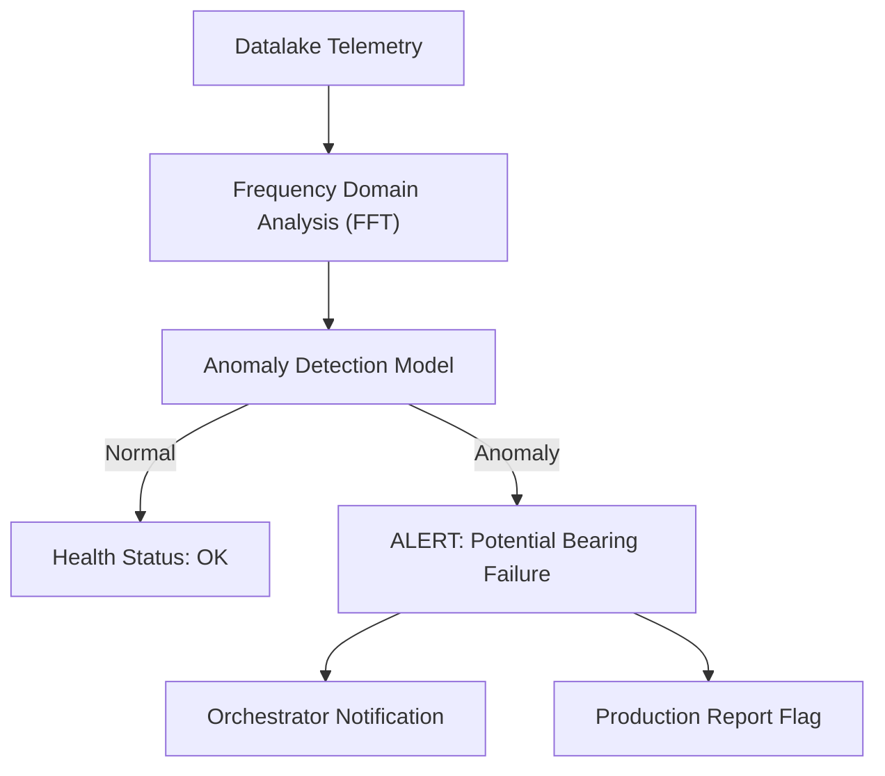

<!-- =============================================================================
HYDRA-UMC-ANOMALY-DETECTOR - Statistical anomaly detector
Copyright (C) JuanenRac (Electro Hobby 3D) <electrohobby3d@gmail.com>
GPL-3.0-or-later - see LICENSE
============================================================================= -->

<p align="center">
  
</p>

# 📈 HYDRA-UMC-ANOMALY-DETECTOR

<p align="center"><a href="README.md">🇺🇸 English</a> | <a href="README_spa.md">🇪🇸 Español</a> | <a href="README_fra.md">🇫🇷 Français</a> | <a href="README_ita.md">🇮🇹 Italiano</a> | <a href="README_deu.md">🇩🇪 Deutsch</a> | 🇨🇳 <b>简体中文</b> | <a href="README_jpn.md">🇯🇵 日本語</a> | <a href="README_por.md">🇵🇹 Português</a></p>

### 🧠 统计异常检测与电机振动分析(不使用机器学习模型)

<p align="center">
  
  
  
  
  
  
</p>

---

> **诚实检查——今天真正可运行的部分：** FFT 频谱（`fft.py`）、按频段的统计基线（`baseline.py`）、max-z-score 异常检测器（`detector.py`）、基于带标签测试集的精确率/召回率/F1 指标（`metrics.py`）、滚动均值漂移检测（`drift.py`）、真正的 HYDRA-UMC-DATALAKE HTTP 客户端（`datalake_client.py`），以及简单的 JSON/HTTP API（`api.py`）都是真实的并经过测试（87 个测试全部通过：`pytest tests/` —— `test_fft.py`、`test_baseline.py`、`test_detector.py`、`test_metrics.py`、`test_drift.py`、`test_datalake_client.py`、`test_api.py`）。下文中的 "AI-driven" 和 "Learning Models" 描述的是真实的信号处理加上从已知健康窗口拟合出的统计基线——不是训练出来的神经网络，也不是后台持续学习：基线只会拟合一次，要么在启动时从真实的 DATALAKE 历史数据拟合，要么通过显式调用 `POST /baseline/fit`，在下一次显式重新拟合之前会一直保持同一个模型版本（见 `detector.py` 自身的模型版本管理）。下文 ROADMAP 中的第 3、4 阶段（无监督学习、声学分析）完全是愿景性的——本仓库目前还没有任何相关代码。目前具体已交付的内容见 `CHANGELOG.md`。

> **安全与安防现状:**本生态系统不是经认证的安全系统。目前尚无硬件 E-STOP 通路,没有由固件强制执行的限位或联锁,也没有经过验证的运动指令;固件映像使用 CRC32 和共享密钥的 HMAC-SHA256 校验,而非非对称签名;TLS 与双向 TLS 均为可选项,默认关闭;自制电路板尚未组装或测试。在依赖此处任何说法来保障人身安全之前,请先阅读[安全基线](https://github.com/JuanenRac/HYDRA-UMC-DOCS/blob/main/docs/SECURITY_BASELINE.md)和[威胁模型](https://github.com/JuanenRac/HYDRA-UMC-DOCS/blob/main/docs/THREAT_MODEL.md)。

---

## 📋 速览

| | |
|---|---|
| 版本 | `0.1.8` |
| 成熟度 | 可用 |
| 测试 | 154 (`python -m pytest -q tests`) |
| 技术栈 | Python / FFT / statistical baseline detection |
| 目标 | HYDRA-UMC 工作单元的 Raspberry Pi CM5 |
| 真实硬件 | 尚未：此版本没有在真实硬件上运行的记录 |

**跳转：** [概述](#-概述) · [架构](#-架构) · [功能](#-功能) · [安全与防护](#-安全与防护) · [接口](#-接口) · [配置](#-配置) · [快速开始](#-快速开始) · [测试](#-测试) · [故障排除](#-故障排除) · [仓库结构](#-仓库结构) · [相关项目](#-相关项目)

## 🚦 项目状态

每一行是本仓库的一个部分，灯号表示它今天做到了哪一步。内容依据仓库能够展示的证据（测试、构建、运行），而不是计划。

🟢 已完成并验证 · 🟡 可用，有已知限制 · 🟠 部分完成或尚未验证 · 🔴 未完成或不可用

| 领域 | 状态 | 在这里的含义 |
|---|---|---|
| 软件 | 🟡 | 主要用途可用；上面的诚实性检查列出了仍然缺少的内容 |
| 测试 | 🟢 | 154 项自动测试，每次变更都会运行 |
| 真实硬件 | 🔴 | 尚未：此版本没有在真实硬件上运行的记录 |
| 文档 | 🟢 | 八种语言的 README，每次变更都会与清单核对 |

## 🎯 概述

**HYDRA-UMC-ANOMALY-DETECTOR** 的目标是成为机器人健康状态的主动守护者。它对遥测样本（振动、电机电流特征和热剖面）应用 FFT 和统计基线（不使用机器学习模型），标记偏离健康基线的情况；目前还不会预测故障。

目标是监控每个电机和刀头的"数字指纹"，以便提前数周发现轴承磨损、
皮带松动或散热故障，从而实现计划性维护而非紧急抢修（计划中：目前还没有故障预测代码）。

## 🧩 在 HYDRA-UMC 中的角色

**HYDRA-UMC-ANOMALY-DETECTOR** 读取 HYDRA-UMC-DATALAKE 保存的遥测数据，找出不再像以前那样工作的序列（开始啸叫的轴承、发生漂移的驱动），并通过 HTTP、写回数据湖和 MQTT 报警告知。它只监视，从不指挥机器。

## 🏛️ 架构

<p align="center">
  
</p>

<details>
<summary>图表的文本版本（Mermaid）</summary>



</details>

**为什么这样构建**

* **为何这是 HYDRA-UMC-DATALAKE 的兄弟项目，而非子模块。** 异常检测是针对已存储遥测数据的只读分析工作负载——将其保持独立，意味着检测器崩溃或缓慢的模型推理永远不会阻塞 HYDRA-UMC-TELEMETRY-COLLECTOR 向同一存储的写入操作。
* **为何今天是 FFT + 统计基线，而非训练好的神经网络。** README 称之为“AI 驱动”——在这第一阶段真实且已经运行的，是一种真正的信号处理技术（`src/hydra_umc_anomaly_detector/fft.py`，numpy 自带的 FFT）加上从已知健康窗口学习得到的、按频率 bin 划分的统计基线（`baseline.py`），以及一个 max-z-score 判定（`detector.py`）——而不是一个训练好的深度学习模型。它是可用的，已针对真实的合成故障特征进行了测试，也是日后在其之上构建学习模型的正确基础（见下方“路线图”部分）——但在这里称其为神经网络会夸大实际运行的内容。
* **为何是所有 bin 上的 max-z-score，而非固定阈值。** 固定阈值（“电机温度 > 80°C”）会漏检渐进式漂移，并对合理的负载峰值产生误报——将实时频谱的每个 bin 与这台具体电机自身学习到的健康基线进行比较，可以检测出一个新的/偏移的频率峰值（真实的轴承缺陷特征），而不会出现这两种失败模式中的任何一种。默认阈值（10.0）是根据真实的经验分离结果选定的，而非凭空猜测——具体数字见 `detector.py` 自身文档字符串中本项目健康-vs-故障合成测试样本的实测数据。
* **这如何融入生态系统的其余部分。** 作为 HYDRA-UMC-DATALAKE 下的同级服务——对 HYDRA-UMC-TELEMETRY-COLLECTOR 已写入其中的遥测数据运行异常检测。
* **为何 `DriftMonitor` 是与 `AnomalyDetector.score()` 相互独立的机制，而非一个更大的阈值。** 二者回答的是不同的真实问题：“这个窗口是否异常”（一次性判定）与“最近的平均值是否已悄然偏移”（一种滚动趋势，对单个噪声异常窗口具有鲁棒性）。一次真实的模拟漂移测试发现并如实记录了：对于该检测器的 max-z-score 设计，面对一种新频率类型的故障，单一窗口自身的标记实际上会*先于*滚动漂移信号触发——`DriftMonitor` 在此的真实价值在于对持续趋势的确认，而非更早的预警，代码本身也是这样说明的，而不是夸大其词。
* **为何 `metrics.py` 计算 precision/recall，而不是把阈值质量留作文字描述。** `detector.py` 自身的文档字符串过去只声称“健康样本得分最高约 5.3，故障样本得分为数百”——是真实的，但不是一个未来重新调优时可以据以做回归测试的数字。`precision_recall()` 基于同一个真实测试样本给出了一个真实的、可核验的数值（目前为 1.0/1.0）。

## ✨ 功能

* **每个序列一个检测器(`/detectors/{sourceId}/{kind}/{field}/...`)。** 电机和主轴的振动并不相同,共用一个基线会把另一个判为异常。`POST /detectors/{sourceId}/{kind}/{field}/fit` 拟合该序列的基线(DATALAKE 存放它所用的三元组),`.../detect` 对照它给窗口打分,`.../drift/init` 和 `.../drift/observe` 给它独立的漂移监视器,`GET /detectors` 列出各序列及其是否已拟合。序列由第一次成功的拟合创建,最多 `--max-series`(64)个;对从未拟合的序列打分返回 `409`,绝不是来自其他基线的结论;拟合一个序列绝不会触及另一个序列或共用的那个。写入与共用基线一样需要令牌,打分在设置了令牌时同样需要（`--no-protect-reads` 可放开）。`--baseline-dir` 为每个序列保存一份基线并在启动时恢复。原有路由不变。*(已实现,已在 `tests/test_series.py` 中测试)*
* **读取默认受保护（`--protect-reads`）。** 设置令牌后，`POST /detect` 也要求 `Authorization: Bearer <token>`；只有健康路径 `GET /stats` 保持开放。只要有令牌，这就是默认行为（`--no-protect-reads` 或 `HYDRA_UMC_ANOMALY_PROTECT_READS=0` 让读取保持开放；`HYDRA_UMC_ANOMALY_PROTECT_READS=1` 在没有令牌时拒绝启动）。没有令牌（仅回环）时无需要求。通过 HYDRA-UMC-SERVER 读取的调用方已经发送令牌。
* 🔍 **特征分析：** 对电机电流样本进行 FFT（快速傅里叶变换）以检测机械不平衡。*(已实现)*
* 📉 **预测性维护：** 面向 NEMA 电机和 URTC 工具的 RUL（剩余使用寿命）估算——仍属愿景,本仓库中目前还没有相关代码。
* 🚨 **早期预警系统：** 直接在 Studio 和 Watch 界面显示告警——仍属愿景;目前该检测器通过自身的 HTTP API 暴露判定结果,在持续模式下还会作为 DATALAKE 中的 `anomaly_score` 样本和 MQTT 消息发布。DASHBOARD-AI 通过 HYDRA-UMC-SERVER 读取它(同源,因此不需要 CORS);Studio 和 Watch 界面还不显示它的告警。
* **持续服务模式(`--follow-config 文件`)。** 随着序列增长,从 DATALAKE 读取每个已配置的序列,在采样不规则之处把它切开,用该序列的检测器给每个完整窗口打分,把判定作为类型为 `anomaly_score` 的样本写回,并且在配置了 `mqtt` 时,在序列状态改变时发布保留的状态消息,对每个异常窗口发布一条告警。所有可调的内容(序列、窗口大小、间隔、主题、代理)都在 JSON 文件里;停机的 DATALAKE 或代理会在 `GET /stats` 中计数,但绝不会让循环停下。*(已实现;已对真实的 HTTP DATALAKE 替身和真实的 TCP 代理替身测试,从未对真实服务运行)*
* 🧬 **基线学习：** 根据数据湖中真实的已知健康历史数据拟合其统计基线——并非后台持续学习,而是每次被请求时进行的真实、显式的重新拟合。*(已实现)*
* 🏷️ **模型版本管理：** 每个 `Verdict` 都携带真实的、单调递增的模型版本以及对其评分所依据的阈值——一次重新拟合（refit）是一个真实的、可追溯的事件。它还会报告基线是用多少个健康窗口校准的，使告警可解释、可复现。*(已实现)*
* 📐 **精确率/召回率指标：** 基于标注测试样本（`metrics.py`）计算得到的真实 precision/recall/F1，而非仅是关于分数分离度的文字描述。*(已实现)*
* 📈 **模拟漂移检测：** `DriftMonitor` 标记出真实的、持续的滚动均值抬升，这与任何单一窗口自身的异常标记不同。*(已实现)*

## 🔒 安全与防护

| 威胁 | 防御 | 位置 |
|---|---|---|
| 任何人都能改写基线或漂移状态 | 以恒定时间比较的 Bearer 令牌保护 `/baseline/fit`、`/drift/init`、`/drift/observe` 以及 `/detectors/...` 的写入路由；未配置令牌时 API 是开放的（回环默认） | `api.py` |
| 用他人的数据评分以及巨大的请求体 | 配置了令牌时 `POST /detect` 需要令牌（`--no-protect-reads` 或 `HYDRA_UMC_ANOMALY_PROTECT_READS=0` 可开放）；只有 `GET /stats` 保持开放；请求体最大 1 MiB | `api.py` |
| 大量序列耗尽内存 | 每个序列一个检测器，最多 64 个（`--max-series`），标识符须匹配 `^[A-Za-z0-9][A-Za-z0-9._:-]{0,95}$`；训练最多读取 200 000 个点（`--max-train-points`）；API 默认监听 `127.0.0.1` | `registry.py`, `main.py` |

**它绝不做的事：** 它是经典统计检测器（每个 FFT 频点一个 z 分数，默认阈值 10），不是训练过的 AI 模型，也从不指挥机器。

## 🔌 接口

默认在 `127.0.0.1:8097` 提供 HTTP；完整参考见 `docs/API.md`。

| 主题或路由 | 内容 |
|---|---|
| `POST /baseline/fit`, `POST /detect` | 学习信号基线，再对窗口评分 |
| `POST /drift/init`, `POST /drift/observe` | 启动并输入漂移监测 |
| `POST /detectors/{sourceId}/{kind}/{field}/...` | 对数据湖中一个序列的同样操作 |
| `GET /stats`, `GET /detectors` | 健康状态与检测器列表 |
| `--follow-config FILE.json` | 连续模式：随各已配置序列增长而读取（每 5 秒，每轮最多 20 个窗口），写回判定，并在 `hydra/anomaly` 下发送 MQTT 报警 |

## ⚙️ 配置

| 变量 | 默认值 | 设置内容 |
|---|---|---|
| `--addr`, `--port` | `127.0.0.1`, `8097` | HTTP API 的监听位置 |
| `--sample-rate`, `--threshold` | `1000.0`, `10.0` | 采样率（Hz）；一个频点允许的最大 z 分数 |
| `--window`, `--window-size` | `none` | FFT 之前用 `none` 或 `hann`；每个窗口的样本数（配合 `--datalake-url` 时必需） |
| `--datalake-url`, `--source-id`, `--kind`, `--field`, `--train-start`, `--train-end` | 未设置 | 启动时从数据湖拟合新基线（前四个必须一起给） |
| `--max-train-points`, `--max-series` | `200000`, `64` | 训练时最多读取的点数；检测器最大数量 |
| `--token-file`, `HYDRA_UMC_ANOMALY_TOKEN` | 无令牌 | API 的 Bearer 令牌 |
| `HYDRA_UMC_ANOMALY_PROTECT_READS` | 设置了令牌就受保护 | `0` 开放 `POST /detect`，`1` 保护它 |
| `HYDRA_UMC_DATALAKE_INGEST_TOKEN`, `HYDRA_UMC_DATALAKE_TOKEN`, `HYDRA_UMC_DATALAKE_READ_TOKEN` | 未设置 | 检测器与数据湖通信所用的令牌（或跟随配置中的 `ingestTokenFile`） |

## 🚀 快速开始

需要 Python 3.10 或更高版本和 NumPy 1.24 或更高版本（`pip install -e .` 会安装）。

```bash
bash run.sh        # Linux, macOS (run.bat on Windows)
python -m hydra_umc_anomaly_detector.main --datalake-url http://127.0.0.1:8095 --source-id press1 --kind vibration --field accel --window-size 1024
curl http://127.0.0.1:8097/stats
```

## 🧪 测试

运行 `python -m pytest -q tests` 会执行 154 个自动测试，使用逼真的信号、误报检查和模拟数据湖；不需要硬件和外部网络。

| 测试文件 | 测试数 | 覆盖内容 |
|---|---|---|
| `test_fft.py`, `test_baseline.py`, `test_detector.py`, `test_drift.py`, `test_metrics.py` | - | 频谱、基线、z 分数、漂移以及精确率/召回率 |
| `test_realistic_false_positives.py`, `realistic_signals.py`, `signal_fixtures.py` | - | 不应触发报警的逼真信号 |
| `test_api.py`, `test_series.py`, `test_follower.py`, `test_datalake_client.py`, `test_window_token_fetch.py` | - | HTTP 接口、每序列一个检测器、连续模式以及针对模拟数据湖的数据湖客户端 |

CI 运行 `HYDRA_UMC_CI=1 python tools/ci_validate.py`，检查清单、文档、八个 README 和图片。

## 🏗️ 构建与发布

需要 Python >= 3.10。一个真正基于 FFT 的异常检测，带有 HTTP API，
而不只是一个能导入的骨架。

```bash
# Linux/macOS
./build.sh
./run.sh --port 8097

# Windows
build.bat
run.bat --port 8097
```

`build` 创建/激活本地 `.venv`，以可编辑模式（含 dev 附加项，包括
`numpy`）安装该包，验证导入，并运行真实的测试套件（`pytest`）。`run`
启动 HTTP API，并转发任何标志(`--addr`、`--port`、`--sample-rate`、
`--threshold`、`--baseline-path`、
`--datalake-url`/`--source-id`/`--kind`/`--field`/`--window-size`)。

另外三个选项，默认都很保守：`--window hann` 在 FFT 之前去除均值并施加汉宁窗(默认的 `none` 是原有行为；数值会不同，所以基线会记住它的窗，检测器拒绝恢复用另一种窗做出的基线，并且在信任 Hann 之前必须用真实的健康记录重新校准 `--threshold`)。从 DATALAKE 读取的训练历史现在分页读取(最旧的先读)，在时间戳间隔不约等于 `1/sample-rate` 的地方切开，并去掉重复的时间戳；在 `--max-train-points` 处停止的读取会明确说明(`--train-start`/`--train-end` 选择范围)。`--token-file`(或 `HYDRA_UMC_ANOMALY_TOKEN`)使 `POST /baseline/fit`、`/drift/init` 和 `/drift/observe` 要求 Bearer 令牌，非回环的 `--addr` 没有令牌会被拒绝。已针对替身测试；从未用真实机器记录测试。

现在拟合出的基线可以在重启后保留下来,也可以直接从 HYDRA-UMC-DATALAKE
的真实历史数据中拟合,而不必手动粘贴数组:

```bash
# 将每次拟合持久化到磁盘,并在下次启动时自动恢复
./run.sh --port 8097 --baseline-path /var/lib/hydra-umc-anomaly-detector/baseline.npz

# 启动时从 DATALAKE 的真实历史数据拟合一个全新的基线,然后将其持久化
./run.sh --port 8097 --baseline-path baseline.npz \
  --datalake-url http://127.0.0.1:8095 --source-id motor-1 --kind vibration --field value --window-size 200
```

```bash
# 针对已知健康的信号窗口进行校准（浮点数的 JSON 数组，与 --sample-rate 相同的采样率）
curl -X POST localhost:8097/baseline/fit -d '{"windows": [[...], [...], ...]}'

# 对一个实时窗口按已拟合的 baseline 打分
curl -X POST localhost:8097/detect -d '{"window": [...]}'
# -> {"score": 6.3, "anomalous": false, "worstBinFreqHz": 276.0}

curl localhost:8097/stats
```

```bash
python -m pytest tests/ -v   # fft.py（正确找到已知正弦波的峰值频率，
                              # DC 被真正丢弃）、baseline.py（均值/标准差
                              # 正确，零标准差下限防止真实的除零错误）、
                              # detector.py（真正的承诺：合成故障信号被
                              # 标记，看似健康的信号不被标记，具有真实的
                              # 分离余量，而非临界阈值），以及 api.py
                              # （通过真实的 ThreadingHTTPServer 的真实
                              # HTTP 往返测试）
```

## 🩺 故障排除

| 你看到 | 原因 | 处理 |
|---|---|---|
| `401` | API 配置了令牌而请求没带或带错 | 发送 `Authorization: Bearer <token>` |
| `--window-size` is required | 给了 `--datalake-url` 却没给窗口大小、来源、类型和字段 | 同时给出 `--source-id`、`--kind`、`--field` 和 `--window-size` |
| false alarms on a healthy machine | 基线用的数据太少或不具代表性，或阈值太低 | 用更长的正常时段训练（`--train-start`、`--train-end`），使用 `--window hann` 并调高 `--threshold` |

## 📂 仓库结构

<p align="center">
  
</p>

<details>
<summary>目录树的文本版本</summary>

```text
HYDRA-UMC-ANOMALY-DETECTOR/
├── src/hydra_umc_anomaly_detector/
│   ├── fft.py                                   FFT 特征提取与窗函数
│   ├── baseline.py                              每个频点的统计画像
│   ├── detector.py                              z 分数检测器与阈值
│   ├── drift.py                                 漂移监测
│   ├── registry.py                              每个序列一个检测器
│   ├── follower.py                              基于 DATALAKE 的连续模式
│   ├── api.py main.py                           HTTP 接口与入口
│   ├── datalake_client.py                       DATALAKE 的 HTTP 客户端
│   ├── mqtt_publish.py                          最小的 MQTT 报警发布器
│   └── metrics.py                               精确率、召回率与 F1
├── tests/                                       154 项测试（含逼真信号）
├── docs/                                        API 参考
├── systemd/                                     CM5 的服务单元
├── tools/                                       构建与测试运行器、版本提升、CI 校验、README 与图片的生成和检查
├── images/                                      横幅图与 README 的图片
├── .github/                                     CI 工作流和 Issue 模板
├── pyproject.toml                               包元数据与依赖
├── hydra-umc.project.json                       清单：版本、成熟度、系列
├── CHANGELOG.md                                 每个版本的变化
├── build.sh build.bat                           构建脚本（从不改变版本）
├── build-test.sh build-test.bat                 构建脚本（从不改变版本）
├── test.sh test.bat                             运行测试
├── bump_version.py / bump_manifest_version.py   显式的版本提升
├── Dockerfile                                   容器镜像
├── run.sh run.bat                               启动服务
└── SECURITY.md SUPPORT.md CONTRIBUTING.md CODE_OF_CONDUCT.md LICENSE LICENSE.md
```

</details>

## 🗺️ 路线图与已知限制

**当前已知限制**

* **第一阶段：** 数据湖的高吞吐量摄取和索引，用于历史分析。
* **第二阶段：** 遥测采集器的边缘压缩和安全传输协议。
* **第三阶段：** 使用无监督学习和电机振动分析进行异常检测。
* **第四阶段：** 集成声学分析以"听出"早期机械问题，以及 AI 驱动的预测性洞察。

## 🌍 语言

本 README 和仓库文档提供八种语言：英语、西班牙语、德语、法语、意大利语、日语、中文和葡萄牙语（葡萄牙）。它们同时编写，并由 CI 检查八个文件拥有相同的章节和相同的链接。 本仓库没有自己的界面或消息目录，因此没有需要翻译的界面文字。

## 🔗 相关项目

本项目是同一作者(JuanenRac / Electro Hobby 3D)打造的 HYDRA-UMC 机器人生态系统的一部分。值得了解,因为某个请求实际上可能是关于这些项目之一,而非本仓库本身。

**父项目**
- **[HYDRA-UMC-DATALAKE](https://github.com/JuanenRac/HYDRA-UMC-DATALAKE)** — 具备真实数据摄入/查询 HTTP API 的真实 sqlite3 时序数据存储;本仓库是其自身数据与分析层中一个具体分析服务所属的父项目。

**兄弟项目** —— HYDRA-UMC-DATALAKE 自身数据与分析层中的其他分析服务
- **[HYDRA-UMC-TELEMETRY-COLLECTOR](https://github.com/JuanenRac/HYDRA-UMC-TELEMETRY-COLLECTOR)** — 面向 DATALAKE 的真实 CAN/WebSocket 数据摄入管道，支持序列去重。
- **[HYDRA-UMC-PRODUCTION-REPORTS](https://github.com/JuanenRac/HYDRA-UMC-PRODUCTION-REPORTS)** — 基于 DATALAKE 历史数据的真实 OEE/可用率计算，支持可复现的 CSV 导出。

**直接相关**
- **[HYDRA-UMC-STUDIO](https://github.com/JuanenRac/HYDRA-UMC-STUDIO)** — 具有实时多机器人 3D 可视化的网页控制面板 —— 将本检测器的真实早期预警直接呈现在控制界面中。
- **[HYDRA-UMC-WATCH](https://github.com/JuanenRac/HYDRA-UMC-WATCH)** — 带有触觉提醒模式与配对手机语音中继的 WearOS 伴侣应用(尚未在实体手表上运行) —— 面向监控车队健康状况(而非驾驶机器人)人员的同一警报界面。
- **[URTC](https://github.com/JuanenRac/URTC)** — 面向实体 Universal Robot Tool Controller 板卡的固件，通过 CAN 总线支持 25 种以上工具配置 —— 此处的 RUL(剩余使用寿命)估算不仅涵盖机械臂自身的 NEMA 电机,也涵盖 URTC 自身的工具头。

**生态系统中的其他项目**

*核心硬件与平台*
- **[HYDRA-UMC](https://github.com/JuanenRac/HYDRA-UMC)** — 机器人手臂主板设计——CM5 主机 + 双核 STM32H745,目标是通过 CAN-OTA/SPI-OTA 协调最多 8 条工具臂(固件处于早期阶段,尚无已组装的电路板)。
- **[HYDRA-UMC-OS](https://github.com/JuanenRac/HYDRA-UMC-OS)** — 面向 CM5 的可复现 Raspberry Pi OS 产品层——只读代理、经过验证的配置/配置文件、WiFi 首次配网。
- **[HYDRA-UMC-SDK](https://github.com/JuanenRac/HYDRA-UMC-SDK)** — 每个桥接都据此校验自身指令的共享 JSON-Schema 契约与软件作业门限边界(并非经认证的安全功能)。
- **[HYDRA-UMC-CONNECTOR-HUB](https://github.com/JuanenRac/HYDRA-UMC-CONNECTOR-HUB)** — 面向外部机器连接器的声明式适配器清单注册与校验工具；把 SDK 自身的契约理念扩展到外部机器，而不取代工业网关类项目。

*核心后端与客户端*
- **[HYDRA-UMC-SERVER](https://github.com/JuanenRac/HYDRA-UMC-SERVER)** — 每个控制客户端真正通信的真实无头后端(REST/WebSocket)。
- **[HYDRA-UMC-SUITE](https://github.com/JuanenRac/HYDRA-UMC-SUITE)** — 面向多台服务器的桌面(PySide6)集群指挥中心，打包为独立可执行文件。
- **[HYDRA-UMC-ANDROID-CONTROL](https://github.com/JuanenRac/HYDRA-UMC-ANDROID-CONTROL)** — 具有生物识别登录和配对 Wear OS 伴侣应用的原生 Android 控制应用。
- **[HYDRA-UMC-IOS-CONTROL](https://github.com/JuanenRac/HYDRA-UMC-IOS-CONTROL)** — 具有实时 WebSocket 同步的 iOS/iPadOS 控制应用(Flutter)。
- **[HYDRA-UMC-DSI](https://github.com/JuanenRac/HYDRA-UMC-DSI)** — 面向机载 7 英寸 DSI 触摸屏的原生触控界面，直接嵌入 CM5 本体。
- **[HYDRA-UMC-EDITOR-URDF](https://github.com/JuanenRac/HYDRA-UMC-EDITOR-URDF)** — 将完成的模型推送到 STUDIO 自身目录的桌面版图形化 URDF 创建/编辑工具。
- **[HYDRA-UMC-EDITOR-STL](https://github.com/JuanenRac/HYDRA-UMC-EDITOR-STL)** — 桌面 STL 模型编辑器，在 HYDRA-UMC-EDITOR-URDF 编辑的同一模型目录中变换/替换/移除/添加真实部件。
- **[HYDRA-UMC-BRIDGE-AMR](https://github.com/JuanenRac/HYDRA-UMC-BRIDGE-AMR)** — 通过 VDA 5050 MQTT 发布者为 AGV/AMR 车队提供的协调边界(仅针对仿真车队测试)。
- **[HYDRA-UMC-BRIDGE-CNC](https://github.com/JuanenRac/HYDRA-UMC-BRIDGE-CNC)** — 具备 GRBL 状态/控制字节访问能力的高层 CNC 单元协调器(仅针对模拟器测试)。
- **[HYDRA-UMC-BRIDGE-DROIDS](https://github.com/JuanenRac/HYDRA-UMC-BRIDGE-DROIDS)** — 面向足式/人形机器人的协调边界,带有 Boston Dynamics Spot 指令发送器(仅针对模拟器测试)。
- **[HYDRA-UMC-BRIDGE-LASER](https://github.com/JuanenRac/HYDRA-UMC-BRIDGE-LASER)** — 读取 3 路钥匙/外壳/联锁 GPIO 信号的激光单元协调器(仅针对模拟芯片测试;无法使激光器上膛或发射)。
- **[HYDRA-UMC-BRIDGE-OPENPNP](https://github.com/JuanenRac/HYDRA-UMC-BRIDGE-OPENPNP)** — 面向 OpenPnP 贴片机板级流程的安全高层协调器。
- **[HYDRA-UMC-BRIDGE-PRINTER3D](https://github.com/JuanenRac/HYDRA-UMC-BRIDGE-PRINTER3D)** — 面向 Moonraker/Klipper 3D 打印机的安全协调边界，具备真实的受控作业指令。
- **[HYDRA-UMC-BRIDGE-ROS2](https://github.com/JuanenRac/HYDRA-UMC-BRIDGE-ROS2)** — 带有惰性导入 rclpy ROS 2 传输层的协调器(尚未在 ROS 2 环境中运行)。
- **[HYDRA-UMC-BRIDGE-UAV](https://github.com/JuanenRac/HYDRA-UMC-BRIDGE-UAV)** — 面向搭载摄像头的无人机的协调边界,带有 MAVLink 指令发送器(仅针对模拟器测试)。

*URTC 工具平台*
- **[URTC-FLASHER](https://github.com/JuanenRac/URTC-FLASHER)** — 面向 URTC 板卡的桌面图形烧录工具，支持 CAN-OTA 以及全芯片 SWD/JTAG。
- **[URTC-TESTER](https://github.com/JuanenRac/URTC-TESTER)** — 面向 URTC 板卡的桌面实时 CAN 总线诊断工具，每种工具配置对应一个面板。
- **[URTC-WEB-STUDIO](https://github.com/JuanenRac/URTC-WEB-STUDIO)** — 通过 Web Serial API 实现的浏览器版 URTC-TESTER 替代方案，无需本地安装。
- **[URTC-GATEWAY](https://github.com/JuanenRac/URTC-GATEWAY)** — URTC CAN 总线前的网关：允许的标识符列表、速率限制和会话密钥；软件已在计算机上测试，尚未在真实总线上测试。

*视觉 AI 节点(Hailo-8)*
- **[HYDRA-UMC-VISION-NODE](https://github.com/JuanenRac/HYDRA-UMC-VISION-NODE)** — 面向 Hailo-8 视觉流水线的集成中枢，具备逐阶段的真实硬件就绪检测。
- **[HYDRA-UMC-DETECTION-HEF](https://github.com/JuanenRac/HYDRA-UMC-DETECTION-HEF)** — 具备 Hailo 架构/校验和安全加载验证的真实编译模型注册表。
- **[HYDRA-UMC-VISION-STREAMER](https://github.com/JuanenRac/HYDRA-UMC-VISION-STREAMER)** — 具备真实 HailoRT 集成边界的真实 GStreamer 流水线 + MediaMTX 配置生成器。
- **[HYDRA-UMC-VISUAL-SERVOING-API](https://github.com/JuanenRac/HYDRA-UMC-VISUAL-SERVOING-API)** — 以区域状态为授权条件的 Position-Based Visual Servoing 修正律;尚无摄像头位姿估计。
- **[HYDRA-UMC-SAFETY-ZONES](https://github.com/JuanenRac/HYDRA-UMC-SAFETY-ZONES)** — 从文件读取物体位置的 v0 区域入侵、校准新鲜度与 E-STOP 请求逻辑;没有检测器为其供数,也尚未连接任何物理 E-STOP。

*认知 AI 节点(Hailo-10)*
- **[HYDRA-UMC-COGNITIVE-NODE](https://github.com/JuanenRac/HYDRA-UMC-COGNITIVE-NODE)** — 面向 Hailo-10 认知流水线(LLM/VLA/语音编排)的集成中枢。
- **[HYDRA-UMC-VLA-ENGINE](https://github.com/JuanenRac/HYDRA-UMC-VLA-ENGINE)** — 面向 Vision-Language-Action 模型的真实动作 token 编解码与轨迹生成。
- **[HYDRA-UMC-VOICE-UI](https://github.com/JuanenRac/HYDRA-UMC-VOICE-UI)** — 具备受限、需确认的 Watch 中继的真实语音前端(VAD + 意图解析)。
- **[HYDRA-UMC-SEMANTIC-PLANNER](https://github.com/JuanenRac/HYDRA-UMC-SEMANTIC-PLANNER)** — 基于真实规则的任务分解，以及针对 MCU 错误码的语义化错误恢复。
- **[HYDRA-UMC-DOCS-QA](https://github.com/JuanenRac/HYDRA-UMC-DOCS-QA)** — 面向本生态系统自身 Markdown 文档的真实纯标准库 TF-IDF 文档检索。
- **[HYDRA-UMC-LOCAL-TECHNICIAN](https://github.com/JuanenRac/HYDRA-UMC-LOCAL-TECHNICIAN)** — 面向生态系统自身的本地、按策略门控的 AI 维护技师——观察、诊断并提出修复建议;两个最高风险等级目前特意尚未实现。

*编排与集群*
- **[HYDRA-UMC-ORCHESTRATOR](https://github.com/JuanenRac/HYDRA-UMC-ORCHESTRATOR)** — 具备真实 gRPC/Protobuf 健康报告契约与任务状态机的集成中枢。
- **[HYDRA-UMC-JOB-DISPATCHER](https://github.com/JuanenRac/HYDRA-UMC-JOB-DISPATCHER)** — 基于真实 HTTP API 的真实优先级任务队列，支持去重。
- **[HYDRA-UMC-NODE-HEALING](https://github.com/JuanenRac/HYDRA-UMC-NODE-HEALING)** — 具备重试/退避与身份不匹配检测的真实基于 gRPC 的车队健康看门狗。
- **[HYDRA-UMC-PATH-PLANNER-3D](https://github.com/JuanenRac/HYDRA-UMC-PATH-PLANNER-3D)** — 具备真实障碍物/工作空间碰撞校验的真实基于 RRT 的三维路径规划器。
- **[HYDRA-UMC-SWARM-SYNC](https://github.com/JuanenRac/HYDRA-UMC-SWARM-SYNC)** — 经过多单元收敛属性测试的真实 CRDT LWW-Element-Map 状态同步。

*数字孪生与仿真*
- **[HYDRA-UMC-TWIN](https://github.com/JuanenRac/HYDRA-UMC-TWIN)** — 面向数字孪生引擎的集成中枢，具备真实的版本兼容性同步契约。
- **[HYDRA-UMC-HIL-BRIDGE](https://github.com/JuanenRac/HYDRA-UMC-HIL-BRIDGE)** — 在仿真与真实硬件之间带有软件碰撞联锁的硬件在环路由器(未在真实硬件上测试)。
- **[HYDRA-UMC-PHYSICS-REPLICA](https://github.com/JuanenRac/HYDRA-UMC-PHYSICS-REPLICA)** — 面向真实 URDF 子集的真实正向运动学与关节限位校验。
- **[HYDRA-UMC-SYNTHETIC-DATA-GEN](https://github.com/JuanenRac/HYDRA-UMC-SYNTHETIC-DATA-GEN)** — 具备 YOLO/COCO 标注导出功能的真实程序化 2D 场景生成器。

*工业网关*
- **[HYDRA-UMC-GATEWAY-INDUSTRIAL](https://github.com/JuanenRac/HYDRA-UMC-GATEWAY-INDUSTRIAL)** — 中继至工业协议的集成中枢，具备真实的指令白名单/背压控制层。
- **[HYDRA-UMC-OPCUA-SERVER](https://github.com/JuanenRac/HYDRA-UMC-OPCUA-SERVER)** — 经真实二进制协议客户端会话验证的真实 OPC-UA 地址空间。
- **[HYDRA-UMC-MQTT-BROKER](https://github.com/JuanenRac/HYDRA-UMC-MQTT-BROKER)** — 具备可选按客户端认证与主题 ACL 的真实 MQTT 代理。
- **[HYDRA-UMC-MTCONNECT-ADAPTER](https://github.com/JuanenRac/HYDRA-UMC-MTCONNECT-ADAPTER)** — 具备降级模式输出的真实 MTConnect `/probe` 与 `/current` XML 端点。

*辅助工具与生态系统运维*
- **[HYDRA-UMC-DASHBOARD-AI](https://github.com/JuanenRac/HYDRA-UMC-DASHBOARD-AI)** — 基于 DATALAKE/ANOMALY-DETECTOR 的智能摘要与异常高亮面板，具备诚实的统计回退机制。
- **[HYDRA-UMC-TOOL-CLI](https://github.com/JuanenRac/HYDRA-UMC-TOOL-CLI)** — 具备真实、稳定退出码契约的车队 CLI，是 HYDRA-UMC-SERVER 自身 API 的真实在线客户端。
- **[URTC-SMART-RACK](https://github.com/JuanenRac/URTC-SMART-RACK)** — 面向板卡安装机架的固件，具备真实的工具 ID 解码与 Smart Idle 预热逻辑。
- **[URTC-VISION-TOOL](https://github.com/JuanenRac/URTC-VISION-TOOL)** — 面向热成像/RGB 检测工具头的固件及真实 Python 视觉伴侣程序。
- **[HYDRA-UMC-UPDATER](https://github.com/JuanenRac/HYDRA-UMC-UPDATER)** — 发现、克隆并更新本生态系统中每个仓库的管理类桌面工具。
- **[HYDRA-UMC-OS-REBUILDER](https://github.com/JuanenRac/HYDRA-UMC-OS-REBUILDER)** —— 构建即刻可烧录、预装生态系统最新版本的 CM5 镜像的 Windows/Linux 桌面工具,具备类似 Raspberry Pi Imager 风格的首次启动 Wi-Fi/用户/SSH 配置。
- **[HYDRA-UMC-OPS-AGENT](https://github.com/JuanenRac/HYDRA-UMC-OPS-AGENT)** — 维护事件协调器：一个低权限的边缘角色采集经过脱敏的库存/健康快照，一个控制面角色以只读方式渲染它，并请求某个 AI 提供方给出诊断建议——从不应用补丁，也从不部署任何内容。
- **[HYDRA-UMC-DEV-SERVER](https://github.com/JuanenRac/HYDRA-UMC-DEV-SERVER)** — 可复现的开发主机（Raspberry Pi 5 / CM5），保存整个生态系统的源代码，并在持久队列下运行有界的构建/测试任务；这是专用的开发角色，明确区别于运行中的 CM5。

## 📚 文档

更多阅读：

* [docs/API.md](docs/API.md) - 每条路由、其令牌规则和错误
* [生态系统的安全基线](https://github.com/JuanenRac/HYDRA-UMC-DOCS/blob/main/docs/SECURITY_BASELINE.md)
* [生态系统的威胁模型](https://github.com/JuanenRac/HYDRA-UMC-DOCS/blob/main/docs/THREAT_MODEL.md)
* [本仓库的更新日志](CHANGELOG.md)
* [本仓库的许可证](LICENSE.md)

## 🤝 参与贡献与社区

* 提交 pull request 之前，请运行 `HYDRA_UMC_CI=1 py -3 tools/ci_validate.py`（或 `HYDRA_UMC_CI=1 python3 tools/ci_validate.py`）：它必须输出 `CI_VALIDATION=PASS`。此检查不要运行 `build.sh` 或 `build.bat`；构建不是检查。
* 八个 README 由 HYDRA-UMC-DOCS 中的同一个源生成；请勿手工编辑。修改源文件，再用 `tools/make_readmes.py` 重新生成。
* 不要在 README 中声称尚未运行过的内容：属实时请写“仅模拟”或“尚未在硬件上试过”。
* 请参阅 [CONTRIBUTING.md](CONTRIBUTING.md)、[行为准则](CODE_OF_CONDUCT.md)、[SECURITY.md](SECURITY.md) 和 [SUPPORT.md](SUPPORT.md)。

## 👤 作者

**JuanenRac (Electro Hobby 3D)** · electrohobby3d@gmail.com

## 📜 许可证

GPL-3.0-or-later - [LICENSE](LICENSE).
